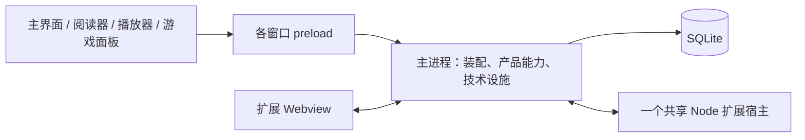

# 运行架构与职责

桌面应用由 Electron 主进程、四类原生窗口、各窗口的 preload，以及一个共享 Node 扩展宿主组成。主进程保存本地事实并执行完整业务操作，窗口负责呈现与交互，扩展通过正式合同参与功能。

## 进程与运行环境

主进程管理数据库连接、窗口、系统集成和产品能力。视频播放直接加载以 Rust 和 napi-rs 实现的 Node 原生绑定 libmpv-node，由包内线程承担原生调用与受管渲染，infrastructure/media 组织应用的加载、定位和采集流程，不另建播放器 utilityProcess 或播放器程序。文件 I/O 使用异步接口，恢复所需的[不覆盖移动](engineering/native.md#files)由本体私有原生工程提供，文件设施通过其 Node 入口消费；媒体文件信息由 infrastructure/media 通过 libmpv-node 的公开属性与 hook 读取，独立读取实例与活动播放器分别持有；其他重工作只有在测量表明确有需要时才隔离。同步 SQLite 调用也必须满足主线程响应性的要求。

主界面、阅读器、播放器和游戏面板各有独立入口、状态和最小窗口 API。preload 在所属窗口的运行环境中桥接受控能力。应用更新界面使用主窗口内的 Dialog。

extension-host 是共享、可信的 Node 执行环境，运行所需依赖独立于 Electron 和主进程源码。main/features/extensions 管理扩展，clients/desktop/extensions/projects 保存扩展作者项目，三者分别承担运行、管理和开发职责。进程隔离限制部分故障的影响，但不提供操作系统权限沙箱；主进程发生致命故障时，仍可能需要重启整个应用。

桌面私有 shared 只保存纯窗口接入合同、主进程与扩展宿主之间的协议，以及必要的确定性转换。公开值直接从 desktop-contracts、extension-api 或 appearance 引用，不在 shared 复制同义定义。ORM、DOM、Solid 状态、日志、连接、定时器和运行登记都属于实际使用它们的运行环境。

各端共同使用独立的 MIT 包 rpc。该包处理帧校验、请求与回复关联、通知、取消和连接结束。端口创建、环境适配、方法开放范围、实例身份和业务调用由各接入端负责。每条连接独立管理待完成请求和释放状态。rpc 不依赖桌面本体、SDK 或产品合同；扩展宿主中的 rpc.ts 只负责装配端点。

各窗口使用独立的 preload 入口。Node 扩展从 activate(context) 获取本次实例的能力，Webview SDK 则建立自己的客户端；SDK 不引用桌面私有源码。环境配置与静态检查必须覆盖相对路径、别名、类型导入和转导出，防止 main 与 extension-host 相互导入实现，也防止 rpc 反向依赖消费者。传输和资源规则见[通信](communication.md)，程序入口与桥接文件见[源码布局](engineering/layout.md#program-layout)。

## 主进程职责与依赖

主进程按 app、features 和 infrastructure 组织；具体文件见[源码布局](engineering/layout.md#main)。

app 解析路径、装配 features 与 infrastructure、协调生命周期，并建立跨模块绑定。所有能力通过参数或创建函数显式取得依赖，功能代码按完整业务操作组织。

Module 表示代码职责和依赖的组织方式，其运行形态取决于实际需要。无状态逻辑使用普通函数，一次操作的数据留在该次调用中；队列、会话、注册集合等长期状态由创建函数或类建立实例。实例提供职责所需的操作，并管理自己取得的连接、监听、定时器等资源，包括创建、局部失败清理和释放。app 协调整体启动与退出。

模块按实际使用者明确入口的可见范围：

| 使用者             | 可取得的能力                                                     |
| ------------------ | ---------------------------------------------------------------- |
| 主进程其他业务模块 | 已声明的完整业务操作，以及确有需要的原生协作入口                 |
| 应用装配           | 创建能力、提供依赖、连接完整事实处理入口，以及必要的生命周期操作 |
| 窗口与扩展         | 各自接入合同明确开放的方法                                       |

模块按实际使用者开放完整业务入口、装配入口和窗口／SDK 合同。内部执行步骤、状态容器及事务辅助函数保持私有。独立调用与已有任务中的协作可以分别组织执行范围，并复用同一份完整业务实现；对象和目录按这些实现的实际协作需要划分。

依赖由使用方按实际需要声明，再由 compose 提供。一个检查函数足够时直接传入函数，一组内聚操作可以传入相应能力对象；资源与持续状态仍由实际拥有者管理。正式业务输入、结果和事件值直接复用 desktop-contracts，主进程私有的依赖形态、资源句柄及内部协作参数留在本体所属模块。 同库原子组合由明确业务入口拥有事务，通过各拥有者显式提供的有限同步写入能力协作；[引导采用](domains/onboarding.md#composition)列出实际范围，装配层不实现取值政策或补写 handled。

app/compose.ts 创建实际能力并提供依赖；app/bindings.ts 建立本体模块之间随应用运行的固定订阅，并持有解除连接的句柄。两者共同承担应用装配。每条连接使用对应的事实事件、读取失效或观察合同，业务处理仍由目标能力负责。

集中连接只调用目标能力声明的完整处理入口，并完成必要的参数适配。触发条件、处理范围、采用规则、业务并发和失败处理由所属能力负责；bindings 不维护业务队列、忙碌状态或另一份执行结果。配置改变是否允许后续工作，由业务拥有者判断，不由连接代码重新定义规则。

固定关系在相关工作开始前接入，启动失败时释放本次已经建立的连接。正常退出的准备与等待期间保留固定连接，先收束实际来源并完成[必要通知交接](communication.md#event-delivery)，再按各能力的合同等待或取消已接纳工作；满足退出条件后才解除相关连接并释放依赖。等待期间取消退出不重建整套固定订阅，也不重复登记处理器；解除订阅不能代替执行收尾。具体会话、页面、目录监听和扩展实例的动态订阅与资源由各自拥有者建立和释放，不纳入应用固定连接清单。

| 模块           | 职责与边界                                                                                                                                  |
| -------------- | ------------------------------------------------------------------------------------------------------------------------------------------- |
| app            | 解析路径、装配依赖、协调启动与关闭、绑定跨模块协作。资料修改规则和具体按钮的业务分支留在功能模块。                                          |
| library        | 管理正式资料图、个人记录、文件绑定、完整合并与删除，以及游戏备份政策。                                                                      |
| metadata       | 管理提供者、独立搜索、资料方案、来源定位、跨来源匹配和资料整合。它不决定本地对象对应、采用政策或正式资料写入。                              |
| ingest         | 准备请求、对应本地对象，并编排标准新增和明确范围的更新。来源读取与整合由 metadata 完成，正式写入由 library 完成。                           |
| scanner        | 发现作品候选并管理扫描配置和历史；调用 ingest 新增，按明确选项调用 holdings 为准确对应的已有作品登记内容。持有规则与后续核对仍归 holdings。 |
| sessions       | 管理启动、播放、阅读和监测会话，并将会话事实转换为正式记录。播放器状态对象不能直接作为数据库记录。                                          |
| tasks          | 提供执行控制、进度、取消、终态和通用历史。导入、备份等业务步骤及其专属历史仍归各功能。                                                      |
| extensions     | 管理安装、仓库、兼容性、贡献接入、执行进程和公开适配，不接管扩展自己的资料库业务。                                                          |
| updates        | 按应用发行身份选择版本，管理下载、安装和更新状态。                                                                                          |
| appearance     | 管理主题目录、用户主题创作与保存、扩展登记、预览和有效外观。用户字体库由 fonts 管理，主题 token 不复制到当前偏好，运行状态不放入纯值包。    |
| fonts          | 管理用户字体的导入、编辑、删除和受控读取，不管理阅读配置、主题定义或扩展私有字体的生命周期。                                                |
| ui             | 管理页面与菜单贡献目录、宿主视图实例、打开请求及跨进程关闭交互。资料规则、原生窗口底层实现、渲染组件和本地 Toast 各由实际拥有者负责。       |
| onboarding     | 管理首次使用与更新推荐、采用协调和处理进度；调用所属模块保存业务配置，草稿用于本次编辑。                                                    |
| preferences    | 管理应用设置及其完整修改操作，不保存资料库对象或视图中的临时筛选草稿。                                                                      |
| infrastructure | 实现数据连接、文件、网络、媒体引擎、窗口和传输等技术能力，不依赖 features 决定产品政策。                                                    |

产品模块按真实工作流单向协作：scanner 调用 ingest，并按明确选项调用 library.holdings 的登记能力；ingest 调用 metadata 和 library，sessions 调用 library。metadata 不查询或写入本地资料，library 不反向调用 metadata、ingest 或 sessions。合并和删除需要判断对象是否正在使用时，由 app 向 library 注入范围明确的回调。infrastructure 不导入产品模块；它需要的产品判断通过调用参数或装配层取得。

library 的职责区域、目录组织与事务内协作见[资料库完整操作](domains/library-operations.md#ownership)。内部区域和公开命名空间各按自身用途划分。

metadata 同时管理提供者目录、资料获取方案、读取会话和单次执行内的缓存。extensions 将扩展实现登记到 metadata 的原生接口，并管理扩展实例的寿命。ingest 先从 library 取得本地目标与身份，获取候选后决定本地对应和采用方式，最后调用 library 写入。metadata_profiles 的业务管理属于 metadata；文件识别方案及其预设按媒介归 library.holdings 管理，正式表结构均属于数据库设施。来源合成、本地采用和已有对象合并各有操作边界；它们可以共用纯比较规则，但不能混用策略含义。

metadata 按来源目录、方案、搜索和单次获取组织，ingest 按新增、更新及本地采用规则组织，具体落点见[获取与采用的内部组织](domains/metadata.md#organization)。scanner 的管理入口拥有配置运行上下文及完整扫描寿命，单次执行、监听和扫描报告分别协作，见[扫描执行拥有者](domains/scanner.md#organization)。模块名称体现实际职责，公开操作按调用者需要的完整能力定义。

extensions 的管理入口组织完整管理操作，包处理、更新准备、运行资源和原生接入各有拥有者，见[扩展模块的内部组织](extensions/runtime.md#organization)。扩展内部 updates 与应用自身的 features/updates 分别处理各自制品及行为。共享宿主的实际运行与重建互斥由扩展 runtime 拥有，管理入口协调版本采用与实际运行，不维护平行状态或反向调用关系。

外部身份的格式、值和准确比较属于公共纯能力。library 负责实际绑定、归属和冲突处理；provider 只报告来源身份；metadata 只在获取范围内对应来源对象；database 只提供存储机制。

holdings 按 game、anime、comic 和 novel 划分持有实现。游戏分支管理内容目录、启动配置与备份；另外三个分支各自管理文件、分部关联、首选、使用位置、保存的设置与本地维护。各媒介拥有识别语义和方案管理，文本规则执行等同义机制由它们复用，具体见[内部组织](domains/holdings.md#organization)。watch 负责持续观察与自动触发，refresh 提供手动和自动共用的刷新能力，重新识别与重定位各自完成独立操作，见[执行组织](domains/file-maintenance.md#execution)。

sessions 管理四类 Work 的使用上下文、控制、观察、有效计时和收尾，正式活动由 library 保存。内部按四类产品会话分支，registry.ts 维护实际实例、打开中的目标占用、集合观察与共同接纳关口，app 决定应用退出期间的接纳和等待，具体边界见[会话实现的组织](domains/sessions.md#organization)。游戏持有配置与备份政策位于 library/holdings/game，归档字节的处理属于设施。即使本地绑定已经移除，备份身份和保留规则仍然有效。保存的文件位置与使用设置属于 holdings，正在使用的目标及临时控制属于 sessions。

应用级 search 在主进程组合各模块的只读检索，统一分类、排序和分页；主窗口管理查询、选择与导航。它使用现有主进程和主窗口的接入及数据库连接，合同位于 desktop-contracts/search。设置与页面以纯数据目录参与搜索，普通列表继续使用所属领域查询。应用搜索入口及本体快捷键仅在主窗口提供。

领域模块定义参与接口的输入、采用规则，以及事实事件的含义和发布时间。原生与扩展事实统一通过 [events.on](communication.md#events) 订阅。events 设施负责登记、订阅、分发、错误隔离与释放；app 建立固定跨模块订阅，实例管理自己的动态订阅。发布方交付其负责的事实，接收方拥有业务响应与接纳的工作，完整业务通过直接、类型化的调用组合。一个文件足以承担职责时使用单文件，需要多份逻辑协作时再拆为模块目录。

## 窗口程序与业务界面

四个窗口分别组织入口和业务界面，目录与样式位置见[窗口源码布局](engineering/layout.md#renderer)。

每个窗口的 app 负责入口、装配和宿主，features 负责场景与工作流，窗口内的 domain-ui 负责复用业务界面。其他窗口不能依赖主窗口的路由、当前选择或私有 API。跨窗口动作通过本体能力执行，每个挂载实例分别管理自己的查询、草稿、订阅和释放。

阅读器按呈现、导航和标注组织代码，漫画与小说共用固定页面、文本重排和混合文档的阅读机制。实际版式与适用设置由文档内容决定，Work 类别只提供作品、卷话及记录上下文。播放器负责播放界面，游戏面板负责会话面板和折叠布局。多个窗口共用的标注列表与编辑组件位于 renderer/domain-ui/annotations，通过明确参数和回调接入。采集标注与读取当前内容的逻辑留在各窗口。内容执行和会话控制见 [使用会话](domains/sessions.md) 与 [标注](domains/annotations.md)。

公共 UI 原语由 ui 包提供，桌面业务组件留在应用内。多个窗口确实需要的技术机制放入 renderer/infrastructure。即使复用 Dialog 实现，每个窗口也必须独立持有宿主、打开状态和草稿。更新 Dialog 位于 windows/main/features/updates，使用主窗口 API 和 Dialog 宿主；下载、准备和安装仍由主进程 updates 执行。系统菜单使用主进程的原生菜单能力。

## 状态归属

| 状态               | 拥有者与更新方式                                                                         |
| ------------------ | ---------------------------------------------------------------------------------------- |
| 正式资料           | 由主进程本体操作和数据库管理，事务提交后成立，离线时也可以使用。                         |
| 界面快照与草稿     | 属于具体视图实例。视图进入时查询，相关事实变化后刷新，离开时释放；草稿独立提交。         |
| 运行状态           | 属于任务、会话或连接等实际拥有者。观察窗口的寿命不决定运行寿命，停止和释放必须明确执行。 |
| 派生索引与技术缓存 | 由负责计算的设施管理，可以重建，不能覆盖正式事实或代替历史记录。                         |

完整操作统一提交必须共同成功的修改，提交后的失效通知提示读取者刷新。活动历史和同步记录由相应业务保存。派生索引与缓存从正式事实计算，维护方向始终由正式数据到派生结果。

## 启动、关闭与故障

启动按实际依赖依次进行：

1. 解析开发、测试、安装或便携环境的路径，建立单实例约束、日志、受控 bridge、原生 i18n 和完整英语基准。窗口创建与窗口显示分别处理。
2. 打开数据库并完成[初始化或本体版本迁移](engineering/database.md#initialization)。新库只建立必要偏好和引导状态，已有库保留用户选择，随后装配本体能力并读取语言与主题选择。资料方案、扫描配置、展示柜和仓库配置都在用户采用后创建。
3. 根据所选译本与完整主题的稳定引用，优先激活相关已启用扩展，完成轻量登记，并准备当前明暗分支需要的字体。首次启动使用本体英语与默认主题。发行提供的仓库信息和语言推荐不会自动安装、选择或重新启用扩展。
4. 基础查询可用，语言与主题已经采用或明确回退后，显示核心界面，再继续其他扩展和可选工作。登记不能依赖主窗口已经显示，也不能根据 categories 猜测启动依赖。语言和主题不另设激活阶段。
5. 各功能在自身依赖就绪后建立监听与定时资源，并处理待接收的入口请求。

必要初始化由启动流程直接组织并等待；相关实际能力及其必要固定连接就绪后，才允许对应来源接纳工作和产生业务事实。app.ready 表达已经达到的就绪条件，不能依赖它的订阅者补齐尚未完成的必要前置步骤。只有确实需要控制持续运行的能力才提供相应启停操作，不为所有模块统一增加 init、start 或 stop 接口。

每次应用进程重新启动，都准备当前语言和外观。从步骤 3 开始准备所选译本、主题及必要字体时计时，这些资源共用最多 5 秒的首屏等待预算，不按扩展或资源分别累计。内置资源直接加载，扩展资源由相应已启用扩展在本次运行中激活并登记。提前就绪便继续启动，不固定等待 5 秒；已经运行时恢复或重新打开主窗口，复用当前有效语言与外观，不重新开启这段等待。

准备失败时立即按相应资源规则回退；到达上限后，尚未就绪的部分不再阻挡首屏。译本使用内建英语，主题按当前 mode 使用默认主题，字体遵守自己的回退规则，已经就绪的部分继续使用。5 秒只约束语言与外观准备对首屏的阻塞，不替代数据库等必要初始化的完成条件，也不成为扩展业务调用的统一超时。

应用保留用户选择，区分“所选值”和“实际采用值”。结束首屏等待不自动停用扩展或改写资源引用；相应资源随后就绪时，按届时仍保存的选择恢复实际呈现，并保留草稿与业务状态。正常首屏等待真实依赖或明确回退，资料浏览不等待全部扩展。启动等待与资源恢复需要用实际制品验收。

app 传入正式选择，安排必要扩展激活并控制首屏等待。infrastructure/i18n 负责译本回退与重新采用，features/appearance 负责主题，各文档的接入代码负责字体加载和外观呈现。启动与后续资源就绪都沿平时的登记、选择及更新流程执行，保存的选择由相应业务拥有。扩展遵守[生命周期等待](extensions/runtime.md#lifecycle-waits)，首屏等待结束后继续按当前选择采用就绪资源。

数据库打开、初始化或迁移失败时，界面显示真实错误，不把未完成的数据库当作空库，也不覆盖其他目录。本体保持离线可用。普通首次打开主窗口时提示引导；未完成引导不会导致每次启动都强制弹出，用户可从固定入口继续。deeplink 先处理其明确目标，引导不能抢占添加、阅读或播放流程。

初次语言选择以各语言自称显示，并按系统语言推荐具体译本。用户选择后执行安装与激活，成功后才保存偏好。失败时保留当前有效语言与选择草稿，允许重试或继续使用英语。已经保存的译本后来失效时，保留其引用并回退英语。具体规则见 [语言](ui/localization.md)。

正常退出先完成未保存编辑和活动使用的确认，再停止接纳新会话及普通自动触发。已经接纳的任务按自身合同等待或取消；会话按用户选择正常关闭或明确停止游戏记录，完成适用记录保存与收尾；只有真实游戏退出触发已启用备份，各自报告结果。只有本次退出流程成功完成后，才撤销扩展贡献、释放设施，最后关闭数据库。创建函数负责清理自身的局部失败，外层按资源实际取得顺序逆序释放。

等待超时时，应报告真实状态并按[完整退出规则](ui/navigation.md#shutdown)允许继续等待或取消退出，不能把仍在运行的游戏或尚在执行的保存改报为中断来绕过等待。内容已经结束而最后记录保存失败时，完成必要清理并保留[运行内快照](domains/sessions.md#pending-recordings)；退出或更新重启前由用户重试保存、明确放弃，或取消退出。明确停止游戏记录时，保存失败则保留会话并拒绝脱离，完整规则见[detach](domains/sessions.md#detach)。

关闭窗口是否退出应用由用户偏好决定。后台任务不依赖任务中心是否挂载。渲染端重载时重新读取当前快照，不重放写入。扩展宿主崩溃后，撤销该代实例的贡献并结束依赖调用；已经提交的资料继续有效。

## 系统集成

infrastructure 实现窗口、托盘、原生菜单、文件选择、文件管理器定位、外链、剪贴板和快捷入口，app 或对应 feature 决定实际操作与生命周期。自动启动、快捷方式、协议注册和便携模式都必须通过明确入口并按用户选择执行。普通构建不能产生安装副作用。

深链和二次启动先解析动作与输入，再由业务核对目标和执行条件，只等待该操作真正需要的能力。有界等待与失败规则见 [应用入口](ui/navigation.md)。安装身份、数据目录和便携配置见 [构建交付](engineering/build.md)；开发与测试使用各自独立的资料目录。

图片下载、缩略图生成和图片处理由 images、attachments 与实际业务协作完成。缓存允许重建，正式图片引用独立保存。系统入口、后台驻留、退出，以及窗口位置、尺寸、全屏、聚焦和关闭行为都需要实际验收。

## 公开边界与独立交付

仓库位置便于协作，各能力仍按自己的合同与资源归属提供入口。[仓库布局](engineering/layout.md#workspace)列出当前桌面工程、公开包和扩展的实际位置。

| 事实或行为                     | 定义与实现的位置                                              | 消费方式                                                                                 |
| ------------------------------ | ------------------------------------------------------------- | ---------------------------------------------------------------------------------------- |
| 桌面正式数据含义与操作承诺     | desktop-contracts 的对应语义模块                              | 本体、存储编码、窗口、extension-api 和工具直接引用；SDK 经 extension-api 使用。          |
| 桌面业务、事务、任务与生命周期 | clients/desktop/app 中的实际功能和设施                        | 通过明确依赖与接入调用，不导出应用私有源码供 Web 复用。                                  |
| 视觉词表、基础样式与组件       | appearance 定义词表与样式，ui 提供组件                        | 各宿主准备资源和状态后使用；桌面字体引用不进入共同模型。                                 |
| 扩展接入与运行实现             | extension-api 和 extension-sdk                                | extension-api 复用本体定义并提供完整扩展接口，宿主与 SDK 实现接入，作者从 SDK 入口使用。 |
| 分发格式与官方内容             | extension-distribution 和 clients/desktop/extensions/registry | 应用和 CLI 使用格式能力，发行流程处理已经准备好的官方数据。                              |
| 依赖、版本与发行说明           | 实际 manifest、锁文件和各项目 release-notes                   | 根工具负责验证与投影，不根据 Git 标签、提交类型或输出文件反推事实。                      |
| 私有宿主协议与通用连接         | 桌面 shared 保存私有协议，rpc 提供机制，各端保存连接状态      | SDK 不消费私有宿主协议；合同不持有连接；rpc 内核不识别产品业务。                         |
| 云端接口与服务规则             | 服务端工程的实际拥有者                                        | 客户端消费明确可取得的合同与版本，不导入服务端内部实现。                                 |

本次交付只实现桌面应用、所属公共包、官方扩展和对应工具，未来工程不参与当前检查与发行完成条件。公开包通过自己的 exports 提供入口。客户端构建不依赖私有服务端源码或生产凭据；同仓不改变 API 合同、资源所有权或部署边界。

同仓维护允许应用、合同和扩展一起修改，但各制品仍须分别版本化、交付并验证真实兼容性。Vantage、Kana、libmpv-node 和 oauth-relay 各有仓库与发行，接入要求见 [独立项目](projects/README.md)。发行说明、扩展索引和软件下载资料分别公开托管。工具链、公开包、发行与正式文档的具体要求见 [工作区](engineering/workspace.md)、[发行](engineering/releases.md) 和 [文档职责](engineering/documentation.md)。
