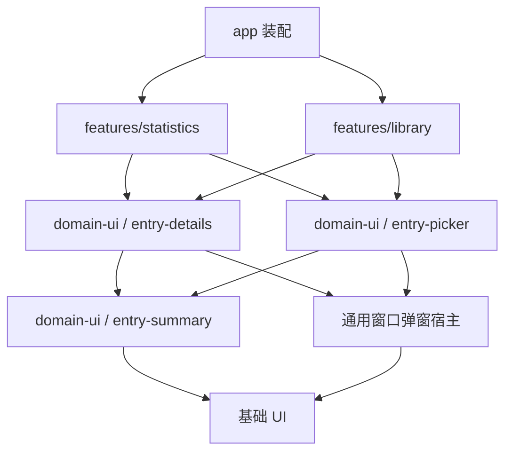

# 共同界面、表单与反馈

主应用、阅读器、播放器、游戏面板和官方扩展共用信息层次、紧凑布局与操作规则。文案说明真实操作、运行状态、结果和必要限制；组件则提供一致的焦点、关闭、校验和反馈行为。

## 现有界面与交互的保留原则

现有应用的界面设计与交互体验整体符合产品目标，主要布局、视觉风格、信息密度、常用操作路径和交互习惯整体沿用，不做整体改版。

现有 UI 的保留要求针对用户看到的界面和实际操作。Solid 接入、模块划分和公共组件重建以已确认的产品行为为依据，代码组织按新架构实现；界面或流程调整须符合相应产品要求。

界面变化限于本规格明确的局部调整、新增能力所需的界面，以及按共同交互规则修复的局部问题。新增界面使用现有设计体系；未另作规定的部分沿用既有体验。不做全局视觉改版、导航重组或普遍更换交互方式。

实现与验收时对照现有应用，按整体观感、信息层次和实际操作核对原有体验及规格要求的局部调整是否协调一致。组件和代码组织按新设计实现。

## 系统能力与控件语义

简洁与原生体验共同约束界面。常见任务沿用户能够辨认的对象和动作完成，默认值减少不必要的选择，必要信息在作出决定的位置表达；内部模块、协议和实施阶段不成为用户必须学习的概念。

文件与目录选择、保存位置、文件管理器定位、系统通知和原生菜单优先使用 Electron 与操作系统提供的能力。标准编辑、窗口和应用菜单动作优先使用适用的 Menu role；用户已经熟悉的快捷键、系统授权与平台行为保持有效。应用自己的资料选择器和业务 Dialog 表达产品所需信息，不另造一套系统文件浏览或基础编辑机制。系统能力不可用时按实际结果反馈，不为统一外观模拟成功。

基础按钮、链接、输入框和表单使用语义 HTML；视觉封装保留控件的 disabled、表单、选择、撤销、键盘和可访问性语义。复杂组件使用既定成熟原语，只补充本产品需要的组合与外观。文本输入期间尊重输入法组合，快捷键只在所属作用域处理，不抢占编辑器和系统的已有操作；焦点移动、滚动和选择以用户当前操作为依据。

统一视觉词表与交互含义，不要求各平台的窗口按钮、菜单顺序、修饰键或系统对话框完全同形。沿用既有界面整体风格，并在目标平台核对其窗口管理、键盘和辅助技术行为；影响既有主要交互的调整按[实施讨论规则](../../implementation/work-packages.md#unexpected-issues)处理。

具体能力以 [Electron 系统对话框](https://www.electronjs.org/docs/latest/api/dialog)、[标准菜单角色](https://www.electronjs.org/docs/latest/tutorial/application-menu#using-standard-os-menu-roles)和 [W3C 控件语义说明](https://www.w3.org/WAI/ARIA/apg/practices/read-me-first/)为依据；库的可访问性声明不能代替本产品中的实际交互验证。

## 界面文案

文案围绕用户能够识别的对象、动作、状态和结果书写，使用直接、准确、自然的产品语言。同一语言中的同一概念保持一致称呼。界面按场景使用“作品”“条目”等名称，不机械展示内部类型名。

标签和标题命名对象或用途，按钮和菜单说明将要执行的动作。说明文字只补充作出选择或完成操作所需的信息。错误提示应讲清实际失败和可用的后续操作，不能暗示已经成功，也不能承诺无法兑现的恢复。技术限制只解释会影响用户操作的部分。

文案遵守不过度防御的原则。能够按既定规则正常处理的来源差异、精度局限和内部边界，不附加提示、警告、免责说明、自动备注或确认步骤。提醒须对应影响当前选择或结果的实际问题，不能仅因存在不确定性就要求用户知悉或确认。必要信息在合适的位置表达一次。

UI 文案不承载工程重构、开发阶段、内部实现进度、临时安排或未来补齐计划。加载、执行进度、取消、部分完成和失败都依据真实业务状态表达，不能用产品文案使未完成能力显得已经可用。

这些规则适用于全项目的界面和面向使用者的说明，包括桌面本体、官方扩展、公共工具及独立项目中的标签、表单、菜单、Tooltip、空状态、通知、对话框和操作说明。消息组织、译本和回退遵循[本地化合同](localization.md)，各语言按自己的自然表达审校。

## 复用能力与依赖方向

可复用业务能力根据需要提供 view.tsx 嵌入组件、dialog.tsx 窗口宿主适配，以及查询、草稿和校验实现。入口保持轻量，无须每项都同时提供嵌入与弹窗入口。统计和库管理共用 EntryPicker、EntryDetails，不跨场景导入内部实现。

Summary 和 Card 只呈现数据并发出局部意图，不依赖完整详情或编辑器。Picker 可以依赖 Summary，关系字段可以依赖 Picker。Details 需要活动摘要时，使用独立 ActivitySummary，不导入整张统计页。导入与编辑共用字段和选择器，不通过大量模式开关构造万能表单。跨场景组合由 app 或真实上层拥有，不能用 Context、动态 import 或延迟函数掩盖循环依赖。

通用窗口宿主负责挂载、关闭、焦点、嵌套、取消结果和资源释放。每个 Dialog 独立拥有数据和草稿；发起页卸载时，仍然有效的全窗口交互应继续存在。Context 必须在正确的 Solid owner 内取得，事件工具不能临时脱离 owner 查找实例。真实 URL 和跨窗口入口属于 app，但普通弹窗不必增加 app.inspectX 转发。

## 执行、确认与预览

普通编辑、导入、同步、批量设置、条目合并、文件重新识别和重定位，在取得明确输入后按完整规则执行，再报告结果。操作所需的目标和采用方式在提交前确定；执行中的歧义或失败按所属结果合同反馈，用户修正后发起新操作。

必要的删除确认只说明对象、数量和影响范围，不逐层列出从属记录。合并使用[固定规则](../domains/library-operations.md#identity-operations)，不提供“展开差异”或合并内字段编辑；普通字段和关联修改使用各自编辑器。目标失效、路径冲突、识别失败及无法映射的字段分别按真实操作结果反馈，不能以“存在疑点”代替明确原因和行为。

规则测试、目录发现、查询条件草稿、主题效果、字体样例和图片裁剪保留直接服务编辑的反馈。它们位于对应编辑界面，不成为普通保存和执行的前置步骤。图片缩略图、内容浏览和应用搜索的少量结果继续服务实际浏览，不扩展为整份采用预览。

## 资料更新入口

作品更新器显示本次作品目标、所选范围、字段与关系策略，各编辑区域使用同一份草稿。可选对象、更新方式、分部与卷话收录由[资料更新合同](../domains/metadata.md#update-entrypoints)定义；界面在相应控件中一次说明必要影响。

字段控件使用“不更新”“补空”“覆盖”。“全部补空”“全部覆盖”填写当前所选范围的具体草稿值，保存前仍可编辑或取消；它们不另行提交写入。方案、搜索和已有对象编辑各使用自己的入口，不因复用编辑器而改变业务范围。

## 关闭确认与嵌套生命周期

Dialog 提供可选、可配置的关闭确认。使用者定义触发条件、标题、说明、可选操作，以及处理后继续关闭还是保留视图，处理过程可以异步。组件统一接收关闭请求、防止重复提示，并在允许后真正关闭，不内置所有表单的保存含义，也不根据任意输入变化猜测脏状态。

表单可以组合保存、放弃和继续编辑，其他场景可以提供适合自身业务的确认。页面离开与窗口退出由宿主复用同一机制协调一次，不在多层重复询问。通用 UI 不依赖 SDK 或业务保存 API，由调用者完成适配。强制销毁或实例失效时按生命周期释放，不承诺始终能够进行交互确认。

## 页面、列表与视觉层次

库内 Explorer、主体详情和库外详情 Dialog 分别承担自己的浏览场景，并提供“在页面中打开”。关系界面按实际职责使用紧凑列表或单项编辑，清楚区分资料关系、工作、分部与收录。模型上分开的事实，不要求在界面上都变成表格，也不要求每行固定三个操作或连续打开多个弹窗。

界面共用语义 token、字体、间距、图框和动效关系。底板、内容、控制带与浮层各有层次，hover、选中、当前和焦点状态可辨，明暗模式保持相同职责。表格坚持一字段一列，不在首列或其他值下方堆叠次要信息。窄宽度下通过水平滚动保留列。

选择资源或配置时，可以提供与当前任务相关的管理入口，复用所属模块的现有界面。导航入口不改变数据拥有者，原表单和管理界面分别保留草稿及保存结果；是否提供入口由操作连贯性决定，不从代码目录边界推导界面禁令。

长任务和批量结果由 TaskCenter 展示，发起入口可以显示摘要并打开对应运行详情。页面布局围绕用户的浏览与操作流程组织，组件共用语义样式、字体、间距、焦点和反馈规则。

视觉、键盘和可访问性必须在真实页面验证，覆盖设置、跨筛选选择、复杂关系与嵌套编辑、任务、阅读播放、统计和外部入口。静态检查不能替代真实交互。

## 当前状态与完成记录入口

四类作品在既有详情 bar 的状态下拉中管理[当前状态与完成记录](../domains/records.md)。入口根据实际数据概括当前状态和完成次数：有当前状态时显示相应的在玩、在看、在读等状态；有完成历史时同时表达完成次数；两者都没有时使用“设置状态”等直接入口文案。当前状态留空且有完成历史时，可以显示由历史得出的已完成信息，不建立另一个 completed 写入值。

菜单将三种当前状态及“清除当前状态”，与“记录本次完成…”及“完成记录…”分组。选择当前状态只修改状态；记录本次完成进入日期、备注表单，保存后新增一条并清除当前状态。完成记录管理入口也可出现在已有作品操作菜单中，不另设持续并列的完成按钮和历史计数按钮。

历史管理按完成日期、备注和操作分别展示，支持补录、编辑和删除。补录与记录本次完成复用字段编辑器，由入口确定日期默认值和是否改变当前状态。每次保存直接完成对应操作。

编辑使用记录 ID，不使用行号或日期寻找目标；日期变化导致排序调整时仍编辑同一条记录。未知日期直接显示为日期未记录，不补今天、不标为未完成。删除最后一条记录只撤回完成情况，当前状态和实际使用保持各自事实。

列表和卡片采用适合既有密度的简要表达，详情与历史管理承担完整内容。表格的当前状态、完成次数和日期各占独立列，不在名称或状态值下叠加历史内容。实际运行中的标识由会话提供，与用户设置的进行中状态分别表达。

这些入口按真实页面的空间、组件和键盘行为实现。交互原型只用于判断方向，不作为间距、布局、弹窗位置或字段限制的逐项模板。

四类作品详情在累计使用时长处提供“编辑附加时长”入口，遵守[共同附加时长合同](../domains/records.md#duration)。表单分别显示已记录的活动时长与可编辑的附加时长；无文件、无活动或未完成的作品同样可编辑。来源总量采用由对应导入入口解释覆盖范围，不把累计总数本身改成可直接写入的统计列，也不因编辑附加时长自动生成笔记。

## 使用与位置操作

游戏主按钮的可开始状态文案为“开始游戏”，不追加目标配置名称。多条配置时，在右侧增加独立的下拉按钮；单条配置不为重复列举这一项增加下拉。主按钮按 [sessions 目标选择](../domains/sessions.md#open)执行，需要选择时请求明确配置。没有配置时进入配置创建，选定的配置尚不完整时进入补全；保存配置本身不发起启动。

启动下拉按配置顺序显示名称，首选项标为默认。点击配置项表示本次使用该配置启动，不保存另一份当前选择，也不改变默认。菜单末尾提供配置管理入口；设为默认在配置管理中明确操作，不与一次启动合并。没有下拉时，原有配置管理入口仍可到达。启动及进行中反馈延续现有按钮形式，游戏关闭使用下方明确的正常与强制交互，实际配置在菜单和游戏面板中展示。启动中、运行中或关闭中，菜单不能再发起另一配置的启动；修改默认只影响以后使用。

启动确认超时且没有建立会话时，主按钮退出忙碌状态并恢复“开始游戏”。由发起界面给出“启动请求已发出，但未检测到匹配进程”的 Toast，附带“编辑启动配置”action，指向本次实际采用的配置。该 action 只打开配置编辑，保存不自动再次开始游戏；主按钮不改为编辑动作，原有配置管理入口仍可使用。没有建立会话时不提供关闭或强制终止按钮，后续再次开始游戏仍须遵守已有运行检查。

游戏主操作按钮按照本次会话的实际状态和结束操作变化：

| 当前状态                             | 主按钮    |
| ------------------------------------ | --------- |
| 没有当前使用上下文                   | 开始游戏  |
| 正在建立会话                         | 正在启动… |
| 游戏运行中                           | 关闭游戏  |
| 正在等待正常退出                     | 正在关闭… |
| 普通关闭超时，且仍确认游戏目标在运行 | 重试关闭  |
| 正在强制终止                         | 正在终止… |

进行中按钮显示忙碌状态，不重复发起同一操作。普通关闭超时后，主按钮仍表达正常关闭的重试；强制终止保留在已有操作菜单或独立危险操作位置，不替换原关闭按钮的含义。纯图标入口使用明确的 Tooltip 和可访问名称。各入口采用同一次会话及结束操作的实际状态，不由单个按钮另设计时器推断超时。游戏真正结束后恢复“开始游戏”，正在关闭面板窗口与结束游戏仍是不同动作。

已有游戏操作菜单在运行期间提供正常关闭和强制终止。正常关闭超时后仍能明确重试，普通关闭等待期间也能直接发起强制终止，不另加一个只为结束操作存在的常驻下拉按钮。明确点击强制终止即调用该操作，不在这条交互中再增加通用确认。

普通关闭超时且目标仍运行时，由发起界面给出“游戏仍在运行”的 Toast，并附带强制终止 action，复用同一个 terminate 操作。Toast 消失后，强制终止仍可从已有操作菜单进入，主按钮继续执行普通关闭。游戏结束后撤掉强制入口和 Toast action；action 始终绑定原 sessionId，点击前核对该次会话，不转向同一游戏后来建立的会话。真实目标已退出、仅记录保存失败时，反馈保存问题，不显示强制终止。

四类作品详情的内容目录入口均为单个文件夹图标按钮，不并列目录名称或另加箭头按钮。没有登记目录时禁用，添加与管理仍在本地内容区提供；只有一个目录时直接打开；多个目录时，点击同一图标展开下拉菜单。目录按 created_at、id 的稳定顺序列出规范路径，选择后只打开这一处位置。图标提供与当前动作相符的 Tooltip、可访问名称和适用的菜单状态。

目录菜单包含所有已登记目录，不根据首选配置、最近文件或当前会话选择目标。失联目录保留在列表中，打开失败说明实际问题，不改开其他路径。管理、播放或切换文件不会保存当前目录，也不会改变下一次目录菜单的对象。

具体对象的位置操作直接采用该对象：游戏命令配置提供打开其初始工作目录，未填写时按[启动规则](../domains/games.md#launch)打开用户主目录；文件启动配置提供显示启动文件位置。普通文件提供在文件管理器中显示，图片目录提供打开该目录；播放器和阅读器使用当前实际文件。分部关联多个文件且没有明确文件时，先选择文件再显示位置。不从命令文本猜测程序位置，也不以启动文件目录冒充工作目录；文件位于作品内容目录之外也可以正常显示位置。这些动作不启动内容、不切换会话，也不修改首选。

动画、漫画和小说先明确作品文件或分部，再选择实际文件。文件选择、设置默认和切换当前内容分别表达；批量设置遵守[分部默认文件](../domains/holdings.md#selection)。继续入口携带已经确定的具体文件 ID，文件失联时不静默替换。配置名称、文件名称及路径在需要选择或管理的界面中展示，不要求为此普遍扩展主动作按钮的标题。

动画详情的内容 tab 与播放器共用[作品级资料和文件视图](../domains/anime.md#views)。资料与文件各自展示真实类别、完成状态、关联和可用性，并提供适用筛选；筛选用于查找，不改变播放范围。详情页 bar 的主播放按钮不受内容 tab 的筛选影响。播放器按查看方式明确呈现“下一集”或“下一文件”及实际下一项，切换 tab 不立即切换视频；下一项被筛选隐藏也不改为其他目标。

漫画和小说的详情与阅读器使用同样的[实时资料和文件视图](../domains/reader.md#work-navigation)。漫画保留卷、作品话和某卷收录话的范围，小说使用卷；当前查看方式决定上一项、下一项的含义，筛选只影响显示。动作明确显示下一卷、下一话或下一文件及实际目标，合订文件不被伪装成逐卷或逐话定位。两处视图各自保存状态，列表刷新和切换查看方式不立即换文件。

播放器的快捷字幕大小控件显示当前会话提供的保存范围：“全局”“本作品”或“本文件”。用户明确调整后通过[同一个保存并采用操作](../domains/sessions.md#subtitle-scale)完成，不另外弹出范围选择或保存确认。调整只影响当前播放器的字幕缩放，临时倍速及其他控制值保持；长期倍速仍通过播放配置编辑器保存。

动画、漫画和小说的目录编辑器分别编辑本目录的发现范围与过滤，并明确选择同类[文件识别方案](../domains/file-recognition.md#recognition-profiles)。选择器提供仅使用内置规则的选项和方案管理入口；管理对话框可从预设创建方案、复制、编辑、查看引用和按引用规则删除，不增加独立侧栏入口。方案管理与目录表单各自保留草稿和保存结果，选用方案不提前提交目录。

目录表单明确显示不限层数或最大层数，并将精确路径与通配模式作为两种可见条件。包含与排除分别编辑，多条取任一，排除优先；说明它们只控制新文件发现，不删除或停止维护已有文件，也不更换其识别方案。同一作品不能重复登记路径相同或相互包含的自动发现目录，冲突时定位已有登记；普通子文件夹不显示为另一处内容目录。

扫描配置另提供“为已存在作品登记本地内容”，对应 registerExistingContent，默认关闭。说明只涉及准确对应作品的目录、文件及明确文件启动入口，不包含资料更新或个人记录覆盖。扫描结果分别显示作品新增与本地登记，重复登记显示已存在；登记失败保留作品事实并提供本地内容管理入口。

文件识别规则编辑器使用“匹配文本”字段，提供文件名和路径两项，并显示实际交给正则的文字。路径按既定规则从登记目录名开始，不提供第二种路径构造选项。普通内置识别不要求用户选择这一字段；卷目录中的编号可以通过路径提取，无须为此逐卷登记内容目录。

实际内容已结束但记录保存失败时，反馈提供“处理未保存记录”入口；主窗口应用菜单和退出界面也可打开同一原生 Dialog，按[运行内保存合同](../domains/sessions.md#pending-recordings)重试或明确放弃。关闭原内容窗口不移除这项入口，记录问题不提供强制终止。

## 文件整理与规则测试

手动添加使用当前作品范围；从分部详情发起时，明确显示本次选定分部。已登记的同路径文件显示为复用原记录，明确增加的分部关联与原有其他关联分别表达。文件的关联编辑器管理完整直接关联，不把漫画卷的收录投影保存成直接话关联。保存关联编辑后采用手动关联，清空的集合也保持；表单说明这一保存效果，不增加确认步骤。

文件详情显示“关联方式”，区分自动匹配与手动关联；列表需要展示时使用独立列。手动关联文件提供“恢复自动匹配”，自动匹配文件可以改为手动关联。该选择不清空已有关联；空关联恢复自动后按本地自动刷新设置处理，关闭自动刷新时可使用普通手动刷新。选择保存失败时恢复已提交状态。完整规则与接口见[关联方式](../domains/holdings.md#association-mode)。

文件列表提供统一的“重新识别”动作，未关联作为筛选与目标选择条件。用户选定文件后按当前规则直接执行，合法结果用于本次关联采用；未匹配或失败时保留原关联并报告原因。执行保持原关联方式，持续自动匹配由对应的恢复动作管理。手动选择分部使用关联编辑器。

| 位置               | 动作     | 内容与保存边界                                                                                                                 |
| ------------------ | -------- | ------------------------------------------------------------------------------------------------------------------------------ |
| 文件识别方案编辑器 | 测试规则 | 用方案草稿和样例文字展示实际匹配文本、命中规则、捕获、偏移及分部条件；没有明确作品时不声称找到实际分部，保存方案仍使用普通表单 |
| 内容目录编辑器     | 预览发现 | 使用目录草稿与选定的已保存方案，展示实际发现目标、已跳过路径及新文件预计对应的本作分部；不登记文件或保存草稿                   |
| 文件列表           | 重新识别 | 对明确选择的已登记文件按当前规则更新合法关联，返回修改与失败结果，不提供另一轮采用                                             |

目录预览遵守发现过滤，不为列出被过滤文件而继续遍历排除的子树；可以说明跳过了某目录，但不能声称已枚举其全部文件。规则测试不拉取远端资料或创建分部，目录预览的实际对应使用当前本地资料。扫描配置自身的作品发现预览继续由 scanner 管理，不与这些文件操作混用。

重新定位入口让用户选择文件的新位置或目录的新根，按[持有重定位](../domains/file-maintenance.md#relocation)核对并更新。路径无效或登记冲突时保留原位置并报错，不展示逐项路径配对。相关游戏配置和手动字幕路径只按明确选中的字段范围更新。结果说明实际更新与失败项，不能仅因目录记录已更新就声称所有文件已经恢复。

批量设置分部默认文件直接使用文件列表的多选与“设为默认”动作。同一分部选中了两份文件时，指出冲突且不提交本次修改；用户返回原列表修改选择，不打开配对向导。

应用外改名或移动后，原文件记录继续显示其已登记位置与实际可访问性，并提供明确重新定位入口。新位置已经登记为另一文件时，显示冲突并保留双方，提供明确的“合并文件登记”入口。用户选择保留记录和实际位置后，按[文件修正合同](../domains/file-maintenance.md#file-merges)一次提交；相同分部关联不自动触发合并。

文件使用期间仍可编辑草稿与查看结果。实际关联修改、重定位或移除受到会话占用限制时，说明哪个文件正在使用，并提供其实际使用入口；不能替用户关闭会话。普通自动刷新按已保存设置执行，不打开规则测试、发现预览或逐文件确认页面。

## 预设入口与选择

资料方案、文件识别方案、扫描规则和展示柜的常规预设选择使用同一套入口与选择器交互。选择预设的入口采用固定位置的次级图标按钮，尺寸、Tooltip 和独立可访问名称保持一致。该按钮只打开预设选择器，不在点击时直接采用某一项。图标按钮约定仅适用于选择预设的入口，普通新建、添加按钮沿用所属界面的既有形式。

选择器共用搜索、筛选、目录列表、详情、空态与选择操作的呈现方式，按各业务显示实际的适用信息、依赖、配置和示例。选择预设后，将其声明范围内的初值载入普通草稿，继续沿用原表单的编辑、校验、保存和取消。数据采用遵守[配置副本规则](../domains/metadata-presets.md#ownership)，不为文件识别方案增加另一套采用阶段或确认流程。

## 字段说明、选项与设置组

FieldDescription 固定说明字段用途和控制范围，不随当前值或菜单高亮改成选项说明、效果预览、警告或错误。选项差异在相应菜单项中解释，名称足够清楚时可以省略说明。闭合 Select 只显示所选名称，不在外部重复一层“当前选择的影响”。少量选项需要持续比较时，可以使用始终可见的单选组。

路径、连接可用性和操作实际影响，放在各自字段或区域中，不伪装成选项说明。设置组使用 FieldGroup、Field 和布局元素，共用文字层次、间距、焦点与校验规则。Webview 不需要额外包框，也不强制嵌套 SettingSection。局部结构复用不接管导航、搜索或草稿；真实账号状态和操作也不能扮成普通字段。

资料方案使用普通字段表单和有序 providerId，不强制采用三列表布局。语言放在基本信息，账号和连接由扩展负责。只定位用途从实际规则推导，不增加角色开关、宿主参数表或自动发现的设置 UI。当前请求与本地采用仍分别处理，见[方案编辑](../domains/metadata-profiles.md#definition)。

## Toast 校验与字段定位

提交校验统一使用共同 Toast。字段保留不改变布局尺寸的错误状态、可访问关联和独立焦点，不默认插入行内错误段或 Popover，也不修改 FieldDescription。一次提交先收集能够确定且适用的错误，再按表单稳定顺序汇总。只有一个错误时说明字段和问题；多个错误时显示总数与第一项，定位前按需展开分组或页签。

同一表单最多一条校验 Toast。重复提交更新已有提示，不逐字段或逐次 invalid 分别弹出。提示保留到问题解决、用户关闭或编辑结束。输入变化会更新相关错误，但内容变化不能自动跳到下一字段或抢走焦点。关闭 Toast 不代表输入已经正确，错误仍由表单持有，重新提交可以再次说明和定位。

成功与错误反馈共用外观，分别使用适合结果的展示时长；大量逐项问题集中在业务报告或 TaskCenter。应用统一提交文案、定位与通知，原生输入保留自身编辑语义。官方扩展表单遵守同一规则，最终业务约束由主进程核对。

## 完成反馈与通知通道

renderer 和 Webview 使用所属窗口或页面的 Toast。主进程自主发起的后台流程使用 infrastructure/notifications 发送桌面通知，Node 扩展经宿主请求，不直接使用 Electron。通道不会随焦点变化而互换。系统不提供自动选择渠道的通用 notify、通知历史或重启重放队列，也不把通知与业务 events、数据失效混为一体。

执行发生在哪个进程，不决定反馈归属。主进程的数据、metadata 和 ingest 内部只返回结果，界面发起者负责 Toast。自主后台流程由实际拥有者通知。明确交给后台持续执行的任务，在接纳时将完成反馈责任交给主进程发起流程，观察 UI 不再发送完成 Toast。责任不能因为耗时变长、页面后来关闭或另一界面开始观察任务而临时转移。

一次完整操作只有一个反馈负责人。内部步骤、TaskCenter、其他窗口，以及扫描和任务两份历史都不重复提示。task_runs 不保存 source 或 notification_owner，也不根据文案猜测去重。业务决定是否提示、标题摘要和打开目标；通知设施只负责展示、交付与资源管理，不解析 result 并把 completed 当作全部成功，也不监听全部日志或数据库制造消息。

批量操作只提供汇总提示，详情进入任务或业务历史。普通新增没有专属结果区或待处理队列，也不自动打开详情。Toast 随 owner 释放，界面负责人销毁后不补发桌面通知；已交给后台的操作则不再依赖页面。通知发出不代表用户已读，调用通知也不代表用户已点击。

通知不可用、受系统抑制或发送失败，都不改变业务结论，不强制打开窗口，也不递归通知“通知失败”，只在设施边界记录。点击通知是用户明确发起的后续动作，应携带可序列化目标走[统一入口](navigation.md)。跨启动点击按真实平台能力接入，不能只保存闭包回调。

## 完整文字与提示

应用可控制的提示使用共同 Tooltip，不用 HTML title 代替。组件参数、文档 title 和 SVG 语义标题仍保留原用途。图标按钮和折叠导航提供动作名称及必要快捷键，已经完整清楚的文字不机械重复。

只有实际溢出截断时才补充全文，Explorer 使用自身的原位延展规则。必要限制应直接可见，错误不能藏在 Tooltip 中；链接或复制帮助使用可交互区域。提示支持悬停、键盘、Escape、移入后继续阅读和视口限制。控件的可访问名称不能依赖提示层出现才完整。延迟与尺寸由共同组件在真实交互中统一验证。

## 语言、外观与可访问性

英语是完整基准，简体中文、繁体中文和日语官方扩展在线安装后可以离线使用，可选译本来自实际登记目录。[i18n](localization.md) 负责 key、参数与回退，使用稳定英文语义键，不以中文正文作 key。UI 语言、资料语言、来源文字和格式化语言各有含义。扩展通过 SDK 跟随有效 UI locale，自己的消息使用普通依赖处理。

[appearance](../domains/appearance.md) 根据完整主题引用、mode 和 interfaceScale 解析有效外观，再向窗口和 Webview 交付当前 colorScheme、缩放、CSS 值及字体资源投影。字体由各文档实际加载，持久主题定义不直接作为文档呈现值。preferences、主题创作和字体管理各守自身范围，不持久保存一份当前 token 副本。

键盘导航、可见 ring 焦点、Dialog 焦点约束、屏幕阅读器名称、对比度和减少动效，都在 Chromium 中验收。复杂控件使用 [Solid/Kobalte 基线](../engineering/workspace.md)，封装必须保留原语的键盘与可访问性行为。
