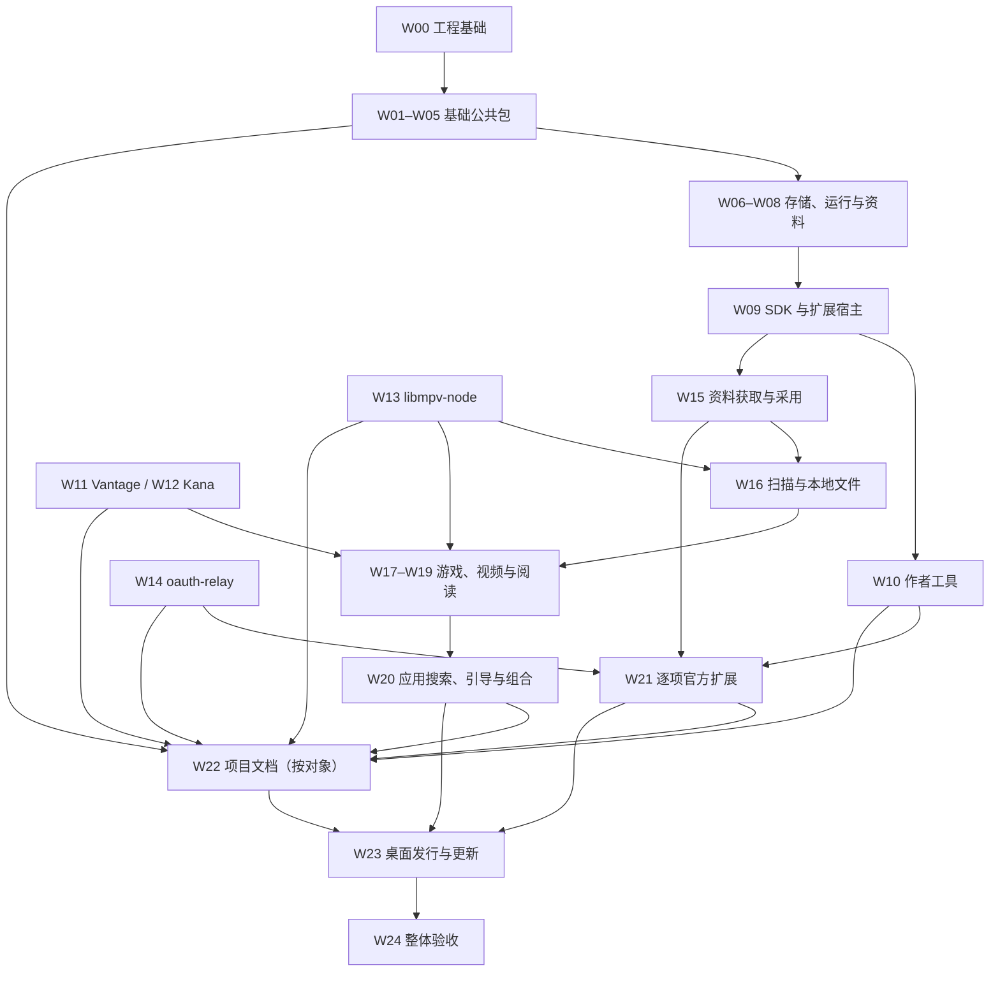

# 实施工作包与完成门槛

工作包按实施对象与交付职责组织，编号按推荐实施顺序排列，前置能力位于消费者之前。七个公共包、四个独立项目和桌面各项能力都有明确的实现与验证责任，33 项官方扩展逐项验收；项目文档在专门环节按对象交付。相互独立的工作可按已列依赖并行推进。产品规则见[设计目录](../design/README.md)，验收编号见 [A01–A33](../verification/acceptance.md#scenarios)，实际进度见[实施状态](status.md)。

## 完整交付

每个公共包、官方扩展和独立项目由一个所属工作包完成全部已确认的实现与适用验收：公开合同、正常与失败行为、取消和清理、构建与资源、适用目标制品、独立消费、测试及发行准备。接口声明、代码注释、运行文案、发行说明与许可材料随实现和制品维护；成篇项目文档由 [W22](#w22) 负责。

实现与适用验收、项目文档和对外发布分别记录。所属实施工作包满足自身条件后登记完成；项目完整交付还须完成对应文档，正式发行遵守实际授权和发行条件。开发与联调中的候选制品记录实际范围。

本体工作包交付完整能力，包含事实与操作、窗口和扩展的服务端接入、对应业务界面、持久化及资源收尾。纯合同包定义语义，SDK 实现客户端接入，本体执行业务；各自的完成条件按这一边界核对。SDK 与正式宿主在同一工作包内联合实现和验收。

后续消费者使用经过适用验证的完整制品，验证新增的业务与装配关系；接入依据包括公共声明、代码合同、设计和实施资料。集成发现的缺陷由实际拥有者修复，并更新受影响证据。实现、制品与项目文档各按上述责任完成。

所有交付遵守[共同原则、终态实现与可读性](../design/engineering/conventions.md#quality)、[编码规则](../design/engineering/conventions.md#coding-style)、[界面文案](../design/ui/components.md#copy)和[文档归属](../design/engineering/documentation.md#owners)。模型、类型、接口、调用方、配置和说明随同一调整闭合。验证按[实际影响](../verification/acceptance.md#verification-scope)选择，目标环境按[统一交付边界](../verification/acceptance.md#runtime-coverage)判定。

仓库接续、npm 发布、签署及服务部署按各自条件和实际授权执行；尚未取得的必需结果保持未完成。证据按[实际用途](../design/engineering/documentation.md#evidence)保留。

### 实施中的判断

遇到原则、正确性、质量或技术实践问题，先按[整体判断](../design/engineering/conventions.md#judgment)审视目标与相关设计，说明依据、选项和影响，由用户确定方向。模型、主要行为、公开合同、架构边界或交付范围的变化遵守同一规则。

已确认合同内的实现选择、缺陷修复与验证由实施者完成。依赖新决定的工作等待讨论，其他工作继续推进；已确认方向与已有授权直接落实。

## 实施顺序与并行工作

| 顺序    | 交付范围                                       | 接续条件                                               |
| ------- | ---------------------------------------------- | ------------------------------------------------------ |
| W00     | 已完成的工程与验证入口                         | 后续工作沿用并维护已有工程基础                         |
| W01–W05 | 视觉、分发、桌面合同、RPC 和 UI 五个基础公共包 | 按包依赖完成完整实现与独立消费                         |
| W06–W08 | 存储、应用运行与资料能力                       | 提供真实数据、资源、生命周期及操作                     |
| W09     | SDK 与扩展宿主                                 | 在同一工作包完成客户端、宿主和真实链路验收             |
| W10     | CLI 与作者流程                                 | 使用 W09 的正式宿主完成开发与安装消费                  |
| W11–W14 | Vantage、Kana、libmpv-node 和 oauth-relay      | 各自完成实现与验收，支持提前并行；在首次实际消费前就绪 |
| W15–W20 | 资料获取、文件、游戏、视频、阅读与应用组合     | 消费已经交付的公共包和独立项目                         |
| W21     | 33 项官方扩展                                  | 各项目按实际业务依赖逐项交付                           |
| W22     | 项目文档                                       | 按对象完成正式说明，与各自发行时点衔接                 |
| W23     | 桌面发行与应用更新                             | 装配已完成并锁定的输入，验证最终制品                   |
| W24     | 整体验收                                       | 核对所有交付对象和完整用户流程                         |

W01–W05 按包依赖推进。W06–W08 完成数据、运行与资料操作后，W09 在真实 Node、Webview、实例和资源环境中一次交付 SDK 与宿主，W10 再完成完整作者流程。各业务工作包拥有自己的操作与服务端绑定，使用已经交付的调用和资源接入机制。

W08 实施期间先以代表资料贯通原生读写、窗口、冲突与重开，再扩大至完整范围。W09 使用这些真实操作验证扩展对同一事实的读写、取消和实例失效；这项集成结果归 W09，资料业务仍由 W08 拥有。

四个独立项目按自身合同建立工程、完成制品与验证，可以提前并行。W13 的完整制品在 W16 首次读取媒体信息前就绪，W11 与 W12 分别在游戏和阅读接入前就绪，W14 服务在相关来源授权验收前满足运行条件。

各官方扩展在实际依赖就绪后推进。资料来源与 W15 接续，导入器使用已完成的资料操作，译本覆盖稳定的完整消息目录。应用组合、译本和发行可以交叠准备，最终制品采用各自完成并锁定的输入。

W22 随各对象的实现与验收就绪分批开展，在对应对象正式发行前完成。独立项目和公共包按自身进度完成文档；桌面发行与更新开发期间，相关说明同步收口。

同一 A 场景可以覆盖多个交付对象。各工作包记录自己负责的具体断言，W24 核对整项要求与最终版本的完整证据。

## W00：工程与测试入口

已完成的工程基础继续成立，实际范围及证据见[W00 状态](status.md#w00)。

交付包括实际 workspace 边界、构建和资源交接、开发会话协调、测试运行环境、工程载体验证、CI、hooks 和合并门禁。工程验证使用独立测试输入；产品源码、公开包和官方扩展随各自工作包完整建立。后续工作同步维护其新增的配置、制品消费和验证入口。

依据：[工作区](../design/engineering/workspace.md) · [构建](../design/engineering/build.md) · [原生工程](../design/engineering/native.md)。

验收：A24、A26、A28、A31 的工程入口范围。验证记录注明对应输入、环境与实际结果。

## W01：desktop-appearance

依赖：W00 与已确认的视觉合同。

交付：完整视觉词表、纯值规则、亮暗默认值、基础和派生 CSS、可选 Tailwind 映射，以及独立类型和样式入口。

验收：纯值、普通 CSS 和映射分别可消费，默认外观完整，包保持纯视觉职责；仓库外制品、声明、资源许可与接口说明通过 A23、A29、A31 的对应断言。

依据：[视觉基础](../design/engineering/workspace.md#visual-packages) · [共同外观](../design/domains/appearance.md)。

## W02：extension-distribution

依赖：W00 与分发合同。

交付：扩展身份、manifest、registry、静态展示与本地化格式、兼容声明、规范化和纯校验，以及独立 Node 签名和验签入口。

验收：格式、错误、不可变版本字节和签名行为完整；纯入口与 Node 入口分别通过仓库外消费，覆盖 A21、A23、A31 的制品协议断言。

依据：[扩展制品与信任](../design/extensions/distribution.md) · [作者仓库工作流](../design/extensions/development.md#registry)。

## W03：desktop-contracts

依赖：W01、W02 的实际公共值。

交付：完整桌面值、查询、编辑基线、操作、结果、错误、参与接口和适用纯校验；包含资源、事件、会话、管理、deeplink、开发控制以及英语消息参数合同。

验收：同一值在各公开入口含义一致，查询与写入语义明确，声明和纯规则可独立消费；A03、A04、A23、A31 的合同断言成立。

依据：[公共值](../design/domains/values.md) · [查询合同](../design/domains/library-query-contracts.md) · [写入合同](../design/domains/library-write-contracts.md) · [接入协议](../design/engineering/protocols.md)。

## W04：desktop-rpc

依赖：W00 与已确认的通信合同。

交付：环境无关的有限帧、握手、双向调用、通知、取消、错误交付和断连清理。真实通道的测试适配核对消息边界与资源寿命；窗口接入归 W07，作者与源码开发接入归 W10。

验收：独立消费者通过完整机制、声明与制品检查；Electron 窗口和 Node 父子通道试件验证序列化、取消、错误和断开。覆盖 A23、A31 的包合同断言；产品端点、就绪和退出分别由实际消费者验收。

依据：[通信分层](../design/communication.md#clients) · [帧与开发控制](../design/engineering/protocols.md)。

## W05：desktop-ui

依赖：W01 与 Solid 1.9 工程基线。

交付：[公开 UI 能力](../design/ui/package.md#families)的完整组件、组合、原生表单、键盘与焦点、浮层、图表、Markdown、拖拽、样式及资源寿命。按组件家族提供子路径，默认样式组合视觉基础，普通 Solid 消费者可直接使用。

验收：浏览器行为、完整视觉状态、声明、无 Tailwind 消费及独立资源清理分别成立，满足 A18–A20、A23、A29、A31 的公共组件断言。支持范围和真实环境由[视觉交付](../design/ui/package.md#delivery)核对。

依据：[UI 包](../design/ui/package.md) · [交互与可访问性](../design/ui/components.md) · [拖拽与虚拟化](../design/ui/virtualization.md)。

## W06：存储与原生基础

依赖：W03 与 W00 工程基础。

交付：正式 schema、编码、连接、同步事务、新基线和前向迁移，以及文件存储、归档和本体私有原生操作所需的基础设施。

固定经验证的 Drizzle 1.x、Kit、better-sqlite3 与 Electron 组合，使用正式生成和迁移入口。以七类非空资料验证读回、局部错误、回滚、重开、文件资源与代表查询；跨文件系统操作按真实环境记录。

验收：A01–A05 的存储断言、A14 的基础资源、A27 的初始化与迁移、A30 的查询成立。

依据：[数据库](../design/engineering/database.md) · [原生工程](../design/engineering/native.md) · [资源访问](../design/domains/resources.md)。

## W07：应用运行与设置

依赖：W01、W03–W05、W06。

交付：启动与退出、窗口接入、TaskRun、通用历史、事实事件、偏好、网络、主题与字体、英语运行文案及对应设置和任务界面。完整交付文件输入、附件与图片准备、受控读取及资源绑定，完成系统集成、运行保护、取消和收尾。

各业务通过已声明的执行、事实和退出接口接入。任务观察、业务执行和历史保存分别保持自身寿命；外观与字体从真实持久状态交付给窗口和后续 Webview。

窗口控制通过 desktop-rpc 接入，main、preload 与 renderer 按公开合同和最小能力边界协作；启动、资料路径和窗口寿命随本包完成。

验收：A14–A16、A20、A27、A29 的运行基础、状态、资源与管理界面成立。

依据：[任务](../design/domains/tasks.md) · [偏好](../design/domains/preferences.md) · [外观](../design/domains/appearance.md) · [网络](../design/engineering/network.md) · [附件与图片](../design/domains/attachments.md) · [受控资源](../design/domains/resources.md) · [应用生命周期](../design/architecture.md#lifecycle)。

## W08：资料与记录

依赖：W03、W05、W06、W07。

交付：七类 Entry、五类 Part、四类关系、资料查询与整理、状态、完成记录、活动、附加时长、Note 和 Annotation，以及列表、详情、编辑、合集、展示柜和统计界面。

核对完整写入、合并删除、动画种类更正、顺序、统计口径、并发基线与使用占用。页面与 Dialog 复用同一 domain-ui，选择、草稿、定位、虚拟化及重排沿实际用户操作闭合。正式业务函数与窗口、扩展服务端接入使用同一事实。

验收：A01–A05、A14、A17–A20、A27、A29、A30 的资料与界面断言成立；代表链路先验证再扩大实现。

依据：[资料操作](../design/domains/library-operations.md) · [查询](../design/domains/library-queries.md) · [领域目录](../design/domains/README.md) · [资料界面](../design/ui/explorer.md)。

## W09：extension-sdk 与扩展宿主

依赖：W02–W08 的公共包、存储、运行基础和资料操作。

本包联合完成 SDK 与正式宿主，交付边界如下：

| 对象           | 完整职责                                                                                                                                                                  |
| -------------- | ------------------------------------------------------------------------------------------------------------------------------------------------------------------------- |
| extension-sdk  | 扩展公开能力选择、作者类型与纯规则、激活和登记合同、公开接入协议、全部 Node 与框架无关 Webview 入口；调用、回调、订阅、取消、实例和视图资源映射、私有通信、外观及语言接入 |
| 桌面宿主与管理 | 共享 extension-host、真实实例与代际、激活和贡献寿命、Webview、storage、secrets、宿主网络与资源；安装更新、仓库信任、兼容、启停、恢复、开发构建采用和完整管理界面          |

完成系统 deeplink 接收与扩展分发，贯通 SDK 登记、冷启动和已运行交付、业务确认、取消及反馈。开发控制执行真实构建采用、共享宿主重建和目录释放，源码与打包应用使用同一接入。

SDK 的纯入口和运行入口分别通过仓库外制品消费。联合验证使用 W08 的真实资料操作和 W07 的运行资源，核对客户端与服务端的实例、回调、来源、取消和释放。后续业务通过明确的参与接口接入自己的操作，SDK 和宿主提供已经完成的共同机制。

验收：A05、A16、A20、A21、A23、A27、A31 的 SDK、宿主、管理与独立消费断言成立；SDK 全部公开接入与正式宿主共同达到交付条件。

依据：[公共包边界](../design/engineering/workspace.md#packages) · [运行机制](../design/extensions/runtime.md) · [Webview](../design/extensions/webview.md) · [资源](../design/domains/resources.md) · [私有数据](../design/extensions/private-data.md) · [安装与信任](../design/extensions/distribution.md) · [开发](../design/extensions/development.md)。

## W10：extension-cli

依赖：W02–W05 的公开包，以及 W09 的 SDK 与正式宿主。

交付：kisx 的 workspace、extension、registry 全部命令和同义程序化入口，配置声明、构建与安装包装配、签名仓库工作流，以及 Node、框架无关 Webview、Solid 三种正式模板。

源码开发会话与作者 CLI 共用本包的应用启动能力，使用 desktop-rpc 完成源码及打包应用的开发控制、就绪、正常退出取消和连接清理。

验收：仓库外 tarball 创建独立项目和工作区成员，完成类型检查、开发、热更新、构建、打包与真实安装；覆盖激活失败修复、连续构建、资源释放、退出取消和再次退出。无源码仓库也可维护 registry。A23、A26、A31、A32 的作者工具断言成立。

依据：[作者工具与开发流程](../design/extensions/development.md) · [开发协议](../design/engineering/protocols.md#development)。

## 独立项目交付

W11–W14 各自拥有完整工程、公共合同、实现、测试、工具链与锁文件、平台资源、制品、可运行示例和发行准备。项目文档由 W22 在各自仓库完成，项目按[独立产品定位](../design/projects/README.md#purpose)实现全部公开范围，按[仓库合同](../design/engineering/repository.md)持续开发并接续正式身份。

项目自身验收与 Kisaki 消费验收分别记录在[交付清单](delivery-checklist.md#projects)。本体从固定制品或已验证服务取得能力，记录版本、来源提交、资源摘要和兼容依据。公开发布及实际部署按授权登记。

## W11：Vantage

交付：进程、窗口与前台观察，真实实例引用，控制、窗口采集，Rust 与 Node 完整实现，以及支持平台和后端的资源与制品。

验收：全部公开操作、观察结束、局部不可用、权限、并发、取消与清理按自身合同成立；独立 Node 消费和实际后端证据满足 A33。W17 负责游戏业务接入。

依据：[Vantage](../design/projects/vantage/README.md) · [原生制品](../design/projects/native-runtime.md) · [项目验收](../verification/scenarios/projects.md)。

## W12：Kana

交付：全部支持格式的阅读内核、源定位、内容与资源合同、布局、选择和阅读交互，以及公开包、配套资源和可运行消费示例。

验收：格式回归、源位置与选择往返、排版、浏览器资源和释放满足 A33；独立制品在声明环境中可消费。W19 负责漫画和小说的业务接入。

依据：[Kana](../design/projects/kana/README.md) · [项目验收](../verification/scenarios/projects.md)。

## W13：libmpv-node

交付：完整 libmpv Client API 的 Node 绑定、控制与属性、事件与 hook、流与资源寿命、可选受管视频输出和独立帧持有，以及全部目标依赖、许可和制品。

验收：Node 与承诺的 Electron 环境、主要图形后端、颜色与截图、线程交接和环境退出满足 A33；制品与运行输入满足 A24 的项目范围。W16、W18 分别负责媒体信息和播放业务接入。

依据：[libmpv-node](../design/projects/libmpv-node/README.md) · [原生制品](../design/projects/native-runtime.md) · [项目验收](../verification/scenarios/projects.md)。

## W14：oauth-relay

交付：独立服务工程、完整中转协议、上游适配、配置校验、服务测试、构建制品、部署配置与运维工具。部署与运维指南由 W22 随已验证的操作形成；核对现有接入事实后，在已授权环境完成部署和服务切换。

验收：授权、取消、刷新、失败、HTTPS、秘密注入及服务停止满足 A33；源码、制品和实际部署分别记录。相关 W21 来源扩展验证账号核验与凭据采用。

依据：[oauth-relay](../design/projects/oauth-relay/README.md) · [来源认证](../design/extensions/private-data.md) · [项目验收](../verification/scenarios/projects.md)。

## W15：资料获取与采用

依赖：W08 的资料操作与 W09 的 SDK、正式宿主。

交付：provider 与字段处理器接入、独立搜索、方案与预设、来源定位、匹配、资料整合、标准新增和明确范围更新，以及全部操作界面。

真实扩展通过正式登记参与完整采用。核对来源身份、无身份候选、共享关联、原子写入、有效部分结果、并发、取消及失败反馈；界面准确呈现选择、采用结果和剩余事项。

验收：A05–A07、A14–A16、A18、A27 的获取、采用与业务界面成立。

依据：[资料获取](../design/domains/metadata.md) · [参与接口](../design/extensions/providers.md) · [方案](../design/domains/metadata-profiles.md) · [预设](../design/domains/metadata-presets.md)。

## W16：扫描与本地文件

依赖：W06–W09、W15；媒体信息读取使用 W13 的完整制品。

交付：扫描配置、发现、识别、持有与业务资源引用、目录监听、增量维护、文件关联、默认目标、重定位与失联状态，以及对应管理、选择和报告界面。

完成全部识别预设、范围核对、文件占用、取消与失败保留。媒体读取使用固定 libmpv-node 输入，与活动播放器保持独立实例和资源寿命。

验收：A08、A09、A14–A16、A18、A27、A29 的文件与扫描断言成立。

依据：[扫描](../design/domains/scanner.md) · [持有](../design/domains/holdings.md) · [文件维护](../design/domains/file-maintenance.md) · [识别预设](../design/domains/file-recognition-presets.md) · [附件](../design/domains/attachments.md)。

## W17：游戏与存档

依赖：W07、W08、W11、W16。

交付：启动配置与确认、真实进程和窗口监测、前台计时、控制与截图、游戏面板、最终记录，以及手动和自动备份、恢复、保留策略与管理界面。

共同会话接纳、观察、计时和收尾在首次实际使用时完整实现，视频与阅读按相同合同接入。备份与恢复覆盖不覆盖移动、文件和索引、取消、中断、再次检查及明确保留现状。

验收：A10、A13、A14、A16–A18、A20、A27–A30 的游戏与存档断言成立，Vantage 固定制品已真实消费。

依据：[游戏](../design/domains/games.md) · [会话](../design/domains/sessions.md) · [备份恢复](../design/domains/backups.md) · [Vantage 接入](../design/engineering/integrations.md#vantage)。

## W18：视频播放

依赖：W07、W08、W13、W16，以及 W17 已交付的共同会话机制。

交付：媒体就绪、切换、播放与续播、轨道字幕、速度与音量、sRGB 显示与真实截图、播放器界面、记录和完整资源收尾。

验证 Node 输出、Electron 纹理交接和最终引用释放，覆盖快速切换、迟到帧、加载失败、设备或窗口失效及退出。

验收：A11、A14、A16、A17、A20、A24、A27–A30 的播放与制品消费断言成立。

依据：[动画与播放](../design/domains/anime.md) · [会话](../design/domains/sessions.md) · [媒体接入](../design/engineering/integrations.md#media)。

## W19：漫画与小说阅读

依赖：W07、W08、W12、W16，以及 W17 已交付的共同会话机制。

交付：全部支持格式的漫画和小说入口、内容列表、阅读偏好、准确源定位、选择与标注、主阅读与临时查看、记录和阅读器界面。

Kana 负责格式与内核，本体负责文件身份、资料、偏好、持久值及会话。各入口核对实际参数、保存结果、资源与关闭，复用所属内核的共用格式证据。

验收：A12、A14、A16、A17、A20、A27–A30 的全部阅读入口与格式断言成立。

依据：[阅读](../design/domains/reader.md) · [标注](../design/domains/annotations.md) · [阅读接入](../design/engineering/integrations.md#reading)。

## W20：应用搜索、引导与全局组合

依赖：W07–W09、W15–W19 的本体能力与公开入口。

交付：分类搜索与导航、首次使用和更新推荐、引导采用编排、全应用入口及跨功能操作的完整衔接。

搜索拥有真实聚合查询，onboarding 拥有状态与采用操作，界面沿同一事实工作。核对主界面与独立窗口的导航、焦点、草稿、共同菜单、失败和退出体验。

验收：A18–A20、A29、A30，以及各相关 R 要求的应用级入口成立。

依据：[搜索](../design/domains/search.md) · [引导](../design/domains/onboarding.md) · [导航](../design/ui/navigation.md) · [视图状态](../design/ui/state.md)。

## W21：逐项官方扩展

依赖：W09、W10 和各项目实际使用的已交付业务能力；需要中转的授权使用 W14 服务。

W21-01–W21-33 沿[官方目录](../design/extensions/catalog.md#catalog)分别完成实现与验收。每项包含声明的全部能力、页面、适用认证、私有状态、测试、资源、版本及独立 .kisx，分别核对正式宿主、仓库外公共包和安装消费。成篇扩展说明由 W22 按对象完成。

17 个资料与平台扩展、13 个导入器、3 个译本各自登记完成。来源解析、个人记录、导入同步、取消、卸载及独立更新按自身语义验证；共用机制引用拥有层证据。

验收：A05、A16、A18、A22、A23、A27、A32 及[逐项专项](../verification/coverage.md#extensions)成立，进度由[交付清单](delivery-checklist.md#extensions)维护。

依据：[来源目录](../design/extensions/catalog.md) · [同步](../design/extensions/synchronization.md) · [导入器](../design/extensions/importers.md) · [译本](../design/extensions/languages.md)。

## W22：项目文档

依赖：待编写对象的实现、制品与适用验证就绪，按对象分批完成。

交付：Kisaki monorepo 与四个独立项目的正式文档结构和阅读入口，包括 README 及其语言版本、CONTRIBUTING、CONVENTIONS、ARCHITECTURE、模块与包说明、33 项官方扩展说明、模板使用指南和项目 skill。各份文档在所属项目维护，依据已验证的实现说明使用、开发、维护、工程规范和适用限制。

核对实际命令、可运行示例、公开接口、语言版本、资源要求与文档引用，更新 AGENTS 的入口，并将 refactor 中对应的实施说明归并到正式文档。设计规格、实施状态和验证证据继续按各自职责维护。

验收：A26、A31、A32 的项目文档断言成立，A33 的独立项目使用与维护说明齐备。各对象在正式发行前完成对应文档；实际结果按[状态归属](delivery-checklist.md)记录，根工程与公共包见[实施状态](status.md)。

依据：[文档职责与生命周期](../design/engineering/documentation.md) · [共用工程与编写规范](../design/engineering/conventions.md)。

## W23：桌面发行与应用更新

依赖：W01–W21 的实现与适用验收；正式发行前完成 W22 对应文档，工程方法沿用 W00。

交付：六目标桌面制品、资源装配、安装升级、便携模式、签署与许可材料、正式仓库接续和发行流程；同时完成应用更新的检查、说明、下载准备、退出协调、安装交接、状态与界面。

独立项目提供已经完成的目标输入，本包核对锁定版本在桌面最终制品中的装配与消费。发行元信息与更新选择遵守实际应用身份；真实文件、系统下限、升级和恢复在适用环境中验证。对外仓库、发布和部署按已有授权执行并记录实际结果。

验收：A16、A23–A28、A31、A33 的桌面制品、更新及联合消费断言成立，干净 checkout 可生成正确目标，字节来源与签署结果可追溯。

依据：[构建](../design/engineering/build.md) · [应用更新](../design/domains/updates.md) · [发行](../design/engineering/releases.md) · [许可](../design/engineering/licensing.md) · [仓库](../design/engineering/repository.md)。

## W24：整体验收与交付核对

依赖：W00–W23 满足各自完成条件。

交付：固定提交和制品的完整使用流程、R／A 证据矩阵、项目说明与实现一致性，以及真实交付报告。

从干净 checkout 安装并执行 check，再执行未覆盖的消费者、浏览器、真实 Electron、原生宿主、开发会话和最终制品验收。任务前置产物按既有规则复用。性能按 A30 的实际场景和明确调用核对。使用空库与代表性新库验证正常、失败、离线、取消、重开和完整退出。

核对 W22 已交付的项目文档，以及所属实施工作包的模板、示例、命令、注释、许可和必要证据。沿实际路径审阅职责、命名、公开边界、资源与清理，删除范围内已失去用途的内容。

完成门槛：R01–R32、A01–A33 按[最终完成条件](../verification/acceptance.md#completion)满足，必需功能与检查齐备，已知失败闭合，运行覆盖和未实测范围准确，交付文件与说明一致。

依据：[覆盖矩阵](../verification/coverage.md) · [验收](../verification/acceptance.md) · [文档归属](../design/engineering/documentation.md) · [编码规范](../design/engineering/conventions.md)。
