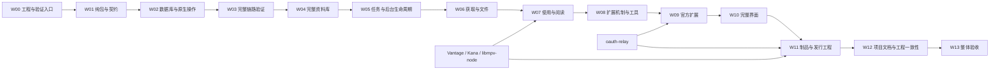

# 实施工作包与完成门槛

W00–W13 将目标系统划分为可以审阅和验证的实施工作。产品与接口规则以[设计目录](../README.md)中的对应文档为准，验收编号见 [A01–A33](../verification/acceptance.md#scenarios)。本篇规定依赖、交付内容和完成条件，实际进度单独记录。

目标平台的运行覆盖与完成条件统一按[运行覆盖与交付](../verification/acceptance.md#runtime-coverage)判定。

## 实施范围与完整交付

实施范围包括桌面系统、八个公共包、33 项官方扩展和四个独立技术项目。工作包用于安排依赖与验收，不缩减产品或接口要求。每项变更应形成完整、可以独立验收的交付，测试替身只用于测试环境。

工作包按[重写范围](../README.md#rewrite)建立目标实现，按产品合同验证界面与行为。

所有工作包共同遵守[编码与实现质量](../design/engineering/conventions.md)、[界面文案](../design/ui/components.md#copy)和[项目文档](../design/engineering/documentation.md#owners)规范。

局部模块拆分、索引、依据已确定合同编写具体 API 调用和不改变语义的优化，由实现者完成。模型、公开合同、主要行为、架构和交付范围按已确认规格执行，实现者不得擅自改变。实现须完成全部必需工作，并通过相应验收后才能标记为完成。不能通过擅自改写要求、减小范围或返回空值消除验收失败；对外仓库、npm 和部署操作按实际任务授权执行。

问题需要改变已确认的模型、用户行为、公开合同、架构边界或交付范围，或现有规格不足以确定这些规则时，暂停受影响部分，保留当前工作与相关证据，向用户说明问题、依据和影响，并讨论处理方案。经用户确认后，先同步相关设计、合同及验收要求，再继续该部分实施。不得自行补定规则、变更目标或绕过问题；不受影响的工作可以继续。

实施者负责定位、修复和验证任务范围内的编译错误、实现缺陷、测试失败及依赖接入问题，并在交付前完成必要修复。需要调整上述合同的方向与取舍时，再与用户讨论。

每项交付都应包含适用的模块职责与依赖、字段与约束、业务规则与默认值、接口与取消、必要的并发控制、失败与清理、界面与反馈、资源与许可，以及验证证据。[设计验证](../verification/acceptance.md#design-validation)在对应设计定稿前完成，解决会影响技术路线、公开合同、正常行为或支持范围的已知疑问。工作包负责按已确认方案实现、集成和验收；依赖制品仍须在调用方接入前验证。设计验证、实现、验收和发布分别记录状态。

## 主线依赖与独立工作

W00–W13 共同交付完整规格，W03 用作内部架构验证关口。UI 原语、样本、资源及独立项目可以按真实依赖提前推进；每个工作包在依赖和自身交付条件满足后，登记完成状态及适用检查结果，并保存剩余事项和证据。

各独立项目形成候选制品后，先验证所用主要后端与宿主接续，再扩大相应业务实现；来源项目先贯通已选认证和一条完整资料采用。资料库的真实结构、IPC 成本与正常负载分别在 W02–W04 取得结果。W13 汇总已有证据及剩余组合，不作为首次发现平台路线或主要性能冲突的阶段。

同一个 A 场景可以由多个工作包共同覆盖。阶段门槛验证本包交付及已就绪依赖对应的断言，证据必须注明具体范围；纯值、数据库或单条链路通过，不能提前把整项 A 场景标为完成。W13 汇总当前版本的完整证据，验证全部入口和最终制品。

### 开始顺序与交付接续

W 编号表达完整交付的依赖，后续工作可以按真实前置条件提前准备。基础机制由首次实际消费的工作包建立，其后沿同一正式合同扩充；进入生产路径的实现必须满足所属合同。

| 工作范围     | 开始条件与接续方式                                                                                                                                                     |
| ------------ | ---------------------------------------------------------------------------------------------------------------------------------------------------------------------- |
| W00–W03      | 先形成可运行工程、公开纯包与通信，再建立真实数据库，最后贯通原生操作、窗口与一个真实扩展的完整链路；W08 继续完善该扩展机制。                                           |
| 四个独立项目 | 各自依据已确认合同建立工程，与本体按实际依赖推进。libmpv-node 的控制、属性与 hook 候选在 W06 首次媒体信息读取前提供，视频输出在 W07 接续；Vantage 与 Kana 在 W07 接入前提供实际候选制品；relay 在 W09 的来源授权接入前提供可测试服务与协议实现。            |
| W04–W10      | 沿已有合同完成资料、后台、文件、使用、扩展与界面。某项 UI、来源解析或测试样本不依赖尚未就绪能力时可以提前完成；整包完成仍须满足本包门槛。                              |

独立项目的自身验证与 Kisaki 联合验证各有拥有者，按[联合交接条件](#independent-projects)执行。平台、图形和系统下限的具体安排见[目标环境验证](../design/engineering/build.md#platform-testing)。

## W00：建立可运行的工程与测试入口

依赖：已确认的设计及其必要可行性验证；无前置实施工作包。

交付：独立程序构建、开发会话、CI 配置、测试运行配置与辅助，以及明确的消费者和最终制品测试任务。

建立本体、八包、官方扩展与实际共享的私有工程包的 workspace、独立程序入口、纯共享合同和依赖检查。配置与工具通过各自拥有者的正式入口复用，项目任务和 CI 缓存遵守[工作区规则](../design/engineering/workspace.md#tasks)。落实输出唯一写入、开发交接、测试环境与 Electron SQLite ABI；保留正式 fuses。同时建立[本体私有原生工程](../design/engineering/native.md)的 Node 入口、绑定声明、目标构建与 Electron 消费验证。本包实际消费的字体、原生及归档输入固定，媒体运行输入由 libmpv-node 在接入工作包交付；Husky 生命周期先在隔离仓库验证。

本包建立的新工程历史及远端验证沿[项目级临时仓库](../design/engineering/repository.md#temporary-repositories)持续接续，后续工作包继续使用同一开发历史。W00 完成不表示临时仓库阶段结束，也不要求立即切换正式远端。

按[桌面工具布局](../design/engineering/layout.md#desktop-tools)建立实际工作流，按[测试结构](../design/engineering/layout.md#tests)配置根工具、本体和各项目的测试发现、运行环境、样本与输出归属。依照[任务分工](../design/engineering/layout.md#test-tasks)设置薄命令入口、前置依赖和实际宿主，测试专用准备归所属 tests/support。

实施依据：[运行架构与职责](../design/architecture.md) · [公共包、工作区与开发工具](../design/engineering/workspace.md) · [构建、桌面制品与便携模式](../design/engineering/build.md) · [验收环境](../verification/acceptance.md#environments)。

完成门槛：A24、A26、A28 和 A31 在本包工程与测试入口范围内的断言通过。不使用真实个人资料，不混淆 Node、浏览器和 Electron ABI，正式制品没有未解决的启动障碍。

## W01：实现桌面与扩展合同、视觉基础及通信内核

依赖：[W00](#w00)。

本包按已经定稿的公开合同实现正式包、声明生成、运行校验与消费入口，遵守[设计与实施的边界](../design/engineering/conventions.md#design-completion)。

交付：八个公共包的独立消费边界、唯一纯值定义、完整业务合同和自研 rpc。

完成纯值读写、桌面与扩展合同、rpc、appearance 和 ui 的真实职责；ui 的通用几何使用已选定的 TanStack Virtual，业务行映射与真实身份仍由各视图拥有；生成声明与公开 exports 一致。查询形状与投影采用[公共查询值](../design/domains/library-query-contracts.md)，逐项声明[编辑基线和错误](../design/domains/library-write-contracts.md)，按[帧与握手](../design/engineering/protocols.md)实现通信，不从任意对象或数据库行推导公共接口。通过仓库外包及无 Tailwind 构建链验证视觉消费，SDK 只通过公开 API 取得业务能力。

deeplink 纯合同覆盖原生请求与[扩展入口](../design/ui/navigation.md#extension-deeplinks)，交付基于标准 URL 语义的共同解析、格式化、身份与路径校验及扩展处理器声明；真实系统接收和实例回调由 W08 接入，不以类型声明代替运行实现。

实施依据：[领域值与边界规则](../design/domains/values.md) · [调用、事件与跨进程通信](../design/communication.md) · [公共包、工作区与开发工具](../design/engineering/workspace.md) · [扩展运行与实例生命周期](../design/extensions/runtime.md)。

完成门槛：A03、A04 的纯值，A23 的基础 tarball 和 A31 通过。本体与外部消费者使用同一公开入口，视觉包不依赖桌面，SDK 不依赖尚未交付的机制，也不直接依赖桌面合同走捷径。

## W02：实现新数据库与原生操作基础

依赖：[W01](#w01)。

交付：正式 schema、新基线及 SQL 迁移链、真实连接与编码、同步事务和代表查询。

实现正式 schema、连接和同步事务、新基线与前向迁移。参考[RC 隔离结果](../verification/evidence/public-contracts/2026-10-22/README.md)，在正式结构与制品上固定 Drizzle 1.x、Kit、better-sqlite3 和 Electron 组合；使用 Kit generate 与原生 migrate()。以七类非空夹具验证读回、局部异常保留、失败回滚、迁移资源和重开，并测量真实查询。

实施依据：[数据库约束、事务与迁移](../design/engineering/database.md) · [条目、分部与资料模型](../design/domains/catalog.md) · [领域值与边界规则](../design/domains/values.md) · [资料库完整操作与并发提交](../design/domains/library-operations.md) · [资料库查询、范围与定位](../design/domains/library-queries.md)。

完成门槛：A01–A05 的数据库与原生操作范围、A27 的初始化、版本迁移与重开，以及 A30 的查询成立。完整操作由真实驱动验证，不能用 mock ORM 代替。

## W03：贯通一个完整业务链路

依赖：[W02](#w02)、基础 UI 和窗口 bridge。

交付：从原生读写、preload、Solid 界面，到变化后重读的真实链路。

以动画、分部及人物角色工作贯通创建、详情、标签和评分；同一 domain-ui 在页面与 Dialog 中复用，并从另一业务入口验证 Picker、Details 和焦点恢复。真实扩展沿正式 API 修改同一事实；覆盖两个窗口、冲突、事务失败与迟到响应。

本包交付首次链路必需的正式运行机制：共享 extension-host 进程、显式开发项目加载、activate(context)、真实实例身份及代际、Node SDK 适配、调用归属校验、取消、实例释放和变更通知。开发加载遵守[开发实例](../design/extensions/development.md#dev-start)的隔离与就绪规则。扩展通过公开 API 执行一次带 expected 的修改，由原生窗口重读结果；实例失效后的迟到回复不能提交。W01 提供纯合同与 rpc，W03 负责把它们接到实际宿主和业务，W08 在同一机制上完成其余能力。

实施依据：[资料库完整操作与并发提交](../design/domains/library-operations.md) · [视图状态、编辑草稿与加载](../design/ui/state.md) · [共同界面、表单与反馈](../design/ui/components.md) · [调用、事件与跨进程通信](../design/communication.md) · [扩展运行与实例生命周期](../design/extensions/runtime.md)。

完成门槛：A01、A02、A05 和 A18–A20 在本链路的适用范围内成立后才扩大实施。该工作包是内部架构关口，一条链路通过不能作为完整新版交付。

## W04：完成全部资料库能力

依赖：[W03](#w03)。

交付：七种 Entry、五种 Part、四类资料关系，以及整理、记录和查询的完整本体操作。

完成七类 Entry、五类 Part、四类关系、查询与整理，以及状态、完成记录、活动、附加时长、Note 和 Annotation。核对完整写入、合并删除、动画种类更正、统计口径、顺序及使用占用；原生与扩展调用共享事实。

实施依据：[领域能力](../design/domains/README.md) · [资料库完整操作与并发提交](../design/domains/library-operations.md) · [资料库查询、范围与定位](../design/domains/library-queries.md) · [当前状态、附加时长与完成记录](../design/domains/records.md) · [作品关系、角色与参与者](../design/domains/relations.md) · [标注、摘录与内容定位](../design/domains/annotations.md)。

完成门槛：A01–A05、A14、A17、A27，以及每个数据族的成功和失败场景通过。全部正式修改都有明确本体拥有者，不使用旧表捷径或公开表级写入。

## W05：完成任务、后台生命周期与偏好

依赖：[W04](#w04)。机制可以先用明确测试负载验证。

交付：TaskRun、独立历史、事实事件、应用启动与退出，以及偏好。

完成任务、扫描历史、事实订阅、自动行为、应用生命周期和完整偏好；执行归属、取消与结果保存沿实际拥有者收尾。配置解析、字体、主题、网络、系统保护和引导采用按各自合同实现。

实施依据：[任务执行、结果与自动行为](../design/domains/tasks.md) · [应用偏好与配置提交](../design/domains/preferences.md) · [主题、字体与外观呈现](../design/domains/appearance.md) · [运行架构与职责](../design/architecture.md) · [调用、事件与跨进程通信](../design/communication.md) · [宿主 HTTP 与网络设置](../design/engineering/network.md) · [扩展私有存储与来源认证](../design/extensions/private-data.md)。

完成门槛：A15、A16、A20 和 A29 的运行与偏好状态成立。观察者结束不会取消已托管业务，重启不重放结果未知的副作用。

## W06：完成资料获取、采用、扫描和本地文件

依赖：[W04](#w04)、[W05](#w05)，以及用于文件技术信息读取的 libmpv-node 控制、属性与 hook 可消费候选。

交付：metadata、ingest、scanner、holdings 与附件的完整协作。

完成 metadata／ingest、资料方案与预设、扫描、holdings、文件识别及附件准备。贯通明确来源身份、原子采用、目录发现与维护、识别上下文、默认文件和手动整理；核对取消、并发、文件占用与失败保留。

实施依据：[资料获取与本地采用](../design/domains/metadata.md) · [资料提供者、字段处理器与识别器](../design/extensions/providers.md) · [资料获取方案与规则目录](../design/domains/metadata-profiles.md) · [资料预设目录与采用规则](../design/domains/metadata-presets.md) · [扫描发现、线索规则与历史](../design/domains/scanner.md) · [本地持有与文件身份](../design/domains/holdings.md) · [文件识别方案的十项预设](../design/domains/file-recognition-presets.md) · [附件、图片与字节存储](../design/domains/attachments.md) · [文件输入与资源访问](../design/domains/resources.md)。

完成门槛：A06–A09、A14–A16 和 A27 通过。重复、取消或局部失败不会丢失已确认事实，UI 能完整说明尚未完成的范围。

## W07：完成游戏、视频、阅读与存档

依赖：[W05](#w05)、[W06](#w06) 和三个技术库的可消费制品。

交付：四种 Work 会话、引擎接入、独立使用界面、备份与恢复。

按[W07 子交付](delivery-checklist.md#w07)分别接续游戏、视频、漫画／小说阅读和存档恢复。各项独立记录合同、实际制品、窗口行为及收尾；共同完成门槛全部成立后再关闭 W07。

接入实际 Vantage、Kana 与 libmpv-node 制品，完成游戏、视频、阅读、位置、标注与存档。贯通目标选择、监测计时、控制与完整收尾，作品内容列表、阅读偏好与源位置、轨道／字幕／倍速，以及自动备份接纳；接入本体不覆盖移动原语，验证恢复中断、明确保留现状和运行内未保存记录。全部支持格式、平台与资源寿命继续按所属合同验收。

实施依据：[作品使用会话](../design/domains/sessions.md) · [游戏、启动与游玩记录](../design/domains/games.md) · [动画、分集与播放资料](../design/domains/anime.md) · [阅读内核、源位置与应用接入](../design/domains/reader.md) · [标注、摘录与内容定位](../design/domains/annotations.md) · [游戏存档备份与恢复](../design/domains/backups.md) · [独立技术项目](../design/projects/README.md) · [Kisaki 的独立项目接入](../design/engineering/integrations.md)。

完成门槛：A10–A14、A16、A17、A20、A27 及全部承诺格式的适用断言通过，目标环境覆盖按[统一交付边界](../verification/acceptance.md#runtime-coverage)完成。关闭后资源回收，独立库版本已经真实接入。

## W08：完成扩展运行机制与作者工具

依赖：[W01](#w01)，以及 [W04](#w04)–[W07](#w07) 中实际需要的本体能力。

交付：正式扩展运行、API 与 SDK、私有通信、kisx 和制品分发合同。

承接 W03 已验证的宿主、实例和 Node API 链路，完成安装更新、完整启停与激活、私有通信、其余公开适配与贡献生命周期，覆盖身份代际、取消及有限恢复。交付 storage／secrets、真实网络和 Webview 能力，以及 kisx、三种模板的源码与工程配置、签名分发；通过仓库外消费和真实 .kisx 验证。

完成[扩展 deeplink](../design/ui/navigation.md#extension-deeplinks)的系统接收、app 分发、Node SDK 登记和实例调用，贯通冷启动与已运行交付、业务参数、具体业务确认、取消及反馈。按[专项场景](../verification/scenarios/engineering.md#extension-deeplinks)验证实际宿主和仓库外消费者；各平台最终制品的协议关联与接收由 W11 继续验收。

Webview 按[实际来源、CSP、Worker 与权限场景](../verification/scenarios/ui.md#webview-isolation)验收；浏览器数据请求、Node 业务网络与开发 HMR 各自覆盖。隔离试件的成功不能代替正式 SDK、资源撤销和真实代理连接。

实施依据：[扩展运行与实例生命周期](../design/extensions/runtime.md) · [资料提供者、字段处理器与识别器](../design/extensions/providers.md) · [扩展页面、私有通信与菜单](../design/extensions/webview.md) · [扩展私有存储与来源认证](../design/extensions/private-data.md) · [扩展包、仓库信任与版本采用](../design/extensions/distribution.md) · [扩展作者工具与开发流程](../design/extensions/development.md) · [调用、事件与跨进程通信](../design/communication.md)。

完成门槛：A05、A21、A23、A26 的模板运行，以及 A27 的扩展数据通过；仓库外生成、开发、构建、打包与安装的实际操作成立。

## W09：完成全体官方扩展

依赖：[W08](#w08) 和每个项目实际需要的本体合同。

交付：33 项扩展各自完整的实现、测试和独立 .kisx。

使用[逐项交付表](delivery-checklist.md#extensions)记录 33 项的实现、正式宿主验证及安装包消费，不以来源夹具通过或汇总百分比替代单项状态。共同工具的结果只记一次，各扩展仍须核对自己的语义与适用路径。

按目录完整实现 17 个资料与平台扩展、13 个导入器和 3 个译本，每项都有自己的来源职责、页面、测试、资源与制品。验证适用认证、导入／同步、格式与语义、独立更新及卸载。

实施依据：[官方扩展目录](../design/extensions/catalog.md) · [平台个人记录导入与同步](../design/extensions/synchronization.md) · [管理软件迁移导入](../design/extensions/importers.md) · [三个官方界面译本接入方案](../design/extensions/languages.md) · [逐源验收](../verification/coverage.md#extensions)。

完成门槛：A05、A16、A18、A22、A23、A27 和[逐源专项](../verification/coverage.md#extensions)全部通过。只有 provider、编译成功或单个演示都不足以完成本包。

## W10：完成主界面与应用管理界面

依赖：[W03](#w03) 的 UI 分层，以及 [W04](#w04)–[W09](#w09) 的实际功能。

交付：完整 Solid 主界面、domain-ui、管理 Dialog 和可访问体验。

完成四类窗口的 Solid UI、domain-ui、Explorer、详情、展示柜、搜索、任务、扩展和管理 Dialog，贯通真实功能与失败路径。落实引导、完整退出、语言／主题／字体、草稿、虚拟化、重排、键盘与焦点；结合现有界面核对实际交互并测量响应。

实施依据：[界面与交互](../design/ui/README.md) · [应用搜索与导航结果](../design/domains/search.md) · [首次使用与更新引导](../design/domains/onboarding.md) · [应用更新](../design/domains/updates.md) · [应用偏好与配置提交](../design/domains/preferences.md)。

完成门槛：A18–A20、A29、A30，以及 R01–R25 的所有实际入口在正常和失败情况下均成立。

## W11：完成制品与发行工程

依赖：[W08](#w08)–[W10](#w10)，以及 [W00](#w00) 的验证与资源方法。

交付：可核验的六目标候选制品、独立项目制品接入，以及可执行的发行与更新流程。

装配六目标制品，在可用环境完成运行、安装、更新、便携与失败恢复，核对各目标的兼容性、签名策略和不可变资源。完成版本和发行说明流程、许可及源码材料、hooks 验证，以及四个独立项目制品与服务的联合消费。发行、部署和更新流程在受限环境中验证。

按[临时仓库与正式接续规则](../design/engineering/repository.md#temporary-repositories)准备正式仓库所需的历史、归档、协作和发布配置。实际仓库切换、公开发行及部署仍依据各自条件与已有授权执行，不由本包构建成功自动触发。

实施依据：[构建、桌面制品与便携模式](../design/engineering/build.md) · [版本、发行与说明更正](../design/engineering/releases.md) · [许可、第三方材料与分发](../design/engineering/licensing.md) · [仓库、公开身份与协作](../design/engineering/repository.md) · [公共包、工作区与开发工具](../design/engineering/workspace.md) · [独立技术项目](../design/projects/README.md)。

完成门槛：A16、A23–A28、A31 和 A33 中适用于本包制品、发行流程与联合消费的断言通过。干净 checkout 可以生成正确目标，可用环境中的真实运行与更新通过，不依赖未记录的个人环境。字节可追溯，不能空称带签名产物能够逐字节重现。

## W12：完成项目文档与工程一致性核对

依赖：全部功能、数据与交付工程工作包完成。

交付：完整项目文档、协作入口，以及与文档一致的代码、命令、示例和依赖结构。

按[文档职责](../design/engineering/documentation.md#owners)完成 Kisaki monorepo 的 README、CONTRIBUTING、CONVENTIONS、ARCHITECTURE、AGENTS、skill、模块与包说明、官方扩展使用说明及模板配套说明。内容依据实际实现，核对命令、公开示例、接口说明、适用规范和协作入口；四个独立项目的文档由各自维护，检查其消费说明与 Kisaki 接入一致。

按[可读性](../design/engineering/conventions.md#readability)、[注释覆盖](../design/engineering/conventions.md#comments)和[工具结构](../design/engineering/layout.md#tools)审查实际实现，核对已有代码注释与文档，删除范围内未采用的实现、依赖、资源与入口。检查唯一拥有者、四类关系、exports、延迟加载、循环和生成资源，并保留必要的存储边界行为。

实施依据：[项目文档与协作规范](../design/engineering/documentation.md) · [编码、命名与运行规范](../design/engineering/conventions.md) · [运行架构与职责](../design/architecture.md)。

完成门槛：A31、A32 和[结构一致性](../verification/acceptance.md#structure)通过，日常运行与开发入口都符合本规格。

## W13：整体验收与交付

依赖：[W00](#w00)–[W12](#w12) 全部完成，且独立项目已经交接。

交付：要求与实现证据矩阵、可运行制品和真实交付报告。

从固定提交建立干净 checkout，执行安装、check、test、build、打包和 run，使用空库及代表性新库覆盖完整功能、失败／离线／取消和最终制品。汇总全部 R／A 的实际结果、兼容性依据和未实测范围；只在已有授权下发布符合交付边界的文件，并回读核对。

实施依据：[要求、实施与专项验收覆盖](../verification/coverage.md) · [验收环境、场景与完成标准](../verification/acceptance.md)。

完成门槛：R01–R32 和 A01–A33 按[最终完成条件](../verification/acceptance.md#completion)全部满足，交付文件与文档一致，必需功能和可执行检查没有遗留，运行覆盖与未实测范围符合统一交付条件，没有未解决的已知失败。

## 四个独立项目的交接

候选制品可消费、完整实现、最终制品联合验收与公开发布分别登记在[独立项目交付表](delivery-checklist.md#projects)。历史设计探针不能推进正式实现状态。

| 项目        | 本项目必须完成的结果                                                                                                                                                                        | 与 Kisaki 工作包的交接                                                                                       |
| ----------- | ------------------------------------------------------------------------------------------------------------------------------------------------------------------------------------------- | ------------------------------------------------------------------------------------------------------------ |
| Vantage     | 完整重写进程与窗口观察、控制、窗口采集；公开 API 遵守[引用、快照与订阅合同](../design/projects/vantage/api.md#operations)，完成 Rust 与 Node 实现、桌面接入、测试、工程设施、独立制品和仓库 | [W07](#w07) 接入真实实例、观察、窗口控制与采集；[W11](#w11) 核对发行与桌面组件装配，[W13](#w13) 验收实际消费 |
| Kana        | 完整阅读内核与源定位规范、资源合同、格式回归、公开包、新仓库及工程                                                                                                                          | [W07](#w07) 贯通阅读、持久定位和标记；[W11](#w11) 核对资源与发行，[W13](#w13) 验收全部支持格式               |
| libmpv-node | 完整 libmpv Node 原生绑定与可选受管渲染、平台依赖与资源寿命、目标制品、新仓库及工程                                                                                                         | [W07](#w07) 完成播放和纹理接入；[W11](#w11) 完成目标制品装配，[W13](#w13) 验收实际播放                       |
| oauth-relay | 按合同直接新写的独立工程与仓库、协议实现／配置、服务测试和部署材料；切换前核对现有接入事实                                                                                                  | [W08](#w08)/[W09](#w09) 完成公开接入与来源扩展授权；[W11](#w11)/[W13](#w13) 核对实际部署和完整授权链路       |

每个项目都在自己的临时私有仓库持续完成合同、实现、测试、工具与锁文件、制品和文档，再按[共同规则](../design/engineering/repository.md#temporary-repositories)接续正式仓库及建仓或重建工作，不能只修改 Kisaki 依赖。候选 tarball 和资源可以按依赖进行私有验证，联合通过后分别明确发布新版。Kisaki 锁定最终版本并验证正式包，不依赖未交付的私有源码路径，也不要求全部项目锁步发版。源码完成、制品验证、仓库接续、包公开和服务部署分别记录。
