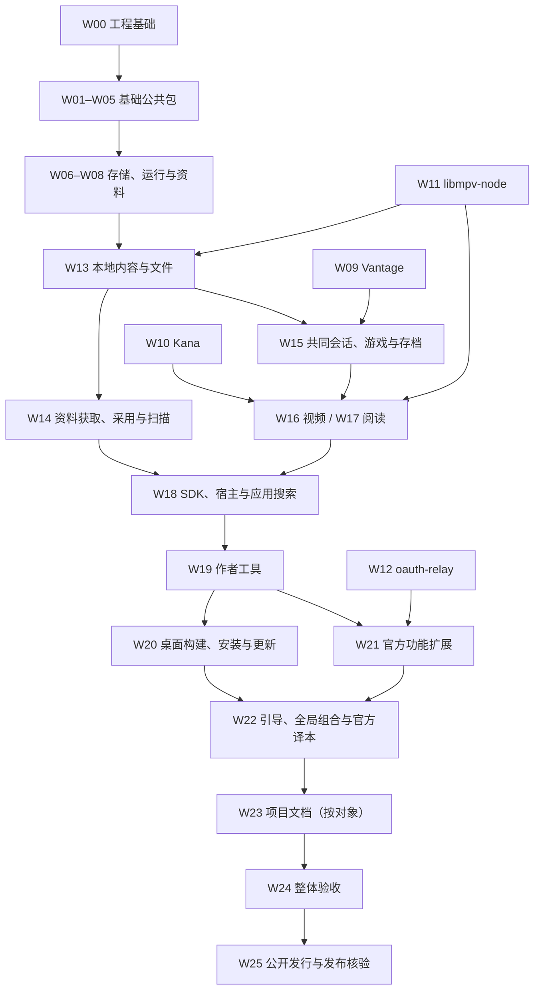

# 实施工作包与完成门槛

工作包按职责与真实依赖组织，编号表示推荐接续顺序，独立项目可以提前并行。每个工作包完成自身范围的实现、制品和适用验收，项目文档、整体验收和首次公开发行分别由末尾工作包承担。产品规则见[设计目录](../design/README.md)，验收编号见 [A01–A33](../verification/acceptance.md#scenarios)，实际进度见[实施状态](status.md)。

## 完整交付

公共包、独立项目和各项官方扩展分别拥有完整的实现责任。每个实施工作包交付其范围内可实际使用的终态能力：公开合同、操作与对应界面、正常和失败行为、取消与清理、构建资源、适用制品、实际消费及验证共同满足要求。纯合同包完成接口、值约束与规范编码，工程工作包完成真实工作流；后续消费者负责自己的接入。

工作包内部可以按依赖分步实现，完成登记时须闭合本包承诺的全部范围。接口声明、代码注释、运行文案、发行说明和许可材料随实现维护；成篇项目文档由 W23 负责。后续修改属于缺陷修复、合同维护或新需求，已知的未实现操作和占位结果仍记为当前工作包未完成。

本体业务先通过 desktop-contracts 定义的值、操作与参与接口实现，完成真实存储、资源和窗口路径。提供者、处理器及识别器通过本体登记接口验证完整调用、取消与释放；W18 消费这些已有操作，联合完成 SDK、宿主及全部跨进程业务接入。业务实现与扩展接入各有自己的完成边界。

实现与适用验收、项目文档和对外发布分别记录。W24 汇总固定候选版本的发布前整体验收，W25 完成本轮首次公开发行与发布核验，整体完成条件见[最终交付](../verification/acceptance.md#completion)。签署与隔离部署随所属工程取得证据，正式仓库接续、公开发布和生产服务切换按[首发规则](../design/engineering/releases.md#first-release)及已有授权执行。

所有交付遵守[共同原则、终态实现与可读性](../design/engineering/conventions.md#quality)、[编码规则](../design/engineering/conventions.md#coding-style)、[界面文案](../design/ui/components.md#copy)和[文档归属](../design/engineering/documentation.md#owners)。验证按[实际影响](../verification/acceptance.md#verification-scope)选择，目标环境按[统一交付边界](../verification/acceptance.md#runtime-coverage)判定，证据按[实际用途](../design/engineering/documentation.md#evidence)保留。

### 实施中的判断

遇到原则、正确性、质量或技术实践问题，先按[整体判断](../design/engineering/conventions.md#judgment)审视目标与相关设计，说明依据、选项和影响，由用户确定方向。模型、主要行为、公开合同、架构边界或交付范围的变化遵守同一规则。

已确认合同内的实现选择、缺陷修复与验证由实施者完成。依赖新决定的工作等待讨论，其他工作继续推进；已确认方向与已有授权直接落实。

## 实施顺序与并行工作

| 顺序    | 完整责任                                       | 接续条件                                       |
| ------- | ---------------------------------------------- | ---------------------------------------------- |
| W00     | 工程与测试入口                                 | 后续工作复用并维护已有工程能力                 |
| W01–W05 | 视觉、分发、桌面合同、本地化、RPC 与 UI 公共包 | 按各包真实依赖完成实现与独立消费               |
| W06–W08 | 存储、应用运行、资料与记录                     | 提供真实数据、资源、窗口与业务操作             |
| W09–W12 | Vantage、Kana、libmpv-node、oauth-relay        | 独立完成工程、制品和适用运行，可提前并行       |
| W13     | 本地内容与文件维护                             | 为采用、扫描和使用会话提供完整文件能力         |
| W14     | 资料获取、采用与扫描                           | 使用 W13 完成本地登记和识别                    |
| W15–W17 | 共同使用会话、游戏、视频和阅读                 | 消费真实文件与独立技术项目制品                 |
| W18     | extension-sdk、扩展宿主与应用搜索              | 在本体业务就绪后闭合全部公开接入               |
| W19     | extension-cli 与作者流程                       | 使用 W18 的真实宿主完成模板、开发与安装        |
| W20     | 桌面构建、安装与应用更新                       | 完成安装升级、更新和发行工作流                 |
| W21     | 30 项官方功能扩展                              | 使用完整 SDK、CLI 与本体业务逐项验收           |
| W22     | 引导、全局组合与三个官方译本                   | 先完成引导及英语基准，再以全部实际扩展联合验收 |
| W23     | 项目文档与协作入口                             | 按各对象实际实现分批完成，整体在 W24 前就绪    |
| W24     | 发布前整体验收                                 | 核对固定候选版本、完整用户流程与交付文件       |
| W25     | 公开发行与发布核验                             | 按依赖顺序执行本轮首发，取得实际渠道与生产结果 |

基础包按自身依赖推进。W06–W08 完成实际存储、运行与资料操作后，W13 先完成已有作品的文件持有与维护，W14 再完成来源采用和扫描。W15 首次完整实现共同使用会话，并用游戏实际消费；W16、W17 复用该机制，分别完成视频和阅读。

W09–W12 的独立工程可提前开展，各消费者使用其已经验证的固定制品；relay 的隔离部署在相关来源扩展的授权验收前就绪。本体业务通过纯参与合同接入测试参与实现，W18 再完成真实扩展实例、回调、业务调用、资源与应用搜索的联合验收；W19 随后闭合作者工作流。

W20 使用真实应用候选完成构建、安装和更新能力。W21 的 30 项功能扩展按实际业务依赖分项完成。W22 在这些制品上实现引导与全局组合，补齐英语消息基准，再完成三个官方译本及全部 33 项扩展的真实引导消费。

W23 随各对象成熟度分批编写文档，最终采用已经验证的实现、命令和制品。W24 使用全部功能与文档就绪的固定候选版本取得整体验收结果；W25 执行首次公开发行，后续项目按各自版本与实际依赖独立维护。

同一 A 场景可以覆盖多个交付对象。各工作包记录自身断言，W24 汇总发布前证据，W25 补齐实际发布与生产接入结果。

## W00：工程与测试入口

已完成的工程基础继续成立，实际范围及证据见[W00 状态](status.md#w00)。

交付包括实际 workspace 边界、构建和资源交接、开发会话协调、测试运行环境、工程载体验证、CI、hooks 和合并门禁。工程验证使用独立测试输入；产品源码、公开包和官方扩展随各自工作包完整建立。后续工作同步维护其新增的配置、制品消费和验证入口。

依据：[工作区](../design/engineering/workspace.md) · [构建](../design/engineering/build.md) · [原生工程](../design/engineering/native.md)。

验收：A24、A26、A28、A31 的工程入口范围。验证记录注明对应输入、环境与实际结果。

## W01：desktop-appearance

依赖：W00 与已确认的视觉合同。

交付：完整视觉词表、纯值规则、亮暗默认值、基础和派生 CSS、可选 Tailwind 映射，以及独立类型和样式入口。

验收：纯值、普通 CSS 和映射分别可消费，默认外观完整，包保持纯视觉职责；仓库外制品、声明、资源许可与接口说明通过 A23、A29、A31 的对应断言。

依据：[视觉基础](../design/engineering/workspace.md#visual-packages) · [共同外观](../design/domains/appearance.md)。

## W02：extension-distribution

依赖：W00 与分发合同。

交付：扩展身份、manifest、registry、静态展示与本地化格式、兼容声明、规范化和纯校验，以及独立 Node 签名和验签入口。

验收：格式、错误、不可变版本字节和签名行为完整；纯入口与 Node 入口分别通过仓库外消费，覆盖 A21、A23、A31 的制品协议断言。

依据：[扩展制品与信任](../design/extensions/distribution.md) · [作者仓库工作流](../design/extensions/development.md#registry)。

## W03：desktop-contracts 与 desktop-localization

依赖：W01、W02 的实际公共值。

交付：desktop-contracts 定义完整桌面能力的 API、输入输出、编辑基线、错误、事件、参与接口与资源合同，以及调用方和实现方共同遵守的值约束、规范编码和运行时校验；覆盖资料、查询、写入、会话、管理、deeplink 与开发控制。desktop-localization 独立交付按领域维护的英语 ICU 源文、同源生成的关联消息类型、作者基准、译本校验与纯格式化能力。两个包分别提供构建制品与仓库外消费入口。

验收：同一值在各公开入口含义一致，查询与写入语义明确，公开声明不暴露校验库内部构造类型；类型、值约束与格式化在 Node 和浏览器中独立消费。消息键与参数关联、译本合法性、缺词的英语回退及字面标签规则成立。按 A03、A04、A23、A31 验证两个包各自的合同、制品和消费边界。

依据：[公共值](../design/domains/values.md) · [查询合同](../design/domains/library-query-contracts.md) · [写入合同](../design/domains/library-write-contracts.md) · [本地化](../design/ui/localization.md) · [接入协议](../design/engineering/protocols.md)。

合同包拥有接口语义及其值的合法性，不以函数是否有副作用决定归属。产品默认配置、预设、业务计算、匹配与结果选择、存储异常处理由所属本体能力实现；规范编码与必要校验随对应值维护。本工作包不建立本体业务源码；业务实现、对应测试、生成数据和资源随所属工作包交付。数据库 codec 消费所属值规则，实际存储接入仍由 W06 完成。

本地化包不持有当前译本、登记实例或窗口状态；本体 i18n 负责有效语言、生命周期、恢复与同步。SDK 在 W18 从两个包选择作者所需的合同、英语基准与校验能力，扩展作者仍使用 SDK 的纯作者入口。各能力的英语文案随所属功能继续维护同一源文，W22 核对完整界面覆盖与三个官方译本。

## W04：desktop-rpc

依赖：W00 与已确认的通信合同。

交付：环境无关的有限帧、握手、双向调用、通知、取消、错误交付和断连清理。真实通道的测试适配核对消息边界与资源寿命；窗口接入归 W07，作者与源码开发接入归 W19。

验收：独立消费者通过完整机制、声明与制品检查；Electron 窗口和 Node 父子通道试件验证序列化、取消、错误和断开。覆盖 A23、A31 的包合同断言；产品端点、就绪和退出分别由实际消费者验收。

依据：[通信分层](../design/communication.md#clients) · [帧与开发控制](../design/engineering/protocols.md)。

## W05：desktop-ui

依赖：W01 与 Solid 1.9 工程基线。

交付：[公开 UI 能力](../design/ui/package.md#families)的完整组件、组合、原生表单、键盘与焦点、浮层、图表、Markdown、拖拽、样式及资源寿命。按组件家族提供子路径，默认样式组合视觉基础，普通 Solid 消费者可直接使用。

验收：浏览器行为、完整视觉状态、声明、无 Tailwind 消费及独立资源清理分别成立，满足 A18–A20、A23、A29、A31 的公共组件断言。支持范围和真实环境由[视觉交付](../design/ui/package.md#delivery)核对。

依据：[UI 包](../design/ui/package.md) · [交互与可访问性](../design/ui/components.md) · [拖拽与虚拟化](../design/ui/virtualization.md)。

## W06：存储与原生基础

依赖：W03 与 W00 工程基础。

交付：正式 schema、编码、连接、同步事务、新基线和前向迁移，以及文件存储、归档和本体私有原生操作所需的基础设施。

固定经验证的 Drizzle 1.x、Kit、better-sqlite3 与 Electron 组合，使用正式生成和迁移入口。以七类非空资料验证读回、局部错误、回滚、重开、文件资源与代表查询；跨文件系统操作按真实环境记录。

验收：A01–A05 的存储断言、A14 的基础资源、A27 的初始化与迁移、A30 的查询成立。

依据：[数据库](../design/engineering/database.md) · [原生工程](../design/engineering/native.md) · [资源访问](../design/domains/resources.md)。

## W07：应用运行与设置

依赖：W01、W03–W05、W06。

交付：启动与退出、窗口接入、TaskRun、通用历史、事实事件、偏好、网络、主题与字体、英语运行文案及对应设置和任务界面。完整交付文件输入、附件与图片准备、受控读取及资源绑定，完成系统集成、运行保护、取消和收尾。

各业务通过已声明的执行、事实和退出接口接入。任务观察、业务执行和历史保存分别保持自身寿命；外观与字体从真实持久状态交付给窗口和后续 Webview。

接续 W00 的构建与打包能力，维护实际应用的程序输入、源码与打包候选的隔离运行入口，供后续业务、SDK 和作者流程验证。

窗口控制通过 desktop-rpc 接入，main、preload 与 renderer 按公开合同和最小能力边界协作；启动、资料路径和窗口寿命随本包完成。

验收：A14–A16、A20、A27、A29 的运行基础、状态、资源与管理界面成立。

依据：[任务](../design/domains/tasks.md) · [偏好](../design/domains/preferences.md) · [外观](../design/domains/appearance.md) · [网络](../design/engineering/network.md) · [附件与图片](../design/domains/attachments.md) · [受控资源](../design/domains/resources.md) · [应用生命周期](../design/architecture.md#lifecycle)。

## W08：资料与记录

依赖：W03、W05、W06、W07。

交付：七类 Entry、五类 Part、四类关系、资料查询与整理、状态、完成记录、活动、附加时长、Note 和 Annotation，以及列表、详情、编辑、合集、展示柜和统计界面。

核对完整写入、合并删除、动画种类更正、顺序、统计口径、并发基线与使用占用。页面与 Dialog 复用同一 domain-ui，选择、草稿、定位、虚拟化及重排沿实际用户操作闭合。正式业务函数与窗口入口使用同一事实；W18 通过这些完整操作实现扩展服务端接入。

验收：A01–A05、A14、A17–A20、A27、A29、A30 的资料与界面断言成立；代表链路先验证再扩大实现。

依据：[资料操作](../design/domains/library-operations.md) · [查询](../design/domains/library-queries.md) · [领域目录](../design/domains/README.md) · [资料界面](../design/ui/explorer.md)。

## 独立项目交付

W09–W12 各自拥有完整工程、公共合同、实现、测试、工具链与锁文件、平台资源、制品、可运行示例和发行流程。项目文档由 W23 在各自仓库完成，本轮正式接续与首次公开发行由 W25 执行。项目按[独立产品定位](../design/projects/README.md#purpose)实现全部公开范围，持续开发遵守[仓库合同](../design/engineering/repository.md)。

项目自身验收与 Kisaki 消费验收分别记录在[交付清单](delivery-checklist.md#projects)。本体从固定候选制品或已验证的隔离服务取得能力，记录版本、来源提交、资源摘要和兼容依据；W25 另行登记公开发行与生产部署结果。

## W09：Vantage

交付：进程、窗口与前台观察，真实实例引用，控制、窗口采集，Rust 与 Node 完整实现，以及支持平台和后端的资源与制品。

验收：全部公开操作、观察结束、局部不可用、权限、并发、取消与清理按自身合同成立；独立 Node 消费和实际后端证据满足 A33。W15 负责游戏业务接入。

依据：[Vantage](../design/projects/vantage/README.md) · [原生制品](../design/projects/native-runtime.md) · [项目验收](../verification/scenarios/projects.md)。

## W10：Kana

交付：全部支持格式的阅读内核、源定位、内容与资源合同、布局、选择和阅读交互，以及公开包、配套资源和可运行消费示例。

验收：格式回归、源位置与选择往返、排版、浏览器资源和释放满足 A33；独立制品在声明环境中可消费。W17 负责漫画和小说的业务接入。

依据：[Kana](../design/projects/kana/README.md) · [项目验收](../verification/scenarios/projects.md)。

## W11：libmpv-node

交付：完整 libmpv Client API 的 Node 绑定、控制与属性、事件与 hook、流与资源寿命、可选受管视频输出和独立帧持有，以及全部目标依赖、许可和制品。

验收：Node 与承诺的 Electron 环境、主要图形后端、颜色与截图、线程交接和环境退出满足 A33；制品与运行输入满足 A24 的项目范围。W13、W16 分别负责媒体信息和播放业务接入。

依据：[libmpv-node](../design/projects/libmpv-node/README.md) · [原生制品](../design/projects/native-runtime.md) · [项目验收](../verification/scenarios/projects.md)。

## W12：oauth-relay

交付：独立服务工程、完整中转协议、上游适配、配置校验、服务测试、构建制品、部署配置与运维工具。在获授权的隔离环境完成部署、真实上游接入及客户端联调，部署与运维指南由 W23 随已验证的操作形成；生产服务切换由 W25 完成。

验收：授权、取消、刷新、失败、HTTPS、秘密注入及服务停止满足 A33 的发布前断言，记录实际镜像与隔离部署。相关 W21 来源扩展通过该服务验证账号核验与凭据采用。

依据：[oauth-relay](../design/projects/oauth-relay/README.md) · [来源认证](../design/extensions/private-data.md) · [项目验收](../verification/scenarios/projects.md)。

## W13：本地内容与文件维护

依赖：W06–W08 的存储、运行资源与资料操作；媒体信息读取使用 W11 的完整制品。

交付：持有内容、目录与零散文件登记、文件识别方案、已有 Part 关联、默认目标、目录监听、增量维护、重定位与失联状态，以及对应管理、选择和报告界面。

本包完整实现已有作品的本地登记、发现、识别与文件维护。登记和首次识别提供可直接消费的入口，后续资料采用与扫描按自己的业务条件调用。文件识别方案、扫描线索规则和资料方案保持各自职责，不通过调用扫描器来完成已有作品内部的文件维护。

媒体读取使用固定 libmpv-node 输入，与活动播放器保持独立实例和资源寿命。验证路径约束、目录冲突、文件占用、局部失败、取消、重开与清理。

验收：A09、A14–A16、A18、A27、A29 的本地文件与持有断言成立，正式操作和对应界面可直接使用。

依据：[持有](../design/domains/holdings.md) · [文件维护](../design/domains/file-maintenance.md) · [文件识别](../design/domains/file-recognition.md) · [媒体接入](../design/engineering/integrations.md#media)。

## W14：资料获取、采用与扫描

依赖：W03 的参与合同、W07–W08 的运行与资料操作，以及 W13 的完整文件能力。

交付：provider 与字段处理器的本体登记及调用、独立来源搜索、资料方案与预设、来源定位、匹配、整合、标准新增和明确范围更新；同时完成扫描配置、发现、线索与识别器调用、批次采用、观察和报告，以及全部对应界面。

metadata、ingest 和 scanner 保持各自模块与事实归属。ingest 按合同提交资料与本地登记，再调用 W13 的首次识别；scanner 调用完整 ingest，已有作品的本地内容交给 W13 登记。两个采用路径均闭合实际结果、部分失败和后续处理。

本体通过已声明的参与接口登记和调用实现，使用符合合同的测试参与实现验证来源身份、读取会话、批量处理、取消与释放。真实扩展实例及跨进程回调由 W18 联合验收，官方来源与导入器由 W21 完成。

验收：A05–A08、A14–A16、A18、A27 的资料获取、采用、扫描及界面断言成立。来源字段、共享关联、原子写入、目录范围、占用和取消均交付真实结果。

依据：[资料获取](../design/domains/metadata.md) · [参与接口](../design/extensions/providers.md) · [资料方案](../design/domains/metadata-profiles.md) · [预设](../design/domains/metadata-presets.md) · [扫描](../design/domains/scanner.md) · [线索预设](../design/domains/file-recognition-presets.md)。

## W15：共同使用会话、游戏与存档

依赖：W07、W08、W09、W13。

交付：启动配置与确认、真实进程和窗口监测、前台计时、控制与截图、游戏面板、最终记录，以及手动和自动备份、恢复、保留策略与管理界面。

共同会话接纳、观察、计时和收尾在首次实际使用时完整实现，视频与阅读按相同合同接入。备份与恢复覆盖不覆盖移动、文件和索引、取消、中断、再次检查及明确保留现状。

验收：A10、A13、A14、A16–A18、A20、A27–A30 的游戏与存档断言成立，Vantage 固定制品已真实消费。

依据：[游戏](../design/domains/games.md) · [会话](../design/domains/sessions.md) · [备份恢复](../design/domains/backups.md) · [Vantage 接入](../design/engineering/integrations.md#vantage)。

## W16：视频播放

依赖：W07、W08、W11、W13，以及 W15 已交付的共同会话机制。

交付：媒体就绪、切换、播放与续播、轨道字幕、速度与音量、sRGB 显示与真实截图、播放器界面、记录和完整资源收尾。

验证 Node 输出、Electron 纹理交接和最终引用释放，覆盖快速切换、迟到帧、加载失败、设备或窗口失效及退出。

验收：A11、A14、A16、A17、A20、A24、A27–A30 的播放与制品消费断言成立。

依据：[动画与播放](../design/domains/anime.md) · [会话](../design/domains/sessions.md) · [媒体接入](../design/engineering/integrations.md#media)。

## W17：漫画与小说阅读

依赖：W07、W08、W10、W13，以及 W15 已交付的共同会话机制。

交付：全部支持格式的漫画和小说入口、内容列表、阅读偏好、准确源定位、选择与标注、主阅读与临时查看、记录和阅读器界面。

Kana 负责格式与内核，本体负责文件身份、资料、偏好、持久值及会话。各入口核对实际参数、保存结果、资源与关闭，复用所属内核的共用格式证据。

验收：A12、A14、A16、A17、A20、A27–A30 的全部阅读入口与格式断言成立。

依据：[阅读](../design/domains/reader.md) · [标注](../design/domains/annotations.md) · [阅读接入](../design/engineering/integrations.md#reading)。

## W18：extension-sdk、扩展宿主与应用搜索

依赖：W02–W08 的公共包、存储、运行与资料能力，以及 W13–W17 的完整本体业务。

本包联合完成 SDK、正式宿主与应用搜索，交付边界如下：

| 对象           | 完整职责                                                                                                                                                                  |
| -------------- | ------------------------------------------------------------------------------------------------------------------------------------------------------------------------- |
| extension-sdk  | 扩展公开能力选择、作者类型与纯规则、激活和登记合同、公开接入协议、全部 Node 与框架无关 Webview 入口；调用、回调、订阅、取消、实例和视图资源映射、私有通信、外观及语言接入 |
| 桌面宿主与管理 | 共享 extension-host、真实实例与代际、激活和贡献寿命、Webview、storage、secrets、宿主网络与资源；安装更新、仓库信任、兼容、启停、恢复、开发构建采用和完整管理界面          |
| 应用搜索       | 各类别的完整聚合查询、类型化结果、可见范围、排序与分页，以及主窗口搜索面板、导航和目标定位                                                                                |

本体业务已经具备完整原生操作，本包将全部 SDK 公开能力接入真实服务端，逐项验证资料、文件、获取、扫描、游戏、播放、阅读和搜索调用。提供者、处理器与识别器由扩展实例接入对应本体目录，验证跨进程回调、执行上下文、取消与最终释放。业务规则继续由原生拥有者维护。

应用搜索消费已安装扩展、原生及扩展页面等真实目录，并向窗口和 SDK 提供同一查询。搜索与宿主在同一工作包完成相互接入，源码模块仍按各自职责组织。

完成系统 deeplink 接收与扩展分发，贯通 SDK 登记、冷启动和已运行交付、业务确认、取消及反馈。开发控制执行真实构建采用、共享宿主重建和目录释放；使用实际源码应用与打包候选验证同一接入。

验收：A05、A16、A18–A21、A23、A27、A30、A31 的 SDK、宿主、搜索与独立消费断言成立。SDK 的纯入口和运行入口分别通过仓库外制品消费，全部公开业务接入与正式宿主共同达到完成条件。

依据：[公共包边界](../design/engineering/workspace.md#packages) · [运行机制](../design/extensions/runtime.md) · [Webview](../design/extensions/webview.md) · [资源](../design/domains/resources.md) · [私有数据](../design/extensions/private-data.md) · [安装与信任](../design/extensions/distribution.md) · [应用搜索](../design/domains/search.md)。

## W19：extension-cli

依赖：W02–W05 的公开包，以及 W18 的 SDK 与正式宿主。

交付：kisx 的 workspace、extension、registry 全部命令和同义程序化入口，配置声明、构建与安装包装配、签名仓库工作流，以及 Node、框架无关 Webview、Solid 三种正式模板。

源码开发会话与作者 CLI 共用本包的应用启动能力，使用 desktop-rpc 完成源码及打包应用的开发控制、就绪、正常退出取消和连接清理。

验收：仓库外 tarball 创建独立项目和工作区成员，完成类型检查、开发、热更新、构建、打包与真实安装；覆盖激活失败修复、连续构建、资源释放、退出取消和再次退出。无源码仓库也可维护 registry。A23、A26、A31、A32 的作者工具断言成立。

依据：[作者工具与开发流程](../design/extensions/development.md) · [开发协议](../design/engineering/protocols.md#development)。

## W20：桌面构建、安装与应用更新

依赖：W07 的实际应用构建入口、W13–W19 的本体与扩展开发能力，以及已经锁定的独立项目制品；工程方法沿用 W00。

交付：六目标桌面制品、完整资源装配、安装升级、便携模式、签署与许可材料，以及本仓库的发行工作流和输入校验；同时完成应用更新的检查、说明、下载准备、退出协调、安装交接、状态与界面。

本包完整实现并验证构建、安装与更新能力，使用实际应用候选和隔离发行源核对系统下限、目标载体、更新失败、恢复及资源寿命。源码与打包候选的基础运行入口由 W07 接续，后续功能与文档使用同一套已完成的构建流程。

独立项目提供已经完成的目标输入，本包核对锁定版本在桌面中的装配与消费。官方扩展通过分发仓库安装，桌面不内置其安装包。W24 再以全部功能和文档就绪的候选版本核对最终待发布文件。

验收：A16、A23–A28、A31、A33 的桌面制品、更新及联合消费的发布前断言成立，干净 checkout 按锁定输入可生成正确目标，字节来源与签署结果可追溯。

依据：[构建](../design/engineering/build.md) · [应用更新](../design/domains/updates.md) · [发行](../design/engineering/releases.md) · [许可](../design/engineering/licensing.md) · [仓库](../design/engineering/repository.md)。

## W21：30 项官方功能扩展

依赖：W18、W19，以及各扩展实际使用的已交付本体能力；需要中转的授权使用 W12 的隔离服务。

交付：[官方目录](../design/extensions/catalog.md#catalog)中 01–30 项的完整功能，即 17 个资料与平台扩展、13 个导入器。每项分别完成声明的全部能力、页面、适用认证、私有状态、测试、资源、版本与独立 .kisx，并核对真实宿主、仓库外公共包和安装消费。

来源解析、个人记录、导入同步、取消、卸载与独立更新按自身语义验证。各扩展按实际依赖分项实施和登记，通用机制复用拥有层证据；三个官方译本由 W22 与引导联合交付，成篇说明由 W23 完成。

验收：A05、A16、A18、A22、A23、A27、A32 及[逐项专项](../verification/coverage.md#extensions)中 01–30 项断言成立，实际进度见[交付清单](delivery-checklist.md#extensions)。

依据：[来源目录](../design/extensions/catalog.md) · [同步](../design/extensions/synchronization.md) · [导入器](../design/extensions/importers.md)。

## W22：引导、全局组合与官方译本

依赖：W07–W08、W13–W20 的本体与宿主能力，以及 W21 的 30 项完整功能扩展。

交付：首次使用和更新推荐、引导采用、全应用入口与跨功能操作的完整衔接，以及[官方目录](../design/extensions/catalog.md#catalog)中 31–33 项简体中文、繁体中文和日语译本。三个译本保持普通扩展的身份、激活机制、独立版本与 .kisx。

先完成引导、全局组合及完整英语基准，再形成三个完整官方译本，使用全部 33 项实际扩展联合验证推荐、安装、激活、资料方案和扫描配置采用、语言选择与切换。功能扩展在进入本包前已经完成；引导与译本在同一工作包内完成相互消费。

onboarding 拥有推荐记录、草稿与采用编排，各业务模块继续拥有完整操作。核对主界面与独立窗口的导航、焦点、草稿、共同菜单、失败和退出体验，以及译本在真实界面、菜单、提示和无障碍信息中的完整呈现。

验收：A18–A23、A27、A29、A30、A32 及相关 R 要求的应用级入口成立。三个译本分别通过构建、独立安装和宿主生命周期验证，完整基准、实际界面与所交付译文一致，逐项结果见[交付清单](delivery-checklist.md#extensions)。

依据：[引导](../design/domains/onboarding.md) · [导航](../design/ui/navigation.md) · [视图状态](../design/ui/state.md) · [本地化](../design/ui/localization.md) · [官方译本](../design/extensions/languages.md)。

## W23：项目文档与协作入口

依赖：待编写对象的实现、制品与适用验证就绪，按对象分批完成。

交付：Kisaki monorepo 与四个独立项目的正式文档结构和阅读入口，包括 README 及其语言版本、CONTRIBUTING、CONVENTIONS、ARCHITECTURE、模块与包说明、33 项官方扩展说明、模板使用指南、项目 skill，以及 GitHub Issue Forms 与 config.yml。各份文档在所属项目维护，依据已验证的实现说明使用、开发、维护、工程规范和适用限制。

核对实际命令、可运行示例、公开接口、语言版本、资源要求与文档引用，按[反馈规则](../design/engineering/repository.md#issues)验证 Issue Forms 的字段、语法、标签和联系入口。更新 AGENTS 的入口，并将 refactor 中对应的实施说明归并到正式文档。设计规格、实施状态和验证证据继续按各自职责维护。

验收：A26、A31、A32 的项目文档断言成立，A33 的独立项目使用与维护说明齐备。各对象在整体验收前完成对应文档；实际结果按[状态归属](delivery-checklist.md)记录，根工程与公共包见[实施状态](status.md)。

依据：[文档职责与生命周期](../design/engineering/documentation.md) · [共用工程与编写规范](../design/engineering/conventions.md)。

## W24：整体验收

依赖：W00–W23 满足各自完成条件。

交付：固定候选提交和制品的完整使用流程、发布前 R／A 证据矩阵、项目说明与实现一致性，以及整体验收结论。

从干净 checkout 按锁定候选输入安装并执行 check，再执行未覆盖的消费者、浏览器、真实 Electron、原生宿主、开发会话和待发布制品验收。任务前置产物按既有规则复用。性能按 A30 的实际场景和明确调用核对。使用空库与代表性新库验证正常、失败、离线、取消、重开和完整退出。

核对 W23 已交付的项目文档，以及所属实施工作包的模板、示例、命令、注释、许可和必要证据。沿实际路径审阅职责、命名、公开边界、资源与清理，删除范围内已失去用途的内容。

完成门槛：R01–R32、A01–A33 的发布前断言满足[发布前完成条件](../verification/acceptance.md#pre-release-completion)。必需功能、文档、目标制品、签署和运行检查齐备，已知失败闭合，候选版本、输入与证据对应；实际公开发行和生产接入按 W25 核验。

依据：[覆盖矩阵](../verification/coverage.md) · [验收](../verification/acceptance.md) · [文档归属](../design/engineering/documentation.md) · [编码规范](../design/engineering/conventions.md)。

## W25：公开发行与发布核验

依赖：W24 发布前整体验收通过，所属发布和部署条件及授权齐备。

交付：本轮桌面应用、八个公共包、33 项官方扩展和四个独立项目的首次公开发行。完成正式仓库接续、适用的 npm 与镜像发布、GitHub Release、正式说明与扩展索引部署，以及 oauth-relay 生产服务切换。各项目保持独立身份、版本、制品与发行结果，按[首发规则](../design/engineering/releases.md#first-release)和实际依赖安排顺序。

核对最终发行来源和待发布文件，沿所属版本 PR 与发行流程交付；从公开渠道取得同一版本，验证来源、摘要、安装、声明与真实消费，核对正式更新源、签名索引和生产服务接入。首次 npm 身份、适用发布认证与来源证明遵守[发布规则](../design/engineering/repository.md#npm-publishing)。公开操作的实际结果逐项记录，部分成功按同一来源继续处理。

完成门槛：[最终完成条件](../verification/acceptance.md#completion)成立，A23–A26、A28、A31、A33 的实际发布与正式接入断言齐备。正式取得路径和交付记录一致，源码与制品可追溯，必要的旧入口接续与清理按所属合同完成。项目、扩展与整体结果分别登记于[交付清单](delivery-checklist.md)和[实施状态](status.md)。

依据：[发行流程](../design/engineering/releases.md) · [仓库接续与身份](../design/engineering/repository.md) · [生产部署](../design/projects/oauth-relay/deployment.md#release) · [发布核验](../verification/scenarios/engineering.md#public-release)。
