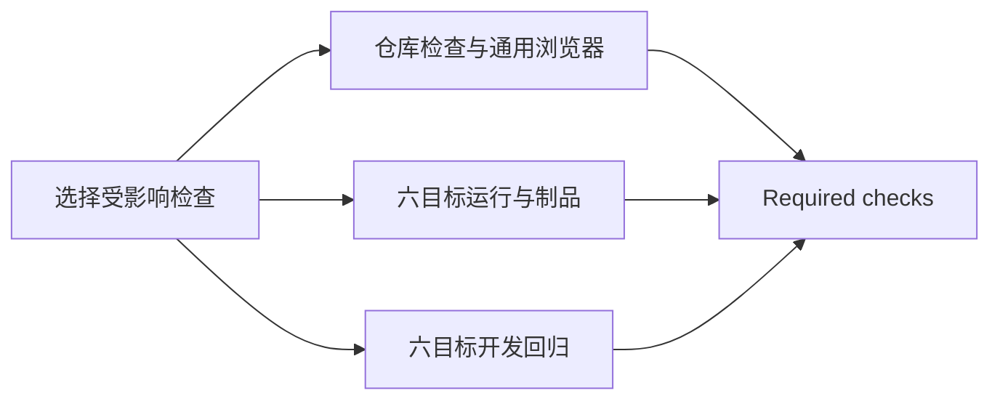

# CI 编排、构建交接与反馈时间

2026-10-27，用户确认开始正式实施。下文保留确认前的方案、原型与实测过程；正式合同与采用进度见[采用记录](adoption/README.md)。

原型结论：将下述编排、构建交接和任务环境分工定为当前 W00 CI 的目标方案。

本轮依据用户要求提出明确设计，并由实施者完成实际测量。正式基线为 PR #3 的 `ffa1c9de6887b6324348ef85e3cf2db08f6809cf`，候选实现位于独立研究分支 `research/ci-final-design-measurements`。本记录区分建议、试验实现与正式采用，不提前改写现有工程合同。

## 推荐结构

保留 pnpm、Turborepo、GitHub Actions 与现有项目任务。将任务关系定为：

选择任务只安装固定依赖并查询 Turbo 已声明的输入与依赖图。它不执行类型检查、消费者测试或应用构建；三个后续分支只依赖选择完成。全局输入变化、首次推送或无法解析比较基线时执行完整范围；查询失败令检查失败。保留独立 PR 标题检查及当前事件、取消和权限边界。

仓库分支执行实际受影响的类型、lint、普通测试和边界检查，格式检查覆盖仓库；公共包消费者和通用 Chromium 交互按任务图选择，在 Ubuntu x64 执行。桌面分支按选中的范围执行工程工具、Rust 检查、原生与 SQLite、四类窗口、每目标二十次启动及正常退出、打包和最终载体启动。开发分支保留 Windows、macOS、Linux 两种架构的七项原有开发场景，由隔离工作副本验证实际监听、失败恢复、HMR、取消和正常关闭。

三个分支分别返回结果，Required checks 必须核对选择成功、仓库成功，以及两个矩阵应运行时成功、未选中时明确跳过。不把跳过、取消或缺失报告解释为成功。六目标、采样口径和测试断言不随这次编排调整减少。

## 构建和打包交接

每个桌面 runner 完成一次有限应用构建，运行测试后直接把同一份构建交给打包入口。根 `desktop:package` 通过 Turbo 的本包 `build` 依赖保持独立可运行；应用 `package` 入口消费准备好的输出。

打包入口读取已有 `build.json`，检查目标、当前输入身份、完整运行文件集合与逐文件摘要。缺失构建、旧身份、文件被改写或多出文件均失败；不自动采用旧输出，也不在消费入口重建。ZIP、NSIS、DEB、RPM 与 AppImage 仍有各自载体身份，electron-builder 继续负责实际装配。现有同工作区任务顺序执行的边界保持，CI 并行发生在独立 runner。

开发回归自行创建隔离工程并执行开发构建；它的根入口只提前准备实际会复制的原生编译输出和任务所需公共依赖，移除未被它消费的完整应用构建。该调整不改变开发会话自身的启动、交接或关闭实现。

## 缓存与资源取舍

继续使用 GitHub 官方 cache 保存 `.turbo/cache`，按操作系统、架构、Node 和任务职责分组，提交作为保存键，优先恢复同职责的旧键。这样仓库、桌面和开发任务不会竞争同一不可变保存键；具体结果仍由 Turbo 的完整输入哈希判断。真实桌面、原生、开发、性能、签署和发布不得重放测试结果缓存。pnpm 依赖缓存继续由 pnpm Action 拥有。

完整范围最多同时运行一个仓库任务、六个桌面任务和六个开发任务。拆分增加重复 checkout、安装和原生准备，交换的是较短的整轮等待；同时记录总 runner 时间，避免只展示墙钟时间。当前采用标准托管 runner，不引入付费机器、自托管镜像或另一套远端缓存服务。

首轮 Windows x64 的 Chromium 准备为 212 秒，其中约 195 秒用于 Playwright 安装 Windows Server 的 Media Foundation，浏览器下载本身约十几秒。增加浏览器二进制缓存无法消除系统组件安装；当前保留正式依赖安装与校验。Playwright 的[官方 CI 建议](https://playwright.dev/docs/ci#caching-browsers)也指出浏览器缓存的恢复成本及不可缓存的系统依赖。锁定的 Playwright 1.64.1 源码和本轮日志均已核对。

## 测量口径和结果

整轮等待从 GitHub run 创建到 Required checks 完成，包含排队、环境准备、检查和上传；runner 时间为各实际任务起止时长之和，不等同于计费分钟。完整留存的各轮上传原有桌面候选、更新元数据、回执和报告。按真实推送的前后提交比较典型单文件修改，注释修改保持业务行为不变，只用于测量任务选择与执行成本。

| 范围                           | 运行                                                                        | 仓库反馈   | 整轮结束    | runner 总时间 | 结果                                       |
| ------------------------------ | --------------------------------------------------------------------------- | ---------- | ----------- | ------------- | ------------------------------------------ |
| 现行基线：完整范围             | [40491626331](https://github.com/ximu3/kisaki-dev/actions/runs/40491626331) | 1 分 35 秒 | 19 分 29 秒 | 58 分 25 秒   | 8 项成功                                   |
| 候选：完整范围与制品           | [40499251641](https://github.com/ximu3/kisaki-dev/actions/runs/40499251641) | 3 分 35 秒 | 13 分 22 秒 | 77 分 42 秒   | 15 项成功                                  |
| 候选：范围修正后的完整轮       | [40501831388](https://github.com/ximu3/kisaki-dev/actions/runs/40501831388) | 3 分 37 秒 | 14 分 13 秒 | 89 分 53 秒   | 15 项成功                                  |
| renderer 单文件                | [40503743693](https://github.com/ximu3/kisaki-dev/actions/runs/40503743693) | 1 分 49 秒 | 7 分 48 秒  | 32 分 27 秒   | 9 项成功，1 个未选中矩阵按预期跳过         |
| 公共 UI 单文件                 | [40504867074](https://github.com/ximu3/kisaki-dev/actions/runs/40504867074) | 2 分 37 秒 | 7 分 34 秒  | 35 分 27 秒   | 9 项成功，1 个未选中矩阵按预期跳过         |
| 开发工具单文件                 | [40505944355](https://github.com/ximu3/kisaki-dev/actions/runs/40505944355) | 1 分 10 秒 | 14 分 9 秒  | 43 分 43 秒   | 9 项成功，1 个未选中矩阵按预期跳过         |
| 原生单文件（失败保留）         | [40507951097](https://github.com/ximu3/kisaki-dev/actions/runs/40507951097) | 1 分 28 秒 | 14 分 38 秒 | 79 分 50 秒   | 未通过：Windows x64 开发观察超时，汇总失败 |
| 原生路径＋观察器修正（四文件） | [40514378630](https://github.com/ximu3/kisaki-dev/actions/runs/40514378630) | 1 分 21 秒 | 12 分 22 秒 | 74 分 29 秒   | 15 项成功                                  |

首轮诊断 [40497120549](https://github.com/ximu3/kisaki-dev/actions/runs/40497120549) 为 13 分 48 秒，仅报告留存，不能作为与基线完全同口径的总耗时对比。误触发后取消的 [40501024765](https://github.com/ximu3/kisaki-dev/actions/runs/40501024765) 也保留，排除于成功计时样本。第二轮修改了全局 workflow 输入，因此虽然恢复旧 Turbo 缓存，任务哈希仍会变化，不称为任务热命中。现行公开仓库基线与候选均在公开仓库运行；更早的私有仓库 Windows／Linux runner 配置不同，不能用其耗时计算这次提速比例。单次样本不用于估计稳定百分比或 CI 的 P95。

三轮完整候选均在六目标各通过七项开发、四项窗口、二十次启动采样及正常退出、一个最终载体测试；每个目标的构建清单摘要与修改时间在测试和打包之间不变，回执使用同一 buildId。完整留存轮的 26 份候选及更新相关文件均在各上传归档的文件目录中。小附件完整下载并核对 ZIP SHA-256；大附件读取报告并校验 ZIP CRC，记录远端归档摘要与载体目录，不声称已下载并重新计算所有大型二进制的摘要。原生与 SQLite 套件维持七项：当前 Windows x64 七项通过，其余五目标六项通过、一项因测试根位于同一文件系统而明确跳过，与现行基线相同。机器可读核对见 [measurements.json](measurements.json)，原始 GitHub 元数据、日志、报告及附件核对回执随各 `ci-*` 目录保存。

renderer 实测的六个平台均命中四个公共包构建任务；公共 UI 修改的六个平台均只使 UI 包构建失效，另外三个公共依赖命中。两类修改的每个平台均只执行一次应用构建，运行测试后直接交给打包，构建清单与回执核对通过。

首次实际 renderer 推送暴露了原有范围提升错误：Turbo 2.11.10 将未改变但必须执行的上游构建以 `TaskAllChanged` 返回，详情为 `required by an affected task`。原脚本把任意此类型都当作全局变化，导致选择了全部开发、原生与消费者任务。初步本地查询只核对了应用任务集合，未覆盖这段范围提升，未能发现错误。取消该轮后，保留其真实记录，修正为只由明确的 `TaskGlobalFileChanged`／`TaskGlobalDepsChanged` 提升完整范围，不解析描述文本。缺失基线继续全量；查询的其他受影响任务仍按其实际名称选择。补充 renderer 的真实任务图回归后通过。随后直接从前后两份 workflow 提取原始 Bash 步骤执行，旧版 renderer 过度选择可复现；修正版 renderer、公共 UI、开发工具、原生源码、全局 workflow、缺失基线及无变更七种输入均符合预期，见 [实际选择步骤对照](local/selection-regression.json)。

修正后的完整轮中，Linux x64 的 Chromium 依赖安装用时 508 秒，其中 Ubuntu 镜像下载 19.7 MB 系统依赖实际花费 8 分 12 秒，平均 40.1 kB/s；随后开发回归通过。该异常准备时间完整计入该轮结果，不剔除，不归因于应用测试。

renderer、公共 UI、开发工具三个单文件样本全部通过。原生单文件样本暴露下述观察器问题；修正后的同任务集合已通过六目标复验，单独注明其四文件范围。原始失败不改写为成功。

## 反馈目标与取舍

建议以当前标准托管 runner 和现有 W00 测试规模，采用以下工程目标：仓库检查、适用消费者和浏览器反馈在 4 分钟内；renderer／公共 UI 修改的全部代码门禁在 10 分钟内；开发工具、原生路径及完整验证在 15 分钟内。时间仍从触发计至对应检查完成，包含实际排队、准备和上传。当前成功样本满足这些目标，但样本量不足以宣称 P95 或服务承诺。超过目标时记录具体阶段并定位，不通过减少六目标、二十次采样或放宽断言达到数字。

我推荐接受完整验证增加的并行准备工作，换取较短等待和独立反馈。完整候选的两次同留存口径样本使用 77 分 42 秒、89 分 53 秒 runner 时间，现行基线一次为 58 分 25 秒；其中也包含任务缓存状态、机器及下载波动，不能把差额当作稳定增幅。日常 renderer／公共 UI 样本分别为 32 分 27 秒、35 分 27 秒。环境准备跟随实际消费者，开发回归只准备自身所需输入，避免为无关任务等待或重复制作制品。

原生单文件轮 `40507951097` 未通过：Windows x64 的第一项开发场景在 `hasNativeWindow` 处失败，Vitest 5.0.5 报告第一次轮询回调未在 30 秒内返回。该结果说明观察命令未及时完成，不能据此判断窗口不可见。六平台运行／制品及其余五个平台开发回归均通过，Required checks 正确拒绝该轮。此失败保留，不记作成功的原生整轮样本。

[两轮 Windows 对照](observation-comparison.json)交换普通／Turbo 环境的执行顺序，共使用四个新 runner。现有 `Get-Process` 在普通环境约 0.23–2.64 秒，在 Turbo 环境约 18–30 秒，并在两轮的 Turbo 优先 runner 上各复现一次超时；脚本体已经开始执行，主要延迟在命令查询阶段。直接使用同一 `System.Diagnostics.Process` API 在两种环境均约 0.15–0.22 秒。仅恢复 `PSModulePath` 未消除慢路径，具体触发环境字段未进一步归因，不把它写成已证实原因。

这是候选原型将开发测试纳入 Turbo 后暴露的观察器环境依赖。修正 `a32abca` 保留严格环境和原来的 30 秒预算，用已有 .NET API 代替 `Get-Process`，不新增 PowerShell 版本依赖；轮询取消传给观察进程，操作等待其输出流关闭。缺失进程、取消与资源收尾五项本地探针、原有七项开发场景及原样 ZIP 的真实启动／关闭均通过。六目标复验 [40514378630](https://github.com/ximu3/kisaki-dev/actions/runs/40514378630) 的十五项任务全部通过，用时 12 分 22 秒，总 runner 时间 74 分 29 秒。该复验同时撤回用于测量的原生源码注释，并修改观察器及两个调用方，共四个文件；它验证与原生修改相同的任务集合，不能标为单文件计时样本。

## 正式采用时的改动边界

确认采用后，正式修改集中在 `verification.yml` 的依赖、两个六目标矩阵、范围选择和缓存归属；应用 `turbo.json` 的打包构建依赖；`tools/package/packager.ts` 对既有构建的消费；根 `package.json` 的开发回归准备，以及已有任务图测试中的 renderer 场景和窗口观察器的环境／取消修正。同步更新 `CONTRIBUTING.md` 与工程工作区合同对根入口准备步骤的说明。三份正式 workflow 的事件、PR 标题和 Required checks 名称继续保持。

本轮 `ci-design-probe.yml`、另一个诊断分支的 `window-observation-probe.yml` 和对照测试只服务研究；注释修改只用于测量，均不属于正式实现的必要改动。诊断分支的 `PSModulePath` 透传试验未被采用。运行、测试和打包继续在同一目标 runner 内交接，开发回归使用独立 runner 和隔离副本；不增加跨任务文件传输协议或另一层构建协调器。

## 本地验证

原型通过完整 `pnpm check`、实际任务图回归及修改入口的类型与 lint 检查。独立根打包命令成功，日志中只有一次应用构建；原样 ZIP 启动通过。缺失清单、旧输入身份、改写运行文件及新增运行文件四项负向探针均明确拒绝且保留既有候选。独立 `desktop:test:dev` 命令通过原有七项场景。原始结果见 [local](local/files.json)。

## 依据

- [GitHub jobs 与 needs](https://docs.github.com/en/actions/how-tos/write-workflows/choose-what-workflows-do/use-jobs)：用原生依赖表达并行与汇总。
- [GitHub YAML anchors](https://docs.github.com/en/actions/reference/workflows-and-actions/reusing-workflow-configurations)：两个矩阵共享同一份六目标声明。
- [Turbo query](https://turborepo.dev/docs/reference/query) 与 [CI 指南](https://turborepo.dev/docs/crafting-your-repository/constructing-ci)：复用已有任务输入和依赖图，不新建路径分类器。
- [System.Diagnostics.Process.MainWindowHandle](https://learn.microsoft.com/en-us/dotnet/api/system.diagnostics.process.mainwindowhandle) 与 [Turbo 2.11.10 的环境过滤实现](https://github.com/vercel/turborepo/blob/v2.11.10/crates/turborepo-env/src/lib.rs)：窗口查询继续使用公开系统 API，任务环境维持明确边界。
- [标准托管 runner](https://docs.github.com/en/actions/reference/runners/github-hosted-runners)：解释公开／私有环境差异；各任务另记录实际 CPU、内存、Node 与架构。
- [VS Code 的平台构建与独立 smoke 测试](https://github.com/microsoft/vscode/blob/main/build/azure-pipelines/product-smoke-flaky.yml)：参考构建后消费同一输出的职责分离；该文件专用于不稳定性探测，其重复次数、忽略失败设置与完整调度未用于本方案。

本轮验证限于现有 W00 工程与测试能力；正式签署、发行前验收和后续业务范围仍按原有工作包完成。研究分支未合并，PR #3 未因本轮测量修改。
