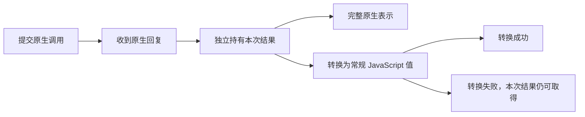

# libmpv 值表示方案比较

这是值表示定稿前的方案比较。当前合同以[值与转换](../../../design/projects/libmpv-node/values.md)为准。

<a id="先分开四个问题"></a>

## 先分开四个问题

| 问题            | 本项目需要达到的结果                                             |
| --------------- | ---------------------------------------------------------------- |
| 原生语义        | 命令、属性与事件仍表达 mpv 的实际事实，不引入第二份播放器状态    |
| 数据保留        | 原生整数、字节、字符串内容、map 的全部键值项和 NONE 不被静默改写 |
| JavaScript 使用 | 常用操作有准确类型，未知名称仍可调用，输入和输出规则可以解释     |
| 资源与失败      | 值独立于事件缓冲和播放器；原生失败、转换失败和取消可以区分       |

本轮的数据保留指公开值的类型与内容，不包括 C 指针、分配布局或浮点 NaN 的负载位。map 的键顺序没有公开稳定性保证；键值对应及不能静默覆盖已有项仍须成立。初始化、文件就绪、截图布局与 NativeFrame 不是这些值表示问题的替代项。

这里最重要的分离是：底层怎样保留一份实际结果，与公开 API 默认怎样呈现它，是两个决定。保留原始信息不要求所有调用者每次都处理 C 风格节点；直接访问 JavaScript 字段也不意味着可以丢掉不能表示的信息。

<a id="facts"></a>

## 核实后的边界

- Client API 允许非 UTF-8 字符串，map 只保证键和值按位置对应。当前节点复制代码逐项复制 map，并未在复制时合并同名键。
- user-data 的子属性可以读写任意节点，读取与写入均使用节点复制。因此完整值不只服务截图这类字段固定的结果。此处是源码路径核对，没有实际执行原生往返，也不代表普通媒体元数据经常出现重复键。
- mpv 的事件数据只在规定期限内有效，绑定必须在它失效前建立独立持有；把指针藏进一个稍后读取的 JavaScript 对象不满足合同。
- Node 的消息克隆不会保留普通 JavaScript 类的原型和私有字段。纯数据中的 bigint、Uint8Array 和普通判别联合可以按相应克隆规则传递。

来源、可复核脚本及实际检查结果见[比较证据](../libmpv-value-options/verification.md)。它们支持边界判断，不证明任何候选已完成原生实现。

<a id="options"></a>

## 六条路线

| 路线                                      | 调用者得到什么                                    | 主要收益                                             | 必须承担的代价                                                       |
| ----------------------------------------- | ------------------------------------------------- | ---------------------------------------------------- | -------------------------------------------------------------------- |
| A：只提供常规 JavaScript 值               | string、对象、数组、bigint、Uint8Array            | 公共表面最小，日常直接使用                           | 严格转换时不能取得所有原生值；放宽转换会丢信息                       |
| B：自动混合表示                           | 常规值，遇到特殊内容时改用字节字符串或 entries 值 | 常见调用直接使用，单次返回可以保留全部信息           | 表示依内容变化；嵌套联合、类型身份与传输适配进入公共合同             |
| C：统一原生值                             | 一套稳定的原生类型节点，转换由调用者显式发起      | 类型来源清楚，全部结果可先保留，转换失败不会抹去结果 | 日常读取也要解包或转换，会改变已经确认的直接值用法                   |
| D：显式选择输入与输出表示                 | 默认常规值，明确选择时得到完整原生值              | 常用调用直接使用，所选表示可预测，完整能力可达       | 两种表示及其转换都要维护；需要明确结果转换失败与观察终止规则         |
| E：统一结果对象                           | 每次得到一份可取常规值或原生值的结果快照          | 同一次结果始终可用；执行与转换自然分开               | 每次读取都多一个对象或解包步骤；类身份、缓存和字节别名需说明         |
| F：已知能力专门适配，未知能力另走通用入口 | 已知操作得到具体结构，通用操作得到原生值          | 已知能力的使用体验可以很好                           | 长期维护两套消费方式，能力目录易膨胀；仅靠重载无法解决运行时身份差异 |

所有路线都应保留 bigint 与独立字节的既定规则。用 JSON 编解码替代转换，或者直接用 JavaScript Map 替代原生 map，都不能解决完整值问题：前者不能直接承载 bigint，后者仍会覆盖相等键。改用字节对象作 Map 的键又会引入对象身份相等，与原生字符串键的内容比较不同。

### A：只提供常规值

这条路线确实最轻，不能因为简单就排除。它适合明确限定输入和输出域的应用 SDK。例如一个只读取固定布尔与时间属性的内部适配层，就不必提供全部 mpv 节点。

但独立 libmpv-node 的定位包含通用命令和属性。严格转换失败之后如果没有任何取得原始数据的途径，完整能力已经被缩窄。用替换字符、最后一个同名键或字符串化大整数来消除失败，则违反已确认的数据规则。因此 A 可以成为 Kisaki 的消费方式，不能独自承担当前独立库的全部合同。

### B：自动混合表示

此前的[混合声明样例](contract.d.ts)属于这条路线。它的优点是真实的：单次命令可以交付完整结果，属性变化也不必因为某一项文本无法解码就成为转换错误。联合类型本身是正常的 TypeScript 工具，不能把它直接称为不现代。

困难在于同一个原生类型对应不止一种公开形状，而且差异递归进入数据树。普通对象和特殊包装的识别也有实际成本：原生 map 可以拥有 kind、format、entries 等字段，不能把某个字符串字段直接当作可靠的包装标记。采用类或私有标记可以消除歧义，但这些身份不会自动随消息克隆保留。

如果使用范围明确局限在一个 Node 环境，调用者经常处理未知原生值，并接受一次完整的联合类型分支，这条路线仍然合理。对于希望默认返回简单数据、将特殊表示集中到显式操作中的本项目，它不是当前优先项。

### C：统一原生值

这条路线把公开值视为一套稳定的数据模型。例如字符串节点始终保存字节，map 节点始终保存键值项；全部节点都使用普通判别联合时，不需要依赖类身份。也可以只为有表示差异的原生类别加标记，但应按类别固定，不能再次退回 B 的逐内容切换。

```ts
type NativeString = { readonly format: 'string'; readonly bytes: Uint8Array }
type NativeMap = {
  readonly format: 'map'
  readonly entries: readonly (readonly [Uint8Array, NativeValue])[]
}
```

NativeValue 在此代表完整的原生值联合，以上只摘录两类。这样的普通数据可以先保存、检查、转交，再用纯转换函数得到 JavaScript 值。转换只作用于已经取得的快照，失败后原结果仍在手中，不涉及再次调用 mpv。

它在单一模型、原生覆盖和可传递性上最直接，值得作为认真对照的路线。代价同样明确：读取暂停状态或时间位置也可能需要访问节点的 value；截图、轨道与章节需要转换或查找后才能使用。若为全部常见操作另写便捷调用，很容易滑向 F。选 C 应接受这一层低级值模型，而不是随后再建立大量同义控制方法。

### D：显式选择表示

这条路线继续让普通读取返回常规值，将原生表示作为可显式选择的同一个调用选项。以下名称只用于说明和声明实验，不是正式 API：

```ts
const position = await mpv.getProperty('time-pos')
const raw = await mpv.getProperty('user-data/example', { output: 'native' })
await mpv.setProperty('user-data/copy', raw, { input: 'native' })
```

输入和输出应独立判断。只想保留原生结果，不应被迫把普通命令参数也改写成节点树；传入一份原生值，也不应暗中改变结果表示。读操作只需要输出选择，写操作只需要输入选择，命令可能同时具有两者。为它们使用明确的选项可以避免把任意带 format 字段的普通对象误认成原生节点。

另一种输入适配是使用一个显式 native(value) 标记，但这会增加值标记的身份与传输约定。本轮比较优先使用外层输入选项，先避免增加新的公开值类。原生输入保留上游支持的格式转换，实际可接受性由 mpv 报告；普通输入的已知参数类型检查不能被无意中的宽重载绕开。

完整原生表示宜采用普通判别联合；输入 STRING 中仍不能包含内嵌 NUL，INT64 仍检查有符号范围。原生表示不是跳过校验，也不允许读写裸指针。原生输入、普通输入最终进入同一份调用与资源机制。

这条路线最贴近已确认的日常调用形态，也有 Node 显式编码选项的设计先例。它增加的是可见的表示选择，不要求引入第二个 Mpv、复制一套请求队列或建立全局表示开关。其真正难点是下文的转换失败，不能只把一个 raw 参数加进声明就视为设计完整。

### E：统一结果快照

```ts
const result = await mpv.getProperty('time-pos')
const position = result.toJavaScript()
const nativeValue = result.toNative()
```

命令或读取成功时先交付结果快照，转换由快照方法完成。调用成功和转换成功因而自然分开，转换失败也不需要把原始值放进错误对象。这是这条路线最强的理由。

它增加了所有日常调用的解包步骤，并改变现有直接值用法。若快照依赖类方法，消息传递前还要先提取普通数据。快照只能延迟转换，不能延迟复制即将失效的 C 事件缓冲；Mpv 关闭后仍须可用。还需规定两种视图是否缓存、字节是否共享、修改一个视图会不会改变另一个，以及重复转换的成本。方法少并不意味着整体合同更少。

把快照改成普通结果信封也可行，例如同时包含原生值与常规转换结果。这样消除了类身份，但增加每次返回的包裹与可能的双份表示；这些成本仍然存在。

### F：专门适配已知能力

具体类型提示本身有价值，所有路线都应保留适用的已知类型。但如果把“已知”和“未知”变成两套运行入口，范围会很快扩大到每个命令、属性和事件，后续需要不断追踪上游变化。

不能仅凭 TypeScript 的字符串字面量重载决定运行时返回哪一种表示。一个普通 string 变量在运行时也可能等于 screenshot-raw；运行时代码不知道调用者当时把它声明成了宽字符串还是字面量。若要按已知能力分路，必须有真实的运行时选择或明确入口，不能靠类型断言掩盖差异。

Kisaki 的 media 接入可以拥有少量符合自身完整操作的适配，这符合已经确认的职责。独立库则保留已知类型和通用入口，不把 F 扩展成另一套播放流程层。

<a id="scenarios"></a>

## 放入相同的调用场景

| 场景                         | A / B                                      | C                                     | D                                            | E                              |
| ---------------------------- | ------------------------------------------ | ------------------------------------- | -------------------------------------------- | ------------------------------ |
| 读取 time-pos                | 直接 number                                | 固定节点中的 number，或明确的标量映射 | 默认直接 number；原生输出由选项确定          | 从结果快照提取 number          |
| screenshot-raw 的常规结构    | 直接字段；B 的通用值仍含额外分支           | 先转换或按节点读取字段                | 默认具体字段；也可选原生结果                 | 从快照取得结构或原生树         |
| 非 UTF-8 字符串或重复键      | A 失败或失真；B 返回特殊分支               | 原样保留                              | 原生输出保留；普通输出明确转换失败           | 快照保留；常规转换失败         |
| 普通、特殊、普通的连续属性值 | B 的形状随内容变；A 中间失败               | 原生形状按类别固定                    | 表示选择固定；普通模式要有明确失败策略       | 快照形状固定，转换结果可能失败 |
| 取得值后关闭 Mpv             | 必须仍可持有                               | 必须仍可持有                          | 必须仍可持有                                 | 快照不得重新读取已关闭播放器   |
| 交给另一个 Node 环境         | 普通数据可按克隆规则处理；B 的类需额外适配 | 普通节点数据适合按克隆规则处理        | 提取的原生或普通数据可处理；异常本身另有规则 | 方法型快照先提取普通数据       |

跨环境传递在这里是设计质量维度，不把 Mpv 或 NativeFrame 变成可随意克隆的对象。实际 Node MessageChannel 检查也不代替 Electron IPC 或原生实例跨环境验证。

<a id="failure"></a>

## 执行、拥有结果、转换分别完成



这张图表达责任顺序，不要求所有实现始终构建两份 JavaScript 树，也不意味着原生失败一定包含结果值。命令返回值是在成功回复后才有效；原生失败按它自己的错误合同处理。

无论哪条路线，值转换失败都不能使绑定声称原生命令尚未执行，更不能通过重新执行命令补取另一种表示。这里分析的是公共合同的失败阶段，没有在本轮真实执行带副作用的命令，也没有证明某一常用命令经常遇到此问题。上游 subprocess 的 stdout 本来就是 BYTE_ARRAY，不能把它误当成“输出非 UTF-8 就一定触发字符串转换失败”的例子。

C 和 E 自然让调用者先拿到原始结果。若采用 D，建议对正常内存条件下的表示转换失败保留同一份原生结果：错误明确属于回复后的转换阶段，并提供显式读取该结果的能力。它不能借用已失效的 C 缓冲，也不通过另一次查询生成所谓原结果。已经取消的等待继续按原合同收尾，不借此重新交付迟到结果。

原始结果可能包含用户内容，不应作为普通可枚举错误字段或 message 的一部分自动进入日志。私有持有加显式访问是一种可行形态；本轮只验证了这种 JavaScript 结构在 Node 默认检查中的行为。错误跨消息边界时，普通 Error 克隆不会保留所有自定义字段或方法，调用方应显式提取需要传递的数据，不能宣称错误对象自动可移植。

如果不愿意让转换错误拥有原始结果，D 就要返回一个带原生值的结果信封；这实际上接近 E。这个成本不能隐藏在所谓“简单的格式选项”后面。

<a id="observation"></a>

## 持续观察的差异

原生 unavailable 继续只表示本次通知没有可用属性值，不增加猜测的 reason。可用原生值中的 NONE 也仍与外层 unavailable 分开。无法转换成所选表示，是绑定层的另一种失败。

对于 D，订阅建立时应固定输出表示，不能按某一次值自动切换。普通输出遇到转换失败有两条实际路线：

| 行为                         | 收益                                                   | 代价                                                           |
| ---------------------------- | ------------------------------------------------------ | -------------------------------------------------------------- |
| 报告转换失败并结束这一个订阅 | 生命周期明确，一次失败只交付一次；不继续交付部分可用流 | 后续即使出现可转换值，也需调用方建立新订阅                     |
| 报告本次转换失败并继续订阅   | 后续值恢复后可以继续更新                               | 需要每值错误事件、失效状态和连续性规则；调用者不能继续误用旧值 |

若继续细化 D，本轮优先建议第一条，错误保留失败的那次原生值；其他订阅与 Mpv 本身不因此关闭。需要完整连续原生值的消费者在开始时选择原生输出。这是新增取舍，尚未确认，不能写成已实施行为。

B、C 和 E 较少因为文字表示边界而中断原生观察，但仍不能免除未知原生格式、数据复制失败或事件队列中断的处理。采用哪种值表示，不会解决所有订阅错误。

<a id="types-cost"></a>

## 类型、性能与维护成本

声明实验表明，D 可以根据明确的输出选项得到确定返回类型，动态选项则诚实返回联合；普通已知属性的错误输入无需借助宽重载放行。原生输入显式选用原生节点，保留底层格式能力。C 可以给已知标量提供相应节点类型，E 可以给转换方法提供具体返回类型；三条路线在 TypeScript 中都可以表达。

这没有证明完整命令目录、生成声明、原生类型变化及所有重载已经正确。路线选择不应只以某一小段类型样例更短为依据。

公开类或纯数据本身不能决定性能好坏。主要成本包括事件缓冲的拥有权转换、字节复制、UTF-8 校验、map 键检查、创建 JavaScript 对象以及队列持有时间。C 也可能创建大量节点对象，D 可能多一次可转换性检查，E 可能持有未使用的表示或重复生成副本。本轮没有性能实测，不宣称某条路线更快或零复制。

实现时可以共享一份拥有原生语义的内部结果与两种表示的转换机制，不必维护两套命令、状态或事件实现。类型表示的数量、源码模块的数量、运行管线的数量应分别判断。

<a id="judgment"></a>

## 当前取舍

已确认采用 D 的方向。下面保留选择依据及其主要对照：

- D 最贴近已经确认的 Node 使用方式，普通读取和已知结果直接使用，同时通过显式选择保留完整原生值。选择它，就需要正面接受输入／输出选项、转换错误保留本次结果以及订阅失败策略。
- C 拥有更单一的数据模型和更直接的原生数据通道。如果把单一值模型放在日常调用简洁之前，它是有充分理由的选择；需要明确重新确认直接返回值的外形，并接受统一的解包或转换。
- B 是可行的取舍，不能仅因联合类型而否定；但它的内容相关分支和身份成本不符合本轮优先目标。E 把结果保留做得自然，却给每次调用增加结果层。A 和 F 更适合作为具体应用的消费层，不能独立替代当前库的完整定位。

这不是宣布 D 已经成为唯一最佳实践。D 的节点结构、输入／输出选项和同次结果保留已经确认。接下来细化订阅接收、事件与日志字段、完整配置与错误，并验证真实 addon 的对应行为。已有标量精度、原生语义和独立持有要求继续作为比较约束，不在探索中默默降低。
