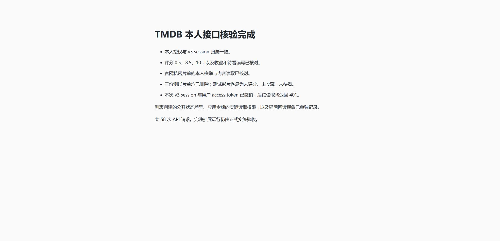

# TMDB 本人授权与个人接口实测

2026-10-21 在用户授权的限定对象和操作内完成本人接口核验，共执行 58 次 API 请求。一次 v4 浏览器授权、v3 session 转换、影片个人字段和真实私密列表读取均取得直接证据；测试记录和本次授权已清理。[结构化结果](2026-10-21-account-api.json)保留每次请求的类别、状态、断言、两项不成立的假设及清理结果。

本次使用用户提供并确认来自本人 API 设置页的 API Read Access Token。授权页显示关联应用名 kyoo；显示名称本身不能判断凭据是否属于用户。首次请求未获批准便停止，确认凭据来源后重新建立本次授权。用户明确允许助手完成授权页面操作；没有新建应用、修改应用登记或把凭据发往关联应用的网站。

## 实际通过的来源能力

| 范围     | 实际结果                                                                                                                    |
| -------- | --------------------------------------------------------------------------------------------------------------------------- |
| 本人授权 | v4 request token 经官网批准后换取用户 access token，再成功转换为 v3 session                                                 |
| 账号对应 | 使用用户 bearer 和转换后的 session 分别读取 v3 account，实际账号 ID 一致；v4 account object id 与 v3 数值 ID 按各自端点使用 |
| 写入前提 | movie/129 确认为动画影片，原状态为未评分、未收藏、未待看；没有覆盖既有个人记录                                              |
| 评分     | 0.5、8.5、10 均写入并准确回读；已评分清单能读到测试值，独立 DELETE 后恢复未评分                                             |
| 收藏     | true、false 均能写入及回读；收藏影片清单能读到测试对象                                                                      |
| 待看     | true、false 均能写入及回读；评分后再设置所选待看值，评分 10 与待看 true 同时成立                                            |
| 私密清单 | 官网明确选择不公开后创建的测试列表，可由本人枚举和读取；唯一成员是测试影片                                                  |
| 收尾     | 三份测试列表均已删除，逐份 GET 返回 404，随后本人枚举不再包含对应列表；测试影片三个个人字段恢复原值                         |
| 授权回收 | 本次 v3 session 和用户 access token 分别删除成功，使用已撤销凭据读取账号均返回 401                                          |

## 两项不成立的假设

**创建请求中的 `public: false` 不足以证明测试列表已经私密。** 第一次 API 创建后的综合断言失败，原响应正文没有保留，不能单独归因。清理后重新建立一份测试列表并拆开检查，确认 POST 传入 `public: false`，GET 却返回 `public: true`。第二份也立即删除。两份都仅含测试名称和 movie/129，没有复制既有私密资料；没有进一步探测其他账号能否读取。

随后通过官网的新建页面明确选择“公开此片单？否”，再由 API 核对枚举值为数值 0、详情值为布尔 false，确认私密后才添加测试影片。该列表完成本人读取后也已删除。API 创建行为的根因未确定，不能用猜测的参数变体宣称已经修复。列表写入只用于本次测试样本，正式扩展仍只提供列表读取与导入。

**本次应用访问令牌能够读取同一账号的私密测试列表。** 在未携带本次用户 access token 的对照请求中，使用应用 Read Access Token 也得到 HTTP 200。“应用令牌必然不能读取私密列表”的断言不成立。该证据仅覆盖当前自有应用与同一用户账号的组合，没有验证跨账号访问，不能概括为任意应用可以访问任意私密列表。

因此，应用凭据、用户许可和本扩展的本人连接应分别判断。接入仍通过显式浏览器授权取得并绑定目标用户，私人操作使用该连接的用户凭据；不因应用令牌碰巧能读取某项内容就跳过连接，也不增加凭据回退。默认应用凭据的发行核验须检查实际可读范围，不能仅凭 `api_read` 名称假设其只涉及公开资料。

## 回读与字段细节

评分 0.5 的首次数值回读已经正确，但待看仍为 true；随后 8.5 与 10 的回读观察到待看变为 false。本次没有修改账号联动设置，不能由第一次即时回读推断不存在联动，也不能确定是哪一次写入导致后续变化。该结果支持既定的有界回读和接受来源原生联动规则。

本人列表枚举中的 public 是数值 0，列表详情中的 public 是布尔 false，解析按各自端点定义处理。分页字段在本次单页数据中存在且一致；本次不证明多页大清单已经通过。

删除自有测试列表实际使用 `DELETE /4/list/{list_id}`，返回 200 后 GET 为 404。核验时官方删除页的路径写成 `/4/{list_id}`；本次没有向该省略 list 段的地址发送删除请求，不能把文档路径照抄为已验证调用。

## 证据与边界

[请求传输代码](account-request.mjs)保留本次执行的 Node HTTPS 传输函数及可独立使用的构造入口。它不自动重试或跟随重定向，记录中没有请求查询、认证头、正文或完整响应；授权与测试步骤由本次隔离进程组织，不是正式扩展实现。

令牌、session、本人接口的完整账号资料和私密列表正文未保存到证据。写入结构化结果前检查其不包含本次实际凭据和 account object id。测试页面与本地监听均已关闭；授权过程没有更改用户的浏览器登录状态或全局账号设置。

本次补齐了设计阶段明确保留的本人接口核验。实际扩展页面、秘密存储、任务与取消、本体采用、完整分页、默认发行凭据和六目标制品仍按正式实现验收，不把本次受控样本概括为这些功能已经完成。

官方依据：[v4 本人授权](https://developer.themoviedb.org/v4/docs/authentication-user)、[session 转换](https://developer.themoviedb.org/reference/authentication-create-session-from-v4-token)、[评分与待看](https://developer.themoviedb.org/reference/movie-add-rating)、[私密列表读取](https://developer.themoviedb.org/v4/reference/list-details)、[列表枚举](https://developer.themoviedb.org/v4/reference/account-lists)和[用户令牌撤销](https://developer.themoviedb.org/v4/reference/auth-logout)。

