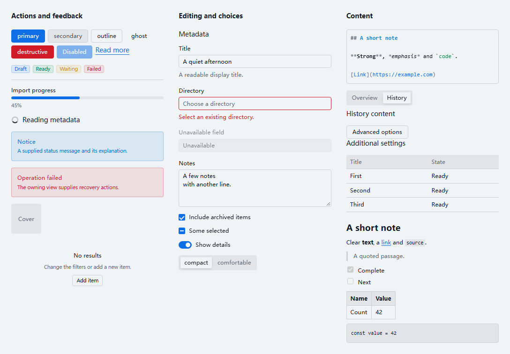
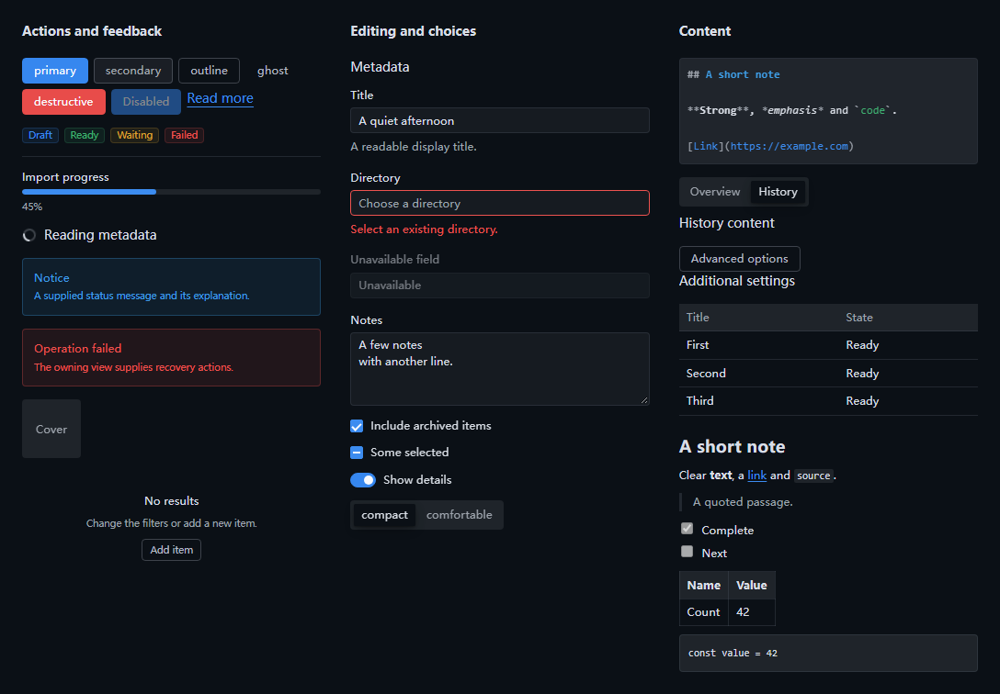

# W01 本机验证

本记录覆盖 [W01 职责矩阵](../../../implementation/work-packages.md#w01)的纯合同、通信、视觉与包消费。源码、测试和设计均在 Kisaki 仓库中实现；独立技术项目、数据库业务、SDK 运行适配和完整产品界面按所属工作包交付。当前实施、远端检查和合并入口见[状态页](../../../implementation/status.md#w01)与 [PR #16](https://github.com/ximu3/kisaki-dev/pull/16)。

## 环境与结果

2026-10-31，Windows 10 22H2 x64、Node 24.11.1、pnpm 11.11.0、TypeScript 6.0.3。浏览器检查使用 Vitest 5.0.5 与 Playwright 1.64.1，Electron 检查使用工程固定版本和独立测试资料。

| 入口 | 实际结果与范围 |
| --- | --- |
| `pnpm check` | 全仓类型、lint、依赖边界、格式和 293 项测试通过；纯逻辑测试可以复用有效 Turbo 缓存，进程与文件系统检查实际执行。 |
| `pnpm desktop:packages:test:consumers` | 八包 tarball 通过 publint、Are the Types Wrong、仓库外 NodeNext 严格声明、typed lint、Node 和 Chromium 消费；消费者没有 Tailwind 工具链，并检查随包第三方通知。 |
| `pnpm desktop:test:browser` | 公共 ui 的 14 项 Chromium 测试通过，覆盖控件组合、表单、输入法、焦点、主题、图表、Markdown、拖拽和销毁。 |
| `pnpm desktop:test:e2e` | 5 项实际 Electron 回归通过：四类窗口的隔离文档、最小 bridge 关闭，以及关闭启动窗口后另一窗口继续使用。 |
| `pnpm desktop:test:dev` | 4 项实际开发回归通过：退出被拒绝、构建失败保留旧进程、公共包与 renderer 热更新、取消准备及完整重试。 |

这些结果属于本机环境，不替代其他目标平台、正式签署、完整业务或独立引擎后端的证据。本次未运行性能采样，未执行 npm 或服务发布。

## 公共 UI 的具体核对

29 个控件家族按[公开目录](../../../design/ui/package.md#families)提供。普通样式在 TSX 内使用完整 Tailwind 类名，文件按职责平铺；Field 负责排布，具体控件保留自己的状态和可访问性关联。Kobalte 已覆盖的交互使用其原语，文字、动作、验证与异步业务由调用方提供。

[控件组合](../../../../clients/desktop/packages/ui/tests/browser/controls.test.tsx)与[表单及反馈](../../../../clients/desktop/packages/ui/tests/browser/composition.test.tsx)验证了响应式 class、原生提交／重置、选择器、Slider、菜单、Dialog／AlertDialog、Toast 及焦点和 Portal 清理。Kobalte 0.13.14 的文本与选择输入在原生 reset 后曾出现状态与 DOM 不一致；接入层同步 DOM 的默认值属性，不另存一份控件值。TextArea 的 Enter 提交使用当前键盘事件，避免在输入法组合期间提交，并尊重调用方的阻止操作。

[内容能力](../../../../clients/desktop/packages/ui/tests/browser/content.test.tsx)验证了图表数据与主题更新、原生实例销毁、图例键盘操作、Tooltip 与 Crosshair 组合，以及 Markdown HTML 转义、只读任务列表、独立标识、资源回调、普通／辅助点击、撤销和外部文本同步。输入法验证通过 Chromium CDP 执行组合与提交，覆盖 TextField、TextArea 和 CodeMirror；它不代替所有操作系统输入法的产品级验收。

[拖拽](../../../../clients/desktop/packages/ui/tests/browser/drag.test.tsx)使用真实 Chromium 指针操作，核对专用手柄、稳定监视器、自动滚动接入及注销和播报区域清理。真实对象、筛选槽位、多选集合、未加载目标和持久顺序仍由业务视图及本体操作拥有，后续按所属查询与重排场景接入。

图表使用 Unovis 1.7.1 的 Solid 组合，原生实例由适配层拥有。上游 bundler 形式的声明通过构建汇总，仍需外部引用的类型依赖由 ui 显式声明；独立 NodeNext 消费没有关闭完整声明检查。打包按构建报告保留实际带入的声明与 CSS 来源的 LICENSE／NOTICE。

## 视觉材料

[呈现试件](../../../../clients/desktop/packages/ui/tests/browser/presentation.test.tsx)使用合成内容，记录控件密度、标签、状态、Markdown 编辑与呈现。明暗切换沿 appearance 变量工作，不重建编辑器；素材不属于正式产品页面。人工核对了布局、文本、标记和边框，修正了局部伪元素对浏览器默认边框宽度的依赖。文档级 reset 不由 ui 注入。

| 明亮主题 | 暗色主题 |
| --- | --- |
|  |  |

截图用于核对当前呈现，不作为跨平台逐像素测试基准。字体取得和持久主题由 W05 接入，业务页面与正式窗口体验由对应工作包验证。

## 工程与职责审阅

全仓审阅按维护范围检查了职责、测试、防御、限制和终态实现，并逐项核对 W00–W13 的接续。公共包纯职责、SDK 运行职责、使用窗口与后续整体界面、能力文档与最终文档核对已有明确拥有者。正式窗口中的工程演示及其演示测试已经删除；开发热更新所需的 Button 夹具只写入隔离副本。

任务输入试件以独立 Git 变更核对验证选择，浏览器交互随公共 ui 的拥有者运行；性能采样退出自动 CI。包消费回执在失败或取消时释放自己的临时文件，既有回执仍引用按摘要命名的完整归档。普通编译、类型和格式检查没有替代上述人工审阅。
