# W07 应用运行与设置验证

验证范围见 [W07](../../../implementation/work-packages.md#w07)。源码会话、真实窗口和打包制品分别使用用例拥有的资料目录，运行版本为 Node 26.13.1、pnpm 12.18.0 和 Electron 45.3.2。

## 运行与资源

| 场景 | 核对结果 |
| --- | --- |
| 任务历史 | 有结果检查点的执行遇到终态保存失败时，已进入的等待者和事实订阅者得到实际失败及完整结果。随后重读显示最后持久化的结果、interrupted 和未知结束时间。筛选、计数和清理使用相同判断。 |
| 任务控制 | 撤回尚未生效的暂停、在安全点暂停、取消等待、释放观察及取消实际任务分别验证。取消交付 Cancelled，终态控制返回已经形成的结果。 |
| 偏好保存 | 按字段核对基线，冲突时整次回滚。更新缩放保留同组损坏的主题原值。窗口保存后立即采用缩放，重载文档仍读取保存值。 |
| 图片与字体 | 真实 ICO 准备与 PNG 旋转、裁剪通过。编辑器释放图像后，已接纳的保存持有独立占用，附件随引用事务提交。字体从实际 WOFF2 解析可变字重，库记录删除后仍持有的字体文件可以继续读取。 |
| 受控读取 | 两个 Session、同一 Session 的两个视图分别验证。范围读取交付准确的 206、Content-Range 与字节。释放一个视图后其 URL 失效，其他绑定继续读取。 |
| 宿主网络 | 回环服务和认证代理验证了流式上传、单次消费、显式 Cookie、两条独立的 Set-Cookie、重定向及在途正文取消。新路由采用失败后，宿主与浏览器都拒绝新的网络访问。 |
| 浏览器 WSS | 在专用 Session 中为回环端点核对测试证书。切换代理后，原连接收到了新的消息，新握手到达了新代理。随后注入无效路由，已有连接继续接收消息，新握手未到达代理。行为见[网络合同](../../../design/engineering/network.md#webview)。 |

## 窗口与制品

界面设计对照取自 `F:/project/3/kisaki` 的标题栏、侧栏、任务中心及设置界面（检出提交 `e311fe7c`）。主窗口在顶部安排窗口控制，在侧栏底部安排固定工具和应用菜单。任务中心区分进行中与已结束，详情关闭后回到原筛选和触发按钮。偏好草稿及保存结果按本项目的操作合同核对。

同一候选的[桌面 UI 复核](#ui-review)另记录了原生按钮颜色、控件比例、字段排布以及正式窗口的滚动视口。

四类原生文档通过各自的沙箱 preload 与窗口 RPC 建立连接。真实窗口用例使用合成的完成记录及中断记录，按名称筛选、查看结果并返回。向字体编辑器拖入测试文件时，可以先预览再保存，重开仍可读取。另从偏好进入主题管理，保存并选用主题，再返回继续编辑或放弃原偏好草稿。资料库业务页面在 [W08](../../../implementation/work-packages.md#w08) 接入同一框架。

源码会话从 `src` 构建，在专用 profile 中执行迁移、显示窗口并正常停止。打包验收按收据核对归档、包内文件摘要与 Electron fuses。全新资料首次启动从部署目录加载原生绑定和迁移。默认关闭转入后台；结束隔离实例后设置关闭偏好，重新启动后正常退出。再将已退出的测试资料转入载体旁的便携目录，用不同的普通资料偏好核对下次实际采用的位置。

## 复验入口

`pnpm check` 运行工作区基础检查。以下命令从仓库根目录执行：

```sh
pnpm exec vp run @kisaki3/desktop-contracts#verify
pnpm exec vp run @kisaki3/desktop-localization#verify
pnpm exec vp run --concurrency-limit 1 @kisaki3/desktop#verify
```

指定已有候选时，以 `KISAKI_ARTIFACT_RECEIPT` 选择收据，再运行 `pnpm exec vp run @kisaki3/desktop#test:artifacts`。各目标的完成情况由[实施状态](../../../implementation/status.md#progress)登记。

## Windows x64 实测

2026-11-17 在 Windows 10 22H2 x64（10.0.19045）通过工作区 `pnpm check` 和桌面完整验证。5 项开发会话、23 项 Electron Node 模式、10 项真实 Electron、2 项性能和 1 项归档制品用例通过，原生格式、Clippy 和绑定声明一致。系统字体来自 DirectWrite，本机单次读取 185 个不同字体族约用 2 ms。主题编辑器选用系统字体后正常保存和退出。

20 次新进程启动采用保留的隔离资料和暖磁盘缓存，中位数为 577 ms，P95 为 613 ms。存储负载期间窗口到 main 的 IPC 往返 P95 为 2.08 ms。本机制品版本为 `0.1.0-dev.0`，buildId 为 `a82b0dec-9ec1-4549-b9cd-2faff3b42b7a`。NSIS 和 ZIP 均完成打包，启停与便携运行使用 SHA-256 为 `cfd7bb0e2cbee08065f3384872fb23fe17170a6705d3286488cd9151f0856f82` 的 ZIP。

<a id="six-targets"></a>

## 六目标开发制品

2026-11-17，提交 `32309210` 的六个原生目标均通过完整桌面验证和制品启停。Windows 实际运行 ZIP 中的程序，macOS 运行从 ZIP 解出的 .app，Linux 运行 AppImage。各目标均从空资料创建数据库，重开后读取已保存的关闭偏好，再验证便携资料。Linux 使用 Xvfb 和 Openbox，macOS 与 Windows 使用 runner 的原生窗口会话。[CI 矩阵](https://github.com/ximu3/kisaki-dev/actions/runs/44069724930)

表中启动时间来自每个宿主的 20 个新进程，IPC 为完整存储负载期间任务中心刷新时 `tasks.types` 的窗口往返时间。构建身份与文件摘要由实际运行制品的用例输出在对应作业中。

| 原生宿主 | 启动中位数 / P95（ms） | IPC P95（ms） | 实际运行归档的 SHA-256 |
| --- | ---: | ---: | --- |
| [Windows Server 2025 x64 · 26100](https://github.com/ximu3/kisaki-dev/actions/runs/44069724930/job/133992797055) | 503 / 537 | 10.75 | `2751e27c868e55b807c0d903355cdc939e5dc0d006ed05cf4a93fc96a6486d33` |
| [Windows 11 arm64 · 26200](https://github.com/ximu3/kisaki-dev/actions/runs/44069724930/job/133992796927) | 618 / 691 | 12.59 | `3af8790b93a5b201319dda5480f6193127dd60e21d615160544f3a0e79be70a3` |
| [macOS 15.7.9 x64](https://github.com/ximu3/kisaki-dev/actions/runs/44069724930/job/133992796953) | 1865 / 2627 | 38.06 | `fb7f7db0687e7647459d73627d7672228e4c84587ef454ba9aa1f3f915df68e6` |
| [macOS 15.8.2 arm64](https://github.com/ximu3/kisaki-dev/actions/runs/44069724930/job/133992796941) | 658 / 788 | 24.43 | `5e336c5a44a8d830df3bb88aa6832aeb7333c9895db5f2f607f6db5c2f0a4740` |
| [Ubuntu 22.04.5 x64 · X11](https://github.com/ximu3/kisaki-dev/actions/runs/44069724930/job/133992796948) | 671 / 688 | 14.97 | `414cdc40c8c5a8e0a4c2dd059d205d9b779a8ccb01205abe3d046e17251aed5d` |
| [Ubuntu 22.04.5 arm64 · X11](https://github.com/ximu3/kisaki-dev/actions/runs/44069724930/job/133992796859) | 596 / 615 | 14.33 | `f9833bc537c0d283fdada492a684729b2414626d1772b697bb9dda0a3aecdab7` |

Windows 与 Linux 双架构在一次性账号中从系统集成界面登记并撤销登录项，随后由操作系统打开 `kisaki-dev://view/tasks`，并在已运行的窗口确认任务中心出现。Linux 双架构还在独立 D-Bus 和 X11 会话中由 dunst 激活真实通知，接收方得到发出通知时指定的任务目标。

上述登录项用例核对登记状态，重新登录后的后台自启与系统许可变化仍待实测。macOS 登录项登记和正式安装身份下的协议关联仍需在对应安装环境核验。

### 通知目标恢复

运行端在通知载荷中保存应用身份和 NativeViewTarget，新进程收到点击后校验目标，等窗口就绪再交付。普通启动不读取通知历史。Windows 的 COM 类工厂、macOS 的默认操作委托和 Linux 的 ActivateAction 都进入同一导航接收器。安装登记和从已安装系统通知中心点击的验收归 [W20](../../../implementation/work-packages.md#w20)。

Windows 双架构在一次性账号中使用开发身份，由独立 COM 客户端递交保存的载荷，实际主窗口打开其中指定的主题 Dialog。Linux 双架构的 portal 试件取得正式发送入口的动作参数，发送端释放总线名称后，私有 D-Bus 启动了另一个 Electron 进程。该进程从参数恢复原任务目标，导航就绪后交付一次。macOS 双架构完成原生委托的构建与候选 .app 启停，签名身份下的通知点击留待安装验收。

<a id="ui-rewrite-six-targets"></a>

### UI 重写后的六目标复验

2026-11-19，包含公共 UI 重写、标题栏尺寸与零长度修正的提交 `95b0c86a` 通过 20 项 CI 检查。六个目标分别执行桌面完整验证，覆盖原生与数据库、源码会话、真实 Electron 窗口、性能和候选制品启停。外观包和公共 UI 的独立制品检查也通过。[本轮 CI](https://github.com/ximu3/kisaki-dev/actions/runs/44350446933) · [零长度复验](../w01/README.md#zero-lengths)

| 原生目标 | 实际运行制品 | 窗口到主进程 IPC P95（ms） | 实际运行制品的 SHA-256 |
| --- | --- | ---: | --- |
| [Windows x64](https://github.com/ximu3/kisaki-dev/actions/runs/44350446933/job/134964567734) | ZIP 中的程序 | 13.81 | `508a0987479449580bbcefc311a6f80d12e5c0c4e19e7fbc9fd7306e48a1e87e` |
| [Windows arm64](https://github.com/ximu3/kisaki-dev/actions/runs/44350446933/job/134964567816) | ZIP 中的程序 | 14.02 | `597fc81997801cf2e49e0ef08c503d406727d1bd41223bac79b8dc8b26022d9d` |
| [macOS x64](https://github.com/ximu3/kisaki-dev/actions/runs/44350446933/job/134964567881) | ZIP 中的 .app | 42.75 | `65ef8e66bb458a676c844044f5d41cfe85f6b55052159abafbacb0b74a680287` |
| [macOS arm64](https://github.com/ximu3/kisaki-dev/actions/runs/44350446933/job/134964567953) | ZIP 中的 .app | 26.98 | `d1526098ce603ce75116d6a245024f4c8afb95f6a9a92d3b32d081243aefcc69` |
| [Linux x64](https://github.com/ximu3/kisaki-dev/actions/runs/44350446933/job/134964567871) | AppImage | 13.44 | `1c252895505e31196f29bdda036414e8cb75e9a833f4fc007fb50bf6cc2f9bed` |
| [Linux arm64](https://github.com/ximu3/kisaki-dev/actions/runs/44350446933/job/134964567828) | AppImage | 16.84 | `7761522fa10375cf3a615ffefb939abdac8ef86b2bd6590f9d7208baceccfa7c` |

Windows 11 悬停贴靠、系统登录许可变化与实际登录后的后台自启继续按对应系统场景验收。

## 附件回收与编辑器核验

2026-11-17 在 Windows 10 x64、Electron 45.3.2 上，以同一隔离资料依次建立空库、3,000 条笔记、同一批笔记各引用一个有效附件的三个样本。各组先运行一次准备，随后测量三个新进程从启动到任务中心入口可操作的时间，磁盘缓存保持暖态。实际资料规模的影响在同轮样本之间比较。

| 样本 | 修正前中位数 | 附件修正候选 | `32309210` 候选 |
| --- | ---: | ---: | ---: |
| 空库 | 565 ms | 574 ms | 688 ms |
| 3,000 条笔记 | 576 ms | 578 ms | 632 ms |
| 上述笔记共引用 3,000 个附件 | 2,581 ms | 594 ms | 679 ms |

单独将一个已引用附件的文件位置设为目录，应用仍完成启动，笔记保留该附件 ID。窗口保存缩放 115 后、回包前输入的 125 保持待保存。无效缩放的错误文本关联到输入框，提交回到该字段。逐键填入多个音轨语言、主题保存期间继续编辑、保存快捷键，以及取消字体准备后打开另一份草稿均在真实窗口复验。在 960 像素宽的主窗口中用鼠标选择系统字体后，列表立即收起，“保存并选用”可直接点击。Windows 主窗口最大化按钮的系统命中结果为 `HTMAXBUTTON`，真实窗口用例向目标窗口查询该命中，不移动系统指针。存储负载下的窗口往返改为观察任务中心“刷新”触发的 `tasks.types` 请求与对应回复，覆盖各平台的实际读取。本机 `32309210` 候选的 IPC P95 为 8.51 ms，实际启停 ZIP 的 buildId 为 `89282d96-558e-403d-8e09-8a91b2a17cf7`，SHA-256 为 `ba5209d5b55b1acf478bf56c8c6a4fcf041f8f679be69fd92943027f769bd8b3`。

六目标运行均验证了主题选项提交后列表关闭及按创建时间清理任务历史。Windows Server 2025 x64 与 Windows 11 arm64 都取得了系统最大化按钮命中，Linux 双架构核对了开发桌面项名、应用清单和实际 AppImage 入口。

Linux 登记另以隔离 XDG 目录核对可移动 AppImage 的换路径登记及旧登录项撤销。凭据适配按固定 Electron 的暂不可用错误注入复验。这两组核对覆盖登记文件与错误转换。安装及真实系统登录仍按[六目标范围](#six-targets)登记。

<a id="ui-review"></a>

## 桌面 UI 复核

运行输入为 `32309210` 的 Windows x64 候选，buildId 为 `89282d96-558e-403d-8e09-8a91b2a17cf7`。环境为 Windows 10 22H2、Electron 45.3.2、英语、独立空资料。应用初始缩放 100%，Windows 显示缩放 125%，后续改变应用缩放的场景单独标注。实际操作覆盖任务中心、偏好、主题、字体、系统集成和关于。旧项目 `e311fe7c` 的 UI 规范及组件源码是布局与比例的依据。旧工程留存的 `artifacts/table-fields/tasks-active.png` 与当前空资料的内容和窗口尺寸不同，用于核对工具带、结果和 Footer 的关系。[旧任务中心画面](ui/reference-task-center.png)

| 原生窗口取像 | 当前颜色编码 | 在同一窗口仅改用 RGBA 次序 |
| --- | --- | --- |
| 亮色 |  |  |
| 暗色 |  |  |

Win32 直接对试件窗口取像。默认亮色底应发送 `#e6eaefff`，实现重排为 `#ffe6eaef`。只更正送入 Electron 的背景和前景色就恢复了亮暗对比。100% 与 200% 时当前栏高分别为 36、72 CSS px，右侧占用均为 138 CSS px。系统按钮命中是独立断言。另建同版本的独立窗口，在本机浅色应用系统设置下，默认 overlay 高 30 CSS px，暗色文档旁仍为浅色控制区。[默认 overlay 取像](ui/default-overlay-dark-document.png) · [完整系统框架取像](ui/system-frame.png)

| 入口和条件 | 观察结果 |
| --- | --- |
| 任务工具栏，根字号 14px | 搜索框外高 31.55px、字号 14px，两个选择器外高 24.50px、字号 12.25px。刷新按钮外高 26.10px、字号 14px。偏好缩放输入与搜索框同高。独立样板五类常规控件实际外高均为 24.50px。[公共包实测](../w05/README.md#control-scale) |
| Dialog 标题 | 默认窗口中为 17.50px。只移除未分层的文档级 `h2` 字号后回到公共部件的 12.25px |
| 任务中心，视口 962 × 562 CSS px，100% | 标题栏底部在 y=36，Dialog 顶部在 y=28。Tabs 外层高 414px，空结果区只取得 84px。Tabs 根是普通 div，应用针对根 `data-orientation` 的纵向布局规则没有命中。[任务中心](ui/tasks.png) |
| 偏好，同一视口，200% | 标题栏高 72px，Dialog 从 y=28 开始。Body 可视高 330px、内容高 711px，内层字段区又是可视 349px、内容 484px。一次阅读遇到两层纵向滚动。[偏好](ui/preferences.png) |
| 字段与嵌套返回 | 使用偏好只有窗口与当前组两个标题，漫画、小说下有重名的 “Reading flow”等控件。主题编辑分支将 43 行按 token 键展开。主题取消会触发浏览器 confirm，字体明确取消返回列表。从主题 Dialog 返回后焦点恢复到“Manage themes”。[主题编辑器](ui/theme-editor.png) |

按受版本控制的 TSX 语法节点复核 17 个正式 renderer 文件、53 个公共 UI 源文件、7 个测试及样板文件，并核对 HTML 入口、动态创建的 DOM、相关 CSS 和宿主系统调用。renderer 有 4 处 `<form>`、17 处 `<input>`、3 处 `<button>`、1 处 `<progress>`，另有 4 处浏览器 confirm 和 2 处控件 title。四处表单分属偏好、主题、字体和任务清理。公共 UI 内的日期输入、选择器提交镜像、按钮与原生 Dialog 有明确行为责任。测试样板中的原生表单和按钮提供独立消费及平台对照。适用判断见[系统交互](../../../design/ui/components.md#native-interaction)和[整体重写方案](../../../implementation/desktop-ui-rewrite.md)。

<a id="titlebar-comparison"></a>

### 默认 100% 下的标题栏对照

Windows 10 22H2 x64，Electron 45.3.2，操作系统显示缩放 125%。两个隔离窗口都使用默认应用缩放 100%、14px 根字号、相同亮色主题、32 CSS px 标题栏和相同内容尺寸。WCO 传入正确的 RGBA 颜色。自绘试件用无框 BrowserWindow，在页面中绘制三个 3rem 宽、1rem 图标槽的具名按钮。下图取自 Win32 PrintWindow，均为窗口客户区右端同一位置的 375 × 49 物理像素裁图。

| WCO，边线画在 Header 内 | WCO，分隔线归内容区 | Kisaki 自绘按钮 |
| --- | --- | --- |
|  |  |  |

- **尺寸与命中。** WCO 预留约 138 CSS px，自绘按钮合计 126 CSS px。向本次窗口的最大化键中心查询 `WM_NCHITTEST`，WCO 返回 `HTMAXBUTTON`（9），普通自绘返回 `HTCLIENT`（1）。Windows 11 悬停贴靠的实际弹出需在 Windows 11 核对。[Microsoft 贴靠说明](https://learn.microsoft.com/en-us/windows/apps/desktop/modernize/ui/apply-snap-layout-menu)
- **分隔线。** 原 WCO 裁图的第 39 行（从零计）左侧 204 个像素为边线色 `#ccd1d9`，右侧 171 个像素为标题栏底色 `#e6eaef`。系统控件区域覆盖 Header 内的边线。把唯一一条 `border-block-start: 1px solid` 放在紧接标题栏、同时承载侧栏与主内容的容器上。重新用 PrintWindow 读取**完整客户区**，100% 亮色和暗色均有 1201/1201 个连续边线像素，最大化亮色为 2560/2560。75% 与 200% 两个应用缩放边界各为 1201/1201。以上各次打开文档模态框后，最大化命中仍为 9。
- **模态。** 在同文档调用 `showModal()`，自绘按钮中心的鼠标点击没有送到其处理器。另以只锁定业务内容的区域试件打开两层 Dialog，点击自绘最大化键和键盘 Space 还原均可操作真实窗口，原业务面和下层 Dialog 保持 inert。Escape 两次依次退回两层的原触发点。此为自绘所需交互范围的对照。[HTML 模态范围](https://html.spec.whatwg.org/multipage/interaction.html#modal-dialogs-and-inert-subtrees)

同日用独立空资料启动 `32309210` 的正式主窗口，实读应用缩放 100%、根字号 14px。只在本次运行中用实际主题的 `#e6eaefff`／`#060d1aff` 设置 WCO 并将栏高设为 32 DIP。Header 保留原底边时，完整客户区的横线只有 1580/1751 像素为 `#ccd1d9`，控制区下方 171 个像素均缺失。把同一条线移到相邻工作区后，1751/1751 像素连续。这个对照把分隔线问题与已经修正输入的颜色问题区分开来。

以上覆盖 Windows 10 的隔离试件与现有候选的运行时试改。正式源码与修订后的跨平台制品按[实施状态](../../../implementation/status.md)跟踪，Windows 11 的悬停贴靠面板需在相应系统实测。

<a id="rewrite"></a>

## 桌面 UI 重写复验

Windows 10 22H2 x64、Electron 45.3.2，系统显示比例 125%。每次运行使用独立资料。页面出口另用同一主窗口和三个测试页面核对。选中第 36 行、将视口滚到 797.6 CSS px 后，打开再关闭任务中心，选中项与滚动位置都保留。将常显数量设为 1，从“更多”连续用键盘上移两次，手柄保留焦点，面板保持打开。重载文档后仍采用保存的顺序。W08 在正式资料页接续这一路径。

偏好保存期间继续输入会留下下一次编辑。无效缩放 201 定位到原输入，步进从 101 调整到 106。另在隔离库中保留缺失的主题与系统字体，选择器显示其身份。保存缩放与使用偏好后，两个原引用都保留。字体文件可先预览再入库。偏好中打开主题管理、保存并选用主题后，焦点返回管理按钮，原缩放草稿仍可继续编辑或放弃。主题预览取得句柄期间连续输入三个色值，文档最终采用最后的 `#426d9a`。切换到暗色编辑分支后选择继续编辑，预览保持；放弃后恢复正式亮色及原色值。任务详情关闭后返回原历史筛选与按钮，按创建日期清理只影响符合条件的已结束记录。正式窗口用例覆盖四个沙箱文档。系统登录登记与 Windows 通知的专用账号用例、Linux 的通知用例按实际宿主另验。

| 正式主窗口 | 标题栏 DIP | 任务查询三个控件的外高，CSS px | 活动结果视口高，CSS px |
| --- | --- | --- | --- |
| 默认窗口，100% | 32 | 21 | 524 |
| 最小窗口，100% | 32 | 21 | 354 |
| 最小窗口，75% | 24 | 15.75 | 392 |
| 最小窗口，200% | 63 | 42 | 151 |

原生窗口设为 960 × 560 DIP 时，文档报告 962 × 562 CSS px。在 100% 下任务 Dialog 顶边为 46 CSS px，位于标题栏下方。200% 暗色偏好切换到“Using works”时，只有字段区纵向滚动，可视高度 207 CSS px。切换到系统强制配色与减少动效后，分组、字段和固定操作仍可使用。两张图均由 Win32 PrintWindow 读取真实客户区，任务记录来自隔离资料。

| 100% 的任务历史 | 200% 的暗色偏好 |
| --- | --- |
| 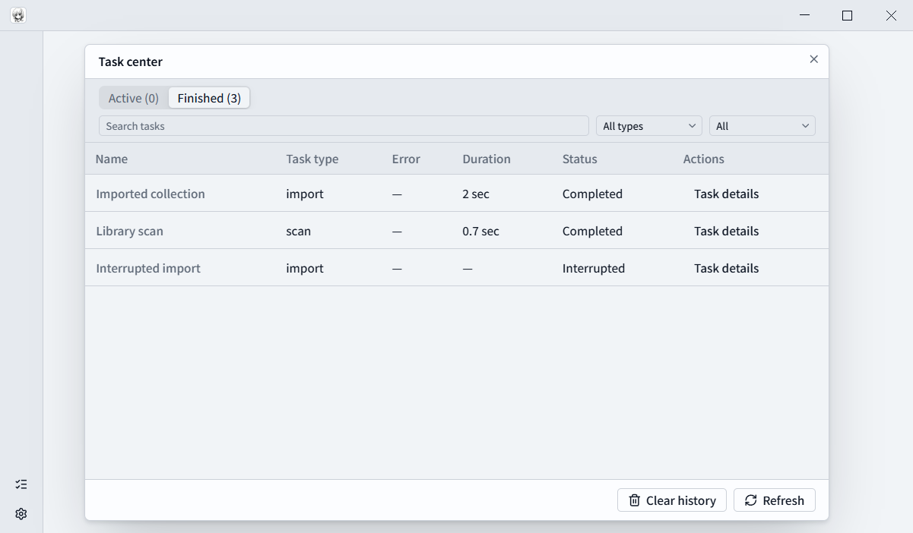 | 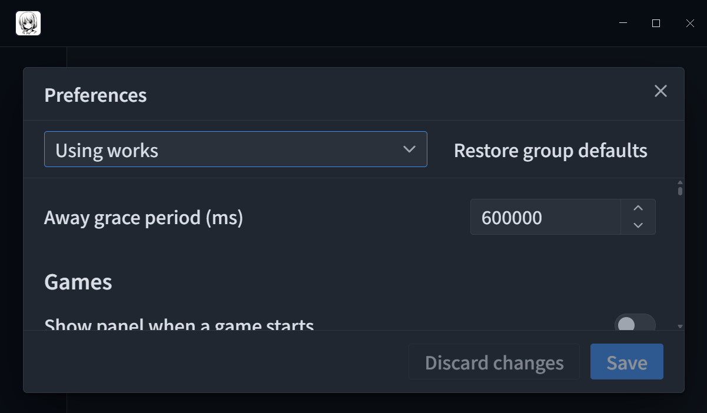 |

在 100% 默认、最小与最大化窗口中，标题栏下沿分别有 1751/1751、1201/1201 和 2360/2360 个物理像素等于分隔线色。最小窗口的 75% 亮色与 200% 暗色分别得到 1201/1201，暗色按透明边线与背景合成后的 `#222830` 测量。在打开任务历史及偏好时，最大化按钮仍返回 Windows 原生命中 `HTMAXBUTTON`（9）。Windows 11 悬停贴靠与其余目标待对应宿主复验。

本机桌面完整验证通过。原生运行 23 项、源码会话 5 项、实际窗口 10 项、性能 2 项通过，制品用例从收据核对并实际启停验证用归档。buildId 为 `9ec6a3d4-99d1-4e33-b27c-f1880b07116c`，ZIP 的 SHA-256 为 `9f61d709b15b867be9fc3577db39994b6e97b38c9b38a1709ca306cc721a1d35`。同一构建在热系统磁盘缓存下启动 20 个全新进程，中位数 615.8 ms，P95 为 679.1 ms。完整存储负载期间 190 次窗口请求的 P95 为 7.39 ms。

<a id="titlebar-scale"></a>

### 标题栏尺寸与启动复验

2026-11-19 在 Windows 10 x64、Electron 45.3.2、系统显示缩放 125% 下验证有限构建 `1cb3b7b7-3146-46e4-bbfe-01177213a522`。使用隔离资料启动，主题基础字号为 14px 和 0.2px 的两个样本都在 100% 缩放下达到窗口就绪，标题栏高 32 DIP，最大化按钮均返回 `HTMAXBUTTON`。75% 下的 0px 和 0.5px 样本均为 24 DIP，200% 下的 1200px 样本为 63 DIP。

在运行中的偏好里将界面缩放从 100% 保存为 120%，覆盖区域和工作区分界同步到 38 DIP。上述样本的工作区起点均与原生覆盖区域下缘重合，进程正常退出。[标题栏尺寸规则](../../../design/ui/components.md#titlebar)

<a id="management-ui"></a>

## 管理界面与公共控件复验

Windows 10 22H2 x64、Electron 45.3.2，系统显示比例 125%。在独立资料目录中启动正式构建 `dca990c8-4c76-407e-bfc4-c2773f12b987`，从菜单与固定按钮操作。截图来自实际 Electron 文档的客户端区域。

| 场景 | 实际观察 |
| --- | --- |
| 任务历史 | 26 条记录。100% 下搜索框与两个筛选外高都是 21 CSS px。默认、最小窗口的活动视口分别为 527、358 CSS px。最小窗口在 200% 强制配色下仍为 147 CSS px，表头固定，横滚能到达状态和操作列 |
| 偏好 | 100% 的对话框宽 784 CSS px。恢复缩放字段会消除动作并聚焦原输入。最小窗口在 75% 下宽 588 CSS px，200% 下宽约 900 CSS px。后者的左栏和字段视口均高 284 CSS px，左栏滚动条紧贴分隔线，页签沿用公共底色 |
| 主题 | 亮暗色样与来源可读，复制后选中副本。编辑器保持名称、亮暗选择及预览入口，分节标题使用次要文字色，背景与文字色成对排列 |
| 字体 | 验证用 WOFF2 在导入前和入库后分别渲染真实样张。混入无效文件时错误显示在该文件行，移除后可保存其他文件。最小窗口 200% 下目录和样张上下排列 |
| 强制配色与键盘 | 竖排和媒体页签的选中文字可读。日期选择器的选中格使用系统配对色，实测前景白色、背景 `rgb(55, 0, 110)`。字体选择展开后描边在搜索输入上，Escape 返回触发按钮 |

| 任务历史，最小窗口 100% | 偏好，默认窗口 100% |
| --- | --- |
| 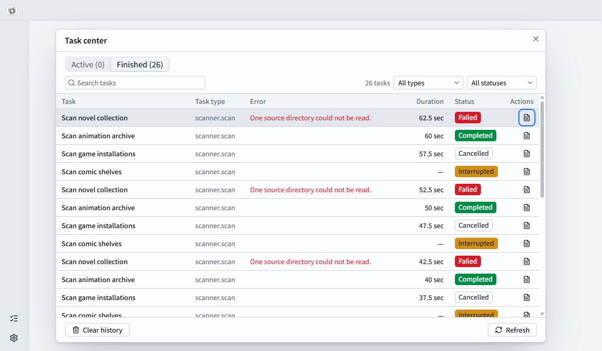 | 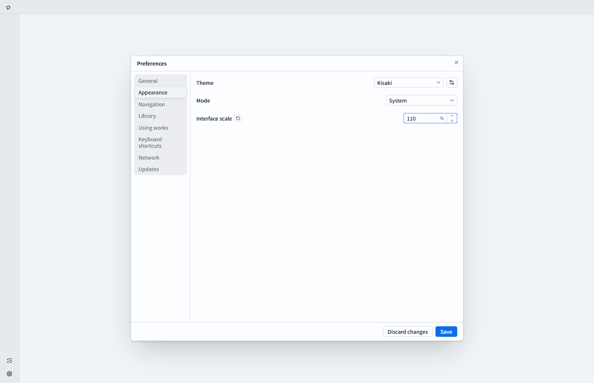 |

主题和字体截图记录当前分栏试排。正式布局待定。

| 主题亮暗检视 | 入库字体实际样张 |
| --- | --- |
| 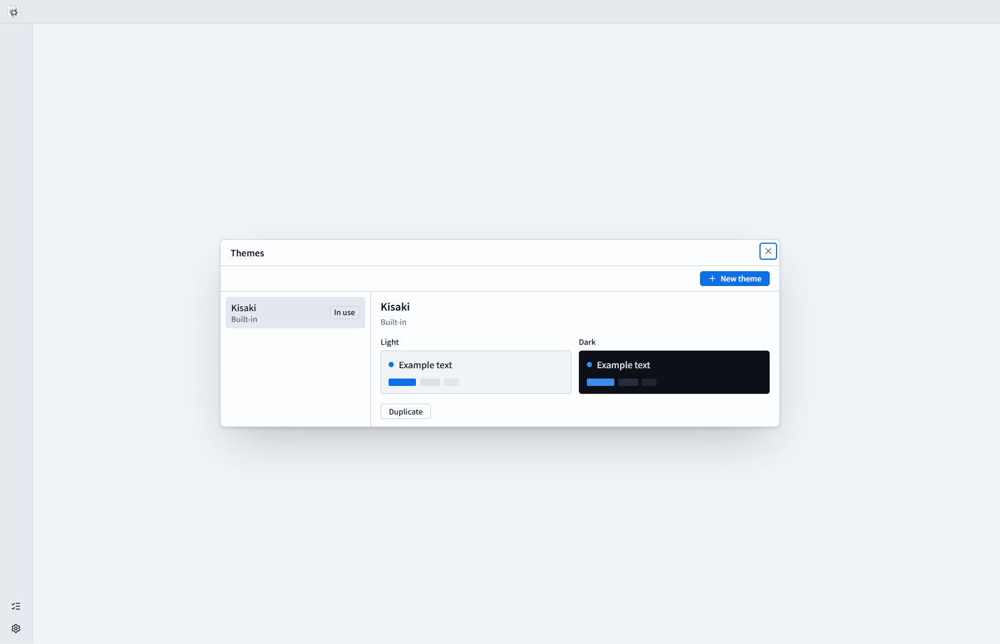 | 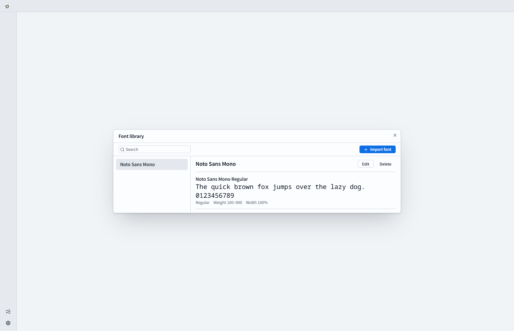 |

[最小窗口 200% 暗色](ui/management-preferences-dark.png) · [强制配色](ui/management-preferences-forced.png) · [主题分节标题](ui/management-theme-sections.png) · [公共包验证](../w05/README.md#management-controls)

Windows x64 的桌面完整验证通过。原生运行 23 项、源码会话 5 项、正式窗口 10 项、性能 2 项及制品 1 项通过。3 项窗口用例需在指定平台或专用账号中运行。同一候选启动 20 个独立进程，热系统磁盘缓存下中位数为 577.7 ms，P95 为 615.0 ms。完整存储负载期间窗口到主进程请求的 P95 为 7.03 ms。验证用 ZIP 已按收据检查并实际启停，buildId 为 `b115a998-4387-474b-adb1-eb705919948d`，SHA-256 为 `7542c3f6e9b2e93962bca361576e4accc143b79698b2fe5c469ee9bca6c471e8`。

<a id="shared-dialogs"></a>

## 统一 Dialog 与旧版实机对照

Windows 10 x64，系统显示比例 125%，两版根字号均为 14 CSS px。旧版从 `e311fe7c` 的正常 `pnpm dev` 启动，读取现有开发资料。新版使用独立资料，放入任务样本，通过实际窗口导入 Noto Sans Mono 并复制内置主题。

| 场景 | 旧版实机 | 本次调整 |
| --- | --- | --- |
| 任务中心 | 范围页签和查询共用一条顶部工具带，维护操作靠右固定在底部。工具带高 67.3 CSS px，页签组高 24.5 CSS px | 顶部与底部使用同一组部件和弱底色。两个高度分别为 67.3 和 24.5 CSS px，查询控件同高 21 CSS px。类型可用于筛选和详情，表格列为任务、错误、耗时、状态与操作。切换范围保留各自查询，详情返回原按钮 |
| 管理条目 | 「管理区块」使用单列、有边框的条目，左侧图标与名称，条目操作和新增分属行尾与底部。实测条目高 57.6 CSS px | 主题、字体和文件列表使用公共 ListItem。主题与字体目录的普通条目均高 57.6 CSS px。预览或编辑时目录继续挂载，复制后定位副本，字体样张关闭后回到原按钮 |
| 偏好 | 「软件设置」按分节排列在一块短正文，修改逐项采用 | 八组采用与任务中心同类的顶部横排页签，正文共用一个滚动区，保存仍提交同一草稿。最小窗口在 200% 下的页签视口为 842 CSS px、完整内容为 1164 CSS px。用 End 能聚焦并看到最后一项 |

| 旧版任务中心 | 新版任务中心 |
| --- | --- |
| 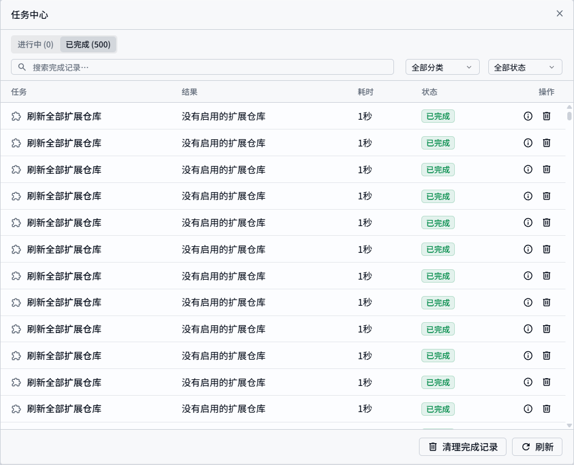 | 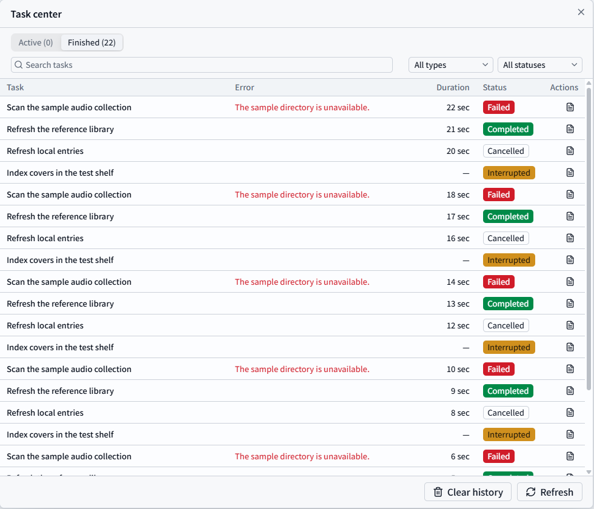 |

[旧版单列管理条目](ui/legacy-catalog-rows.png) · [新版顶部偏好页签](ui/shared-dialog-preferences.png) · [最小窗口 200% 的页签滚动](ui/shared-dialog-preferences-200.png)

在 Windows x64 源码 dev 中轮流选用内置主题及同配置副本。修复前，100% 缩放下的徽标将标题行从 18.375 撑到 19.1 CSS px，说明相对条目移动了约 0.36 CSS px。修复后，在 75%、100% 和 200% 下切换，条目外高、名称及说明相对条目的纵向位置均一致。普通行内排版与居中的 Flex 标题组取得相同结果。[选用主题后的条目](ui/theme-title-stable.png)

Windows x64 的正式窗口用例 10 项通过，3 项需在指定平台或专用账号运行。

<a id="source-dev-styles"></a>

## 源码 dev 样式与任务列表复验

在 Windows x64、系统显示比例 125% 的真实 Electron 源码窗口复现了样式问题。变更前，组件样式先声明 components 层，随后加载的 Tailwind 基础重置覆盖菜单和页签内距以及原生 Dialog 的外距。偏好 Dialog 左边界为 0，菜单与页签的水平内距均为 0。

四个文档改从 HTML 头部链接入口样式。与复现相同的 1402 CSS px 视口下，偏好左右边距分别为 308.8 和 309.2 CSS px。菜单条目内距为 1.75 × 7 CSS px，页签恢复 8.75 CSS px 水平内距。用仓库固定的 Node 26.13.1 启动 dev，实际编辑事件前后，入口样式请求均返回 200，工具类与主题变量均存在。系统原有 Node 24.11.1 下的 Tailwind 热更新出现 CommonJS 缓存错误。

已结束任务只显示任务、耗时、状态和操作。人工样本的失败原因从详情读取。在默认亮、暗主题上对实际状态标签的颜色取样，四种样本状态的最低文字对比度分别为 4.53 与 5.41。

| 源码 dev 偏好 | 源码 dev 任务中心 |
| --- | --- |
| 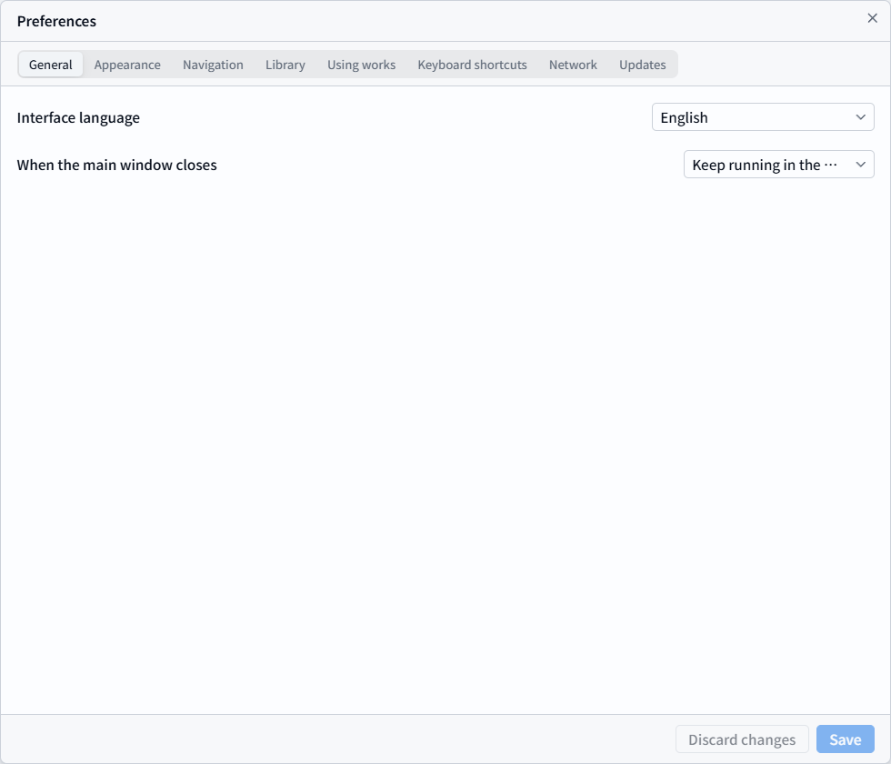 | 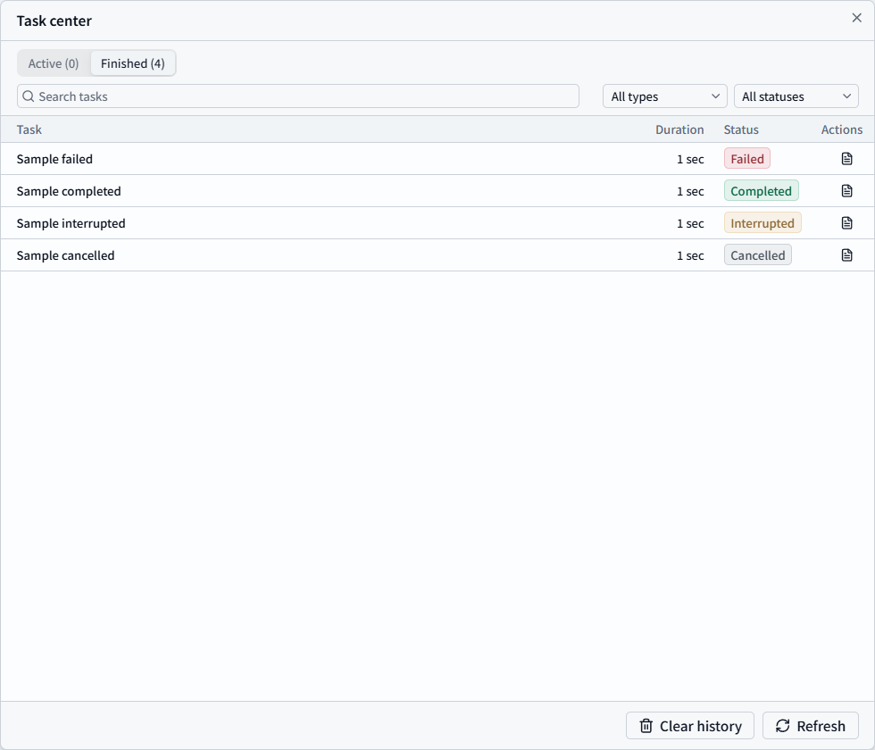 |

固定 Node 下整仓检查通过，开发会话 5 项和 Windows x64 正式窗口 10 项通过。开发会话验证包含真实 Electron 源码文档的弹窗几何，以及隔离工程中 Tailwind 的热更新。

<a id="ui-refinement"></a>

## 侧栏、任务与偏好细节复验

在 Windows x64 的源码 Electron 窗口对照旧版。默认根字号为 14px 时，两版侧栏的动作热区均为 35 × 35 CSS px，图标均为 17.5 CSS px。设置菜单与按钮底边对齐并向右展开。任务工具带使用标准档。滚动 240 CSS px 后，表头位置固定，底线仍绘制为一个实际像素。单条删除用原生确认框，取消回到发起动作，确认刷新总数并移除记录。

简体中文覆盖英语基准的 449 条消息，并通过 ICU 参数校验。新的开发资料在首屏使用简体中文。常规页两个选择框均宽 194.4 CSS px。快捷键用实窗核对录入、Escape 取消、清除后的焦点和字段恢复。作品使用在同一个视口分节。在 960 CSS px 的验证视口下切到英语，将界面调到 200%，垂直滚轮使溢出的顶部页签横向滚动到末端。

| 实窗画面 | 内容 |
| --- | --- |
| [侧栏动作](ui/refinement-sidebar.png) | 按钮热区和悬停底色 |
| [滚动后的任务表格](ui/refinement-task-table.png) · [任务详情](ui/refinement-task-details.png) · [删除确认](ui/refinement-alert-dialog.png) | 标准档工具带、固定表头、结果分节和确认动作 |
| [快捷键](ui/refinement-shortcuts.png) · [系统集成](ui/refinement-system-integration.png) · [横向页签](ui/refinement-tabs-overflow.png) | 公共录制控件、系统服务与数据位置、200% 界面下的滚动 |

<a id="handoff"></a>

## 源码交付与逐项复核

在 Windows x64 实际 dev 的日志中，公共包重建时 Tailwind 读取 `desktop-ui/dist/styles.css` 返回 ENOENT。此时浏览器仍能解析文档结构和品牌图片，窗口的布局工具类随 CSS 一起丢失。两个同时运行的 dev 也曾冲突于 Vite 优化缓存的重命名。

开发模式从公共包的源码 CSS exports 解析样式，依赖优化缓存在各自源码会话目录。隔离测试移去两个公用包的制品 CSS，再修改源码并观察浏览器热更新和重载。相同源码启动实际 Electron 窗口，在真实公共 UI 重建期间对四类文档的 CSS 入口连续采样，每个入口均返回 200。实窗的品牌图标、侧栏、按钮与图标分别维持 17.5、45.5、35 和 17.5 CSS px 的宽度。[重建后实窗](ui/handoff-shell.png)

| 原序号 | 复核结果 |
| --- | --- |
| 1 | 旧、新侧栏动作均采用 2.5rem 方形热区和 1.25rem 图标。 |
| 2 | 「保存」为次要按钮，「保存并选用」为主按钮。 |
| 3 | 确认框有独立标题、正文和底部动作，初始焦点落在取消。[实窗确认框](ui/handoff-alert.png) |
| 4 | 任务表头在视口滚动后保持原位并绘制底线。 |
| 5 | 下拉框焦点使用内描圆角，无叠加轮廓。 |
| 6 | 已结束任务采用四列结构，标题占余宽，耗时、状态与操作保留固定空间。 |
| 7 | 结果容纳状态、实际数值与输出，信息用两列排列。失败原因在结果区。 |
| 8 · 系统集成 | 系统服务与数据位置采用普通字段，说明和操作就近展示。 |
| 8 · 空状态 | 页面顺序用居中的公共 EmptyState 表达暂无可用页面。 |
| 9 | 作品使用将共用、游戏、动画、漫画和轻小说放在同一层。阅读设置通过具名字段组直接呈现。提交无效字段时聚焦该字段。[作品使用](ui/handoff-works.png) · [阅读选项](ui/handoff-works-reading.png) |
| 10 | 「恢复默认值」使用控件左侧小号描边按钮，操作后聚焦原控件。 |
| 11 | 公共 ShortcutInput 表达各套组合键并支持录制、取消和清除。 |
| 12 | 应用代理的中间态和失败可见，稳定时界面只呈现设置。 |
| 13 | 关闭主窗口提供「最小化到托盘」和「退出应用」。 |
| 14 | 常规的两个选择控件取同一字段栏宽。 |
| 15 | 字体目录浏览时直接展示条目与管理动作。 |
| 16 | 横排页签在单行内滚动。960 CSS px、200% 界面下，纵向滚轮可横移溢出的页签。 |
| 17 | 任务行使用默认主题下 12.25 CSS px 正常字号，已结束记录支持确认后单条删除。 |
| 18 | 设置菜单提供偏好、主题、字体库、系统集成和关于。 |
| 19 | 设置菜单从按钮右侧展开，底边对齐。 |
| 20 | 关于显示项目、环境和复制操作，当前版移除致谢。 |
| 21 | 任务类型通过可读标签参与筛选，固定分类可本地化。 |
| 22 | 任务中心顶部沿用紧凑工具带，页签采用旧版尺度，只显示状态名。 |
| 23 | 表单与筛选由公共 UI 的标准档和紧凑档度量，侧栏使用应用导航的尺寸。 |
| 24 | 临时简体中文覆盖当前消息目录，新的源码资料默认采用，可在偏好切换英文。 |

主题和字体目录均消费公共 List。页面顺序在侧栏与偏好共用 ReorderableList，分别采纳到正式顺序和草稿。独立来源优先级试件覆盖了菜单移动、跨过隐藏槽位的组选拖拽、Alt+方向键、失败后顺序及焦点保持。用例验证实际浏览器交互，并通过独立制品工程检验包的公开入口。

<a id="visual-recheck"></a>

## 旧版实窗对照与首帧

两版实窗采用 14 CSS px 根字号。任务页签组实高 24.5 CSS px，文字 10.5 CSS px。结果卡的数值与输出分层，信息网格的两列在当前样本中均宽 363.2 CSS px。新版展示现行模型中实际保留的数据。

| 旧版 | 当前 |
| --- | --- |
| [任务详情](ui/legacy-task-detail.png) | [任务详情](ui/corrected-task-detail.png) |
| [普通设置](ui/legacy-settings.png) | [系统集成字段](ui/corrected-system-fields.png) · [作品使用](ui/handoff-works.png) |

旧设置的标题与正文相隔 7 CSS px，节之间相隔 17.5 CSS px，正文底部内距 14 CSS px。新作品使用的分节沿用这些尺寸。窄至 960 CSS px、界面放大至 200% 时，在实窗点击快捷键右侧开关，并核对恢复按钮位于控件左边。[放大后的快捷键](ui/corrected-shortcut-narrow.png)

悬停侧栏任务按钮时，提示与按钮垂直中心相差 0.125 CSS px。行内动作提示采用单一短动词。主题编辑器使用「预览」，页脚从右到左依次为主操作、描边与次要操作。

字体预览逐帧记录到的原高度依次为 87、124、169 CSS px。当前读完文件信息和实际字形后才进入顶层，第一帧、打开期间与退场均为 169 CSS px。退出帧保有真实字样，退场后验证所持字体已释放。[字体预览](ui/corrected-font-preview.png)

### 焦点、选择与操作顺序

Windows 125% 的真实开发窗口中，字段焦点边框为 1 物理像素，按钮显示贴边的 1 物理像素焦点环。打开字体 Combobox 后验证触发器保有焦点，方向键可移动高亮，Tab 进入搜索，Escape 返回触发器。候选行的尺寸更新在观察器交付之后处理，重复核对开场时的控制台和字段操作。

主题编辑器由右到左显示「保存并选用」「取消」「保存」。放弃主题草稿后可立即关闭外层目录。任务筛选与详情均显示相同的本地化名称，验证英文「Directory scan」和简体中文「刷新资料库」。

<a id="media-and-shortcuts"></a>

### 媒介选择、退出确认与快捷键

这里记录页内媒介选择与即时录入版本的实测。现行界面见[作品子表单与快捷键录入](#work-usage-and-shortcut-popovers)。

在 Windows x64 的简体中文源码 dev 和正式构建中使用独立的新资料复验。源码 dev 的系统显示缩放为 125%，应用缩放为 100%，根字号为 14 CSS px。旧版任务中心标题带的布局高度是 39.3 CSS px，新版偏好标题带是 40.2 CSS px，双方上下内距都是 10.5 CSS px。[作品使用实窗](ui/media-preferences.png)

- 作品使用页面显示共用计时和选中的媒介设置。漫画写入空字号后切到轻小说，轻小说保留默认字号。提交会切回漫画并聚焦错误字段，输入仍在同一草稿中。
- 主题编辑页脚从左到右为「取消」「保存」「保存并选用」，采用幽灵、描边和主按钮。退出草稿的确认依次为「放弃更改」「继续编辑」「保存」，实窗验证保存初始焦点、Enter 成功保存后退出、Escape 返回草稿。[退出确认实窗](ui/unsaved-confirm-save.png)
- 清空「打开偏好设置」的绑定并保存后，重开仍显示未绑定，相同组合不再触发。恢复默认并保存后，可再次用原组合打开偏好。录制图标使用公共的 100ms 悬停颜色过渡，减少动效时为 0ms。在 960 CSS px 的视口和 200% 的应用缩放下，清除按钮完整可见并可操作。
- Windows x64 实窗录入 `Ctrl+Shift+1` 和 `Ctrl+Shift+K`，键帽与实际数字、字母一致。再次录入默认搜索组合只保留原绑定。为「下一页」添加两个组合后，单独移除 PageDown，保存并重开仍有 Space 和两个新增组合。清空后焦点回到录入按钮，恢复默认重新得到 PageDown 与 Space。[逐条移除](ui/shortcut-field.png)
- 在简体中文源码 dev 将缩放草稿改为 105%，数值框的右缘保持原位。以 14 CSS px 根字号测量，缩放框、主题模式、敏感内容开关和快捷键框的左缘与恢复按钮右缘均相隔 7 CSS px。恢复缩放后原生输入框获得焦点。[缩放字段](ui/reset-scale.png)
- 用扫描目录、扫描资料库、刷新资料库和未知类型验证四种任务行图标。列表和详情共用类型图标，筛选和详情共用类型译名。

<a id="work-usage-and-shortcut-popovers"></a>

### 作品子表单与快捷键录入

2026-11-18 在 Windows 10 x64、Electron 45.3.2、系统显示缩放 125% 的隔离资料上复验。简体中文源码窗口采用默认主题和 100% 应用缩放。漫画子表单的分节标题为 10.5 CSS px、500 字重，使用当前主题的次要文字色。标题到正文为 7 CSS px，节间距为 17.5 CSS px，与旧设置窗口同档。「暂离宽限」直接呈现，说明距字段标题 1.75 CSS px，距后面的作品入口 17.5 CSS px。

- 逐一从作品使用打开游戏、动画、漫画和小说，核对各自的标题、字段、独立 Form 与取消后的返回焦点。Windows 正式窗口用例以无效漫画字号核对首错定位，再用保存快捷键确定漫画的修改。小说编辑用 Escape 取消。偏好保存和重开后，漫画为 28 px，小说保留 20 px。
- 在「下一页」原有两组快捷键上加入五组，字段高度保持 24.5 CSS px。滚轮到达末项时可操作最后一组标签。浮层内录入数字组合、重置和外点关闭后，已绑定标签保持原值。正式窗口用例还核对按住修饰键时的预览与确认状态、重复绑定、逐条移除、保存空列表和恢复默认。窄窗口的快捷键路径采用 960 × 640 CSS px 和 200% 应用缩放。
- Windows x64 正式窗口 11 项通过，3 项按宿主或隔离账号条件跳过。当前修订的其他宿主结果按各自环境取得。

| 作品使用 | 漫画子表单 | 快捷键浮层 |
| --- | --- | --- |
| 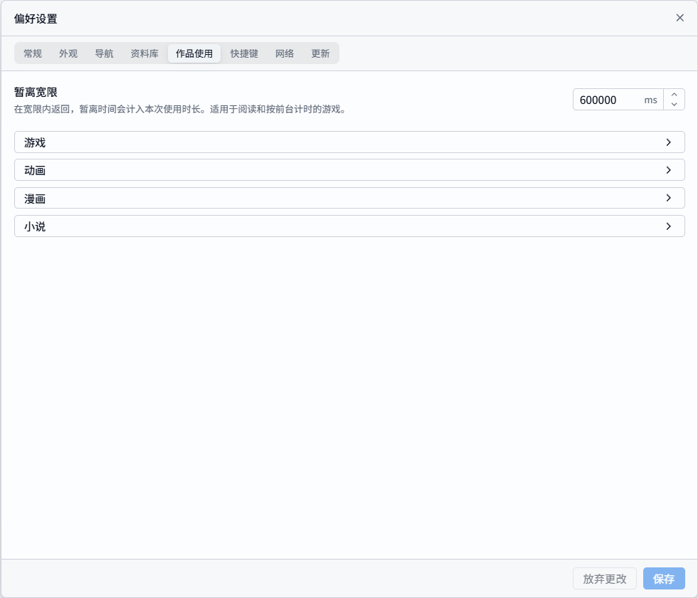 | 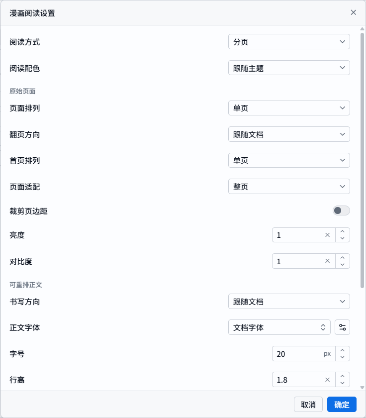 | 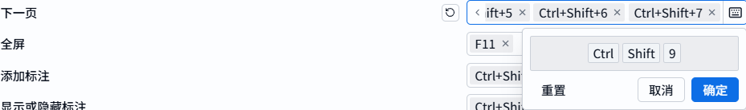 |

<a id="field-presentation-and-proxy"></a>

### 字段标题旁的操作、代理凭据与主题对照

2026-11-18 使用 Windows x64 正式窗口和隔离资料复验。恢复动作与字段标题同组，标题右缘与动作相隔 5.25 CSS px。用合成凭据验证直接保存、读取时保持输入为空、修改绕过规则后保留原 revision、放弃本次输入、更新产生新 revision，以及清空和标题旁的移除动作均可删除凭据。

主题编辑器在 1402 CSS px 的默认比例窗口中将背景和前景排在同一行。缩至 820 CSS px、应用比例为 200% 时，两个字段纵向并按同一左缘排列。亮暗色样可以并排读，任务详情保留结果与执行信息各自的栅格。

代理认证改用独立分组后，实窗中组标题为 10.5 CSS px，距上一组 17.5 CSS px。保存后组名关联已保存状态，移除整组凭据后焦点回到用户名。将 `*.example.test, 192.0.2.10` 保存为绕过规则，Electron 的窗口会话将命中的子域与 IP 解析为 DIRECT，未命中的地址采用所设代理。

在凭据状态旁执行「移除凭据」，实窗验证未保存时保有移除提示，保存后清除整组。填入凭据后切换 SOCKS5，仍可从状态旁清除草稿，焦点回到代理认证组，保存后采用 SOCKS5 路由。

采用单字段入口后，在 Windows 实窗验证「配置…」只打开用户名和密码表单。确定与保存快捷键均回填草稿，取消与 Escape 均放弃本次子编辑。已有凭据的空输入直接确定保留原值。移除动作位于配置旁，恢复默认与普通字段一致。移除和恢复均随偏好保存。切到 SOCKS5 后仍可移除已填入的凭据。作品子表单复用相同外壳，原有保存与回焦用例通过。

同轮偏好实窗用例通过保存、重载、子表单确定与取消、组合键及恢复后的回焦验证实际数据。布局和尺寸使用独立实测。[自动用例保留复核](../README.md#test-retention-review)

<a id="windows-edge"></a>

### Windows 原生窗口边缘

在同一台 Windows 10 19045 主机、两块均为 125% 的屏幕上，以同一个最小窗口分别运行 Electron 41.2.0 和 45.3.2。试件给网页客户区画红线，通过 Win32 与 DWM 同时读取客户区和可见框架，并核对边缘像素。有无窗口控制覆盖的两组结果一致。

| Electron | 可见框架相对客户区的额外像素 |
| --- | --- |
| 41.2.0 | 四边均为 0 |
| 45.3.2 | 左、右、下各 1 物理像素，顶部 0 |

关闭 `thickFrame` 的 45.3.2 对照试件边缘和客户区重合，同时失去标准窗口阴影及动画。结果支持上游无框窗口边缘回归的方向。混合 DPI 的表现依据对应环境另行验证。[Electron #51892](https://github.com/electron/electron/issues/51892) · [缩放变更来源](https://github.com/electron/electron/pull/51503) · [Electron 窗口选项](https://www.electronjs.org/docs/latest/api/structures/base-window-options)

Electron 的 `thickFrame` 同时提供标准边缘缩放。Windows 11 Build 22000 起的 `DWMWA_BORDER_COLOR` 可关闭 DWM 绘制的边框，适合在该宿主独立验证。上游 #51892 仍开放，候选修复需要在混合 DPI 环境中核对开窗、跨屏、最大化和还原，并复验拖边缩放与系统贴靠。[Electron #51892](https://github.com/electron/electron/issues/51892) · [Microsoft DWM 窗口属性](https://learn.microsoft.com/en-us/windows/win32/api/dwmapi/ne-dwmapi-dwmwindowattribute)

<a id="menu-and-integration"></a>

### 应用菜单与系统集成

在 Windows x64 的简体中文源码 dev 检查主题模式子菜单、敏感内容复选项、系统集成平铺字段、「关于 Kisaki」的正文间距及退出确认。作品使用的媒介名使用「小说」。[应用菜单](ui/menu-quick-settings.png) · [系统集成](ui/system-integration-flat.png) · [关于 Kisaki](ui/about-plain.png) · [退出确认](ui/draft-close-actions.png)

Windows 正式窗口用例以键盘打开主菜单与主题模式子菜单，验证深色实际生效与焦点返回。切换敏感内容后，重载窗口并在偏好的外观和资料库页读取同一保存状态。退出确认核对幽灵「放弃更改」、描边「继续编辑」和默认聚焦的主操作「保存」。

正常开发资料只显示适用的启动、链接和目录字段。在独立 Windows 进程中注入受阻的登录项和其他协议默认处理程序，确认两项分别打开启动项与默认应用设置的指定地址。再注入系统已允许的状态，返回窗口时启动项设置入口收起。此复验拦截系统跳转与登记状态，实际 OS 登记交由对应平台的隔离账号用例。

<a id="single-control-scale"></a>

### 任务查询控件与页签字号

在 Windows x64 正式构建的独立资料中核对亮暗模式。应用缩放 100% 时，任务查询的三个控件均高 21 CSS px，文字为 10.5 CSS px。工具带总高 67.3 CSS px，页签组高 24.5 CSS px。筛选列表的选项正文高 24.5 CSS px、字号 12.25 CSS px；普通偏好选择框也高 24.5 CSS px。简体中文源码 dev 实窗中，放大镜、清除图标和两个筛选箭头均为 12.25 CSS px。 [任务工具带](ui/task-query-controls.png)

应用缩放 75% 时查询控件高 15.75 CSS px。在 960 CSS px 视口放大到 200% 后，查询控件高 42 CSS px，工具带高 133.8 CSS px。三个控件都在工具带内，展开状态筛选后可以按 Escape 返回，清除搜索后焦点回到输入框。正式窗口用例同时检查页签、查询文字和放大镜的实际尺寸。 [公共控件尺度](../../../design/ui/package.md#styles)
